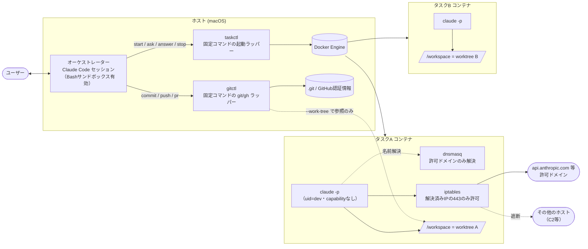

# ADR-035: 並行タスクのオーケストレーター / サブエージェント協調方式

- ステータス: 承認済

## コンテキスト

複数のAIコーディングタスクを並行して進めたい。現状は、タスクごとにClaude Codeのセッションを立て、ユーザーがそれぞれを個別に監視しており、運用負荷が高い。

目指す運用は次のとおり。

- ユーザーが会話するのは「オーケストレーター」セッション1つだけ
- オーケストレーターがタスクごとにサブエージェントを起動し、指示・結果の受け取りを行う
- サブエージェントは判断に迷ったら作業を止め、オーケストレーター経由でユーザーに質問し、回答を受け取って作業を再開する

あわせて、次の安全要件を満たす必要がある。

- サブエージェントがプロンプトインジェクション等で乗っ取られても、ホストOS・ホスト上の認証情報（`~/.ssh`、`~/.claude` 等）・他タスクの作業ディレクトリに影響を及ぼせない
- サブエージェントは許可した宛先以外（C2サーバー等）と通信できない
- ホスト側のClaude（オーケストレーター）にDocker socketを直接操作させない（任意のホストパスをマウントしたコンテナを起動でき、実質ホストのroot相当になるため）

本ADRでは、サブエージェントの実行環境・隔離方式・通信制限・オーケストレーターとの連携方式・git/GitHub操作の分担を決める。方式の妥当性は、本ADRの作成時に実環境で検証した（「検証結果」の節）。

## スコープ外

- コンテナ定義・起動ラッパー・ファイアウォール設定の具体的な実装（本ADRの決定と検証結果に従って実装する）
- 許可ドメイン一覧の最終確定（本ADRでは必要最小限の例を示す）
- 運用手順書（起動・監視・終了の手順）
- サブエージェントの役割定義（pdm/designer/implementer 等）。`.claude/agents/` の既存定義で扱う

## 決定

### 全体構成

### 1. サブエージェントはタスクごとのコンテナ内で別プロセスの `claude` として動かす

- タスクごとにworktreeを1つ作り、そのworktreeだけを `/workspace` としてマウントした常駐コンテナを起動する
- サブエージェントは、コンテナ内で `claude -p` として実行する。オーケストレーターと同じプロセス内で動く `Agent` ツールのサブエージェントは使わない
- コンテナは `--cap-drop ALL` と `--security-opt no-new-privileges` で起動し、ファイアウォール設定に必要な capability だけを `--cap-add` で戻す

  | capability | 用途 |
  |---|---|
  | `NET_ADMIN`・`NET_RAW` | iptables / ipset の設定、dnsmasq による ipset への登録 |
  | `NET_BIND_SERVICE` | dnsmasq の53番ポートへの bind |
  | `SETUID`・`SETGID` | dnsmasq の専用ユーザーへの降格、`setpriv` による `dev` への切り替え |
  | `SETPCAP` | `setpriv` による bounding set の破棄 |

- エントリポイントは root でファイアウォールを設定し、**設定に1つでも失敗したらコンテナを終了する**（`claude` を実行しない）。通信制限なしでサブエージェントが動く状態を作らないため
- `claude` は `setpriv --reuid=dev --regid=dev --init-groups --inh-caps=-all --bounding-set=-all` で一般ユーザー（`dev`）に切り替え、上記の capability をすべて落として実行する
- Docker socket・ホストのホームディレクトリ・`.git` 本体は、コンテナにマウントしない

### 2. コンテナの通信は「許可ドメインの443番のみ」に制限する

- コンテナ内で dnsmasq を動かし、許可ドメインの問い合わせだけを上流DNSへ転送する。それ以外は `REFUSED` を返す
- dnsmasq が解決したIPを、その場で ipset に登録する。iptables は「ipsetに載ったIPへの443番」だけを許可し、それ以外の外向き通信はすべて拒否する
- 上流DNSへ問い合わせられるのは、dnsmasq の実行ユーザーだけに限定する（iptables の owner マッチ）。上流がDocker内蔵DNS（`127.0.0.11`）の場合、Dockerはポートを書き換えるDNATで実装しているため、ポート番号ではなく宛先IPで判定する
- ループバック宛ての通信は dnsmasq（`127.0.0.1`）宛てだけを許可する。ユーザー定義ネットワークでは `127.0.0.11` が任意ドメインを解決できるため、ループバックを全許可するとDNS制限を迂回されるため
- 許可ドメインは、タスクの種類に応じて最小限にする（例: Claude実行のみなら `api.anthropic.com`、依存取得が必要なら `registry.npmjs.org`・`proxy.golang.org` 等を追加）

### 3. オーケストレーターとの連携は `claude -p` の JSON 出力と `--resume` で行う

1. オーケストレーターは `taskctl ask <task> <prompt>` でタスクを依頼する。taskctl はコンテナ内で `claude -p --output-format json` を実行し、`session_id` と `result` を返す
2. サブエージェントには、システムプロンプトで次の規約を課す。判断が必要なら作業を止め、最終出力を `QUESTION: <質問>` の1行にする。完了したら `DONE: <やったこと>` の1行にする
3. `QUESTION:` が返ったら、オーケストレーターはタスク名を添えてユーザーに提示する
4. ユーザーの回答は `taskctl answer <task> <回答>` で渡す。taskctl は保存しておいた `session_id` で `claude -p --resume <session_id>` を実行し、サブエージェントは文脈を保ったまま作業を再開する
5. タスクは taskctl がタスク名と `session_id` の対応で管理する。複数タスクが同時に質問しても、回答は対応するタスクにだけ届く

サブエージェントの権限モードは `--permission-mode acceptEdits` とする。本プロジェクトの設定では `--dangerously-skip-permissions` が無効化されているため（`permissions.disableBypassPermissionsMode`）。

### 4. ホスト側の操作は固定コマンドのラッパー経由に限定する

オーケストレーター（ホスト側のClaude）には `docker`・`git`・`gh` を直接実行させない。代わりに、決まった操作だけを受け付けるラッパーを用意し、オーケストレーターにはそのラッパーの実行だけを許可する。

- **taskctl**（コンテナ操作）: `start` / `ask` / `answer` / `status` / `stop` のみ。コンテナの起動オプション（マウント・capability・ネットワーク）はラッパー内に固定し、引数から変更できないようにする
- **gitctl**（git/GitHub操作）: 「指定タスクのworktreeをコミット」「push」「PR作成」のみ

git/gh をラッパーにする理由は2つある。

- **gitの設定・フック経由でのコード実行を防ぐため**: worktree内のファイルはコンテナから書き換えられる。素朴に `git -C <worktree>` を実行すると、worktree内を指すフック（`core.hooksPath` が `.githooks` のような相対パスの場合）や、書き換えられた `.git` ポインタが指す偽の設定（`core.fsmonitor` 等）を、ホスト上で実行してしまう。フックの置き場所は環境ごとの設定で変わりうるため、設定値に頼らず常に無効化する。gitctl は常に `--git-dir=<本物のgitdir> --work-tree=<worktree> -c core.hooksPath=/dev/null -c core.fsmonitor=false` で実行し、worktree側の設定を一切信用しない。lint等のフック相当の処理はコンテナ内で実行する
- **git/gh には任意コマンド実行の抜け道があるため**: `-c alias.x='!sh ...'`、`-c core.pager=...`、`git config` 等。オーケストレーターはサブエージェントの出力（信頼できない入力）を読むため、プロンプトインジェクションで抜け道を使わされうる。許可ルールでgitのサブコマンドを絞るだけでは不十分

GitHubの認証情報はホストにだけ置き、コンテナには渡さない。

worktreeはホスト上のディレクトリで、コンテナが書いた内容を後からホスト側のツールが読む。そのため、gitctl と運用で次の対策をとる。

- **`.git` ポインタの検査**: gitctl は実行のたびに、worktree直下の `.git` が本物のgitdirを指しているかを検査し、改ざんされていればそのタスクの操作を拒否する
- **危険パスの変更はユーザー承認を必須にする**: ホストやCIで実行されうるファイルへの変更を検出したら、ユーザーが明示的に承認するまでコミット・pushしない。対象は `.claude/`・`.agents/`・`.githooks/`・`lefthook.yml`・`.github/`・`.devcontainer/`・`mise.toml`・`Makefile`・`package.json` の scripts 等。承認時は差分をユーザーに提示する
- **タスク用worktreeをホストのツールで開かない**: シェルのプロンプトやIDEがworktreeで `git status` 等を実行すると、改ざんされた `.git` ポインタを辿ってホスト上でコードが実行される（「検証結果」で確認済み）。タスク用worktreeは専用ディレクトリに置き、ホストのシェル・IDEでは開かない。内容の確認は gitctl が出力する差分で行う

### 5. オーケストレーターはホスト上で動かす

オーケストレーターをdevcontainer内で動かす構成は採らない。オーケストレーターがコンテナを起動するにはDocker socketが必要になり、コンテナ内に置いても隔離にならないため。ホスト上のオーケストレーターは、既存のBashサンドボックス設定と、taskctl/gitctl 以外を許可しない権限設定で制限する。

## 検討した選択肢

### 選択肢1: タスクごとのコンテナ内で `claude -p` を動かし、固定コマンドのラッパーで操作する（採用）

#### 概要

「決定」の節のとおり。

#### メリット

- ファイル・プロセス・ネットワークのすべてを、タスク単位でコンテナの境界により隔離できる（検証済み）
- ホスト側のClaudeがDocker socket・git・ghを直接扱わない
- 質問・回答の往復は Claude Code の標準機能（`-p`・`--output-format json`・`--resume`）で実現でき、独自の通信プロトコルが要らない

#### デメリット

- taskctl / gitctl の実装と保守が必要
- サブエージェントの途中経過は、`-p` の1回の実行が終わるまで見えない
- コンテナ起動・`claude` 実行のオーバーヘッドがある

### 選択肢2: オーケストレーターと同じプロセス内で `Agent` ツール（`isolation: "worktree"`）を使う

#### 概要

Claude Code の `Agent` ツールで、作業ディレクトリを一時worktreeに分けたサブエージェントを起動する。連携は `SendMessage` 等の標準機能で行う。

#### メリット

- 追加の実装がほぼ不要で、連携も標準機能で完結する

#### デメリット

- 検証の結果、隔離の境界にならなかった。Read/Write ツールはOSサンドボックスを通らないため、worktree外のファイルの読み取り、`~/.claude/` や `.claude/hooks/` への書き込みができた。Bashでも、親セッションの作業ディレクトリへ書き込めた（詳細は「検証結果」）
- `~/.claude/` やフックへの書き込みは、ホスト上でのコード実行につながる

### 選択肢3: オーケストレーターにDocker socketを渡し、コンテナを直接操作させる

#### 概要

オーケストレーターが `docker` コマンドを直接実行してタスク用コンテナを起動・操作する。オーケストレーター自身をdevcontainer内に置き、socketをマウントする構成を含む。

#### メリット

- ラッパーが不要で、柔軟にコンテナを操作できる

#### デメリット

- Docker socket を使えれば、任意のホストパスをマウントしたコンテナを起動できる。Docker Desktop for Mac は既定で `/Users` を共有しているため、`~/.ssh` を含むホームディレクトリ全体に到達できる
- オーケストレーターはサブエージェントの出力を読むため、プロンプトインジェクションでsocketを悪用されうる

### 選択肢4: 1つのコンテナに全タスクを同居させる

#### 概要

オーケストレーターとサブエージェント（`Agent` ツール）を、まとめて1つのdevcontainer内で動かす。

#### メリット

- ホストからは隔離でき、標準の `Agent` / `SendMessage` もそのまま使える

#### デメリット

- タスク同士が隔離されない（選択肢2の穴がコンテナ内でそのまま残る）
- 許可する通信先が全タスク共通になる
- GitHubの認証情報をコンテナ内に置く必要がある

### 選択肢5: git/gh をコンテナ内で実行する（`.git` もマウントする）

#### 概要

worktreeに加えて `.git` 本体をマウントし、コンテナ内でコミット・pushまで行う。

#### メリット

- ラッパーが不要

#### デメリット

- `.git/hooks`・`.git/config` をコンテナから書き換えられ、ホストでgitを実行した際にコードが実行される
- GitHubの認証情報をコンテナに渡す必要がある

### 選択肢6: IPアドレスの許可リストのみで通信を制限する（DNS制限なし）

#### 概要

起動時に許可ドメインのIPを解決してipsetに登録し、それ以外を遮断する。DNSは上流へ自由に問い合わせられる。

#### メリット

- 構成が単純

#### デメリット

- 任意ドメインの名前解決ができるため、DNS問い合わせに情報を乗せて外部へ送れる（検証で確認）
- CDN側でIPが変わると、許可ドメインにも接続できなくなる

## 決定理由

- 安全要件（ホスト・認証情報・他タスクからの隔離、許可外通信の遮断、ホスト側ClaudeにDocker socketを触らせない）を、検証で満たせることを確認できたのは選択肢1だけである
- 選択肢2は導入コストが最小だが、検証でworktree外への読み書きが確認され、隔離の境界にならない
- 選択肢3・5は、ホスト上でのコード実行やホスト全体へのアクセスにつながる
- 選択肢4はホストからは隔離できるが、タスク間の隔離とタスクごとの通信制限ができない
- 選択肢6は、DNS経由で外部に情報を送る経路が残る
- 選択肢1の質問・回答の往復は Claude Code 標準の `-p` と `--resume` で実現でき、並行時の取り違えがないことも検証できたため、ラッパーの実装コストは許容できる

## 検証結果

本ADRの作成時（2026-11-08、macOS + Docker Desktop、Claude Code 2.1.285）に、以下を実環境で検証した。読み取りテストには本物の認証情報ではなく、検証用のダミーファイル（カナリア）を使った。

### 選択肢2（`Agent` + `isolation: "worktree"`）の隔離

| 操作 | Read/Write ツール | Bash |
|---|---|---|
| worktree外のカナリアを読む | 読めた | 読めた |
| worktree外に書き込む | 書けた | サンドボックスが拒否 |
| `~/.claude/` に書き込む | 書けた | サンドボックスが拒否 |
| 自worktreeの `.claude/hooks/` に書き込む | 書けた | サンドボックスが拒否 |
| 親セッションのworktreeを読む | 読めた | 読めた |
| 親セッションのworktreeに書き込む | worktree隔離ガードが拒否 | 書けた |

### 選択肢1のコンテナ隔離

worktreeだけをマウントし、`--cap-drop ALL`・`no-new-privileges`・一般ユーザーで起動したコンテナから確認した（この確認ではファイアウォールを設定していないため、capability は追加していない）。

| 操作 | 結果 |
|---|---|
| ホストのカナリア・`/Users`・`~/.claude`・`~/.ssh` | 存在しない |
| 他のworktree | 存在しない |
| Docker socket | 存在しない |
| マウントしたworktreeへの書き込み | 書けた（ホスト側に反映） |
| `/etc` への書き込み | 拒否 |
| root への昇格（sudo / su） | できない |
| worktree内でのgit操作 | `.git` がホストのパスを指すため動かない |

### 選択肢1の通信制限

| 操作 | ファイアウォールなし | IP許可リストのみ | IP許可リスト + dnsmasq |
|---|---|---|---|
| `example.com` へHTTPS | 200（通る） | 遮断 | 名前解決できず失敗 |
| IP直指定（`1.1.1.1`）へHTTPS | — | 遮断 | 遮断 |
| `host.docker.internal` | 名前解決でき、到達可能 | 遮断 | — |
| 許可ドメインの443以外のポート | — | 遮断 | — |
| 許可ドメイン（Anthropic API・npm・Go proxy・GitHub）へHTTPS | — | 通る | 通る |
| 許可外ドメインの名前解決 | — | できる | `REFUSED` |
| 外部DNS（`8.8.8.8`・上流リゾルバ）へ直接問い合わせ | — | — | 遮断 |
| 一般ユーザーから iptables 消去・dnsmasq 停止・`resolv.conf` 書き換え | — | iptables 消去は拒否 | すべて拒否 |
| Docker内蔵DNS（`127.0.0.11`）へ直接問い合わせ（デフォルトブリッジ / ユーザー定義ネットワーク） | — | — | どちらも遮断（ループバックを `127.0.0.1` 宛てのみに制限） |
| `NET_ADMIN` を与えずに起動 | — | — | ipset の作成に失敗し、コンテナは exit=1 で終了 |

### ホスト側gitの実行方法

worktree内に悪意あるフック（`.githooks/pre-commit`）と偽の `.git` ポインタ（`core.fsmonitor` を設定した偽gitdirを指す）を仕込み、ホスト側でgitを実行した。

| 実行方法 | 結果 |
|---|---|
| `git -C <worktree> status`（偽ポインタ） | fsmonitor がホスト上で実行された |
| `git -C <worktree> commit`（フック設置） | pre-commit がホスト上で実行された |
| `git --git-dir=<本物> --work-tree=<worktree> -c core.hooksPath=/dev/null -c core.fsmonitor=false` | どちらも実行されず、コミットは成功 |

### 質問・回答の往復

通信先を `api.anthropic.com` のみに制限したコンテナ2つで、`claude -p` を並行実行した。

| 確認項目 | 結果 |
|---|---|
| 判断が必要な点で `QUESTION:` を返して止まる | 両タスクとも止まった |
| `--resume <session_id>` で回答を渡すと再開する | 同じ `session_id` で再開し、`DONE:` を返した |
| 並行時に回答を取り違えない | 各worktreeにそれぞれの回答の文言が書き込まれた |
| `claude` 実行中も許可外ホストへ出られない | 名前解決できず失敗 |
| 認証トークンが常駐プロセスに残らない | `docker exec` で渡した実行時のみ存在 |

## 結果

### 良い影響

- サブエージェントが乗っ取られても、実行中に直接影響を及ぼせるのは、そのタスクのworktreeと許可したドメインへの通信に限られる。worktreeの内容がホストやCIに持ち出される経路（コミット・push、ホストのツールによる読み込み）は、gitctl の検査・危険パスの承認・運用ルールで抑える
- ホスト側のClaudeがDocker socket・git・ghを直接扱わないため、ホストへの攻撃面が小さい
- ユーザーは1つのセッションを見ていれば、複数タスクの質問に答えられる

### 悪い影響

- taskctl / gitctl の実装・保守が必要になる。ラッパーは引数をシェルに展開しない等、ラッパー自体が抜け道にならない実装が求められる
- 現在の `.claude/settings.json` は `sandbox.excludedCommands` に `docker *`・`git *`・`gh *` を含んでおり、本ADRの方針と矛盾する。実装時に、これらをラッパーに置き換える
- サブエージェントは、作業中に Claude の認証トークンを読める。通信先を許可ドメインに絞ることで持ち出しの経路を狭めているが、許可ドメイン経由での持ち出しを完全には否定できない
- コンテナ内では Claude Code 自身のサンドボックスが無効になる（bubblewrap・socat が無い）。境界はコンテナで確保しているが、多層防御として導入を検討する
- オーケストレーターは信頼できないサブエージェントの出力を読む。ラッパー以外を許可しないことで影響を抑えるが、ユーザーへの提示内容がインジェクションされうる点は残る

### 既知の制約

- **許可ドメインのサブドメイン**: dnsmasq はサブドメインも転送するため（例: `codeload.github.com`）、許可ドメイン配下へのDNS問い合わせで情報を送る余地が残る。ただし届く先は許可ドメインの権威DNSであり、攻撃者のサーバーではない
- **IPベースの判定**: 通信の許可をIPで判定しているため、CDNで共用されているIPを経由すると、許可外のサイトに接続できる可能性がある（ドメインフロンティング）。SNIで判定するプロキシへの移行は、必要になった時点で別ADRで扱う
- **途中経過の可視性**: `-p` の1回の実行が終わるまで、オーケストレーターから途中経過は見えない
