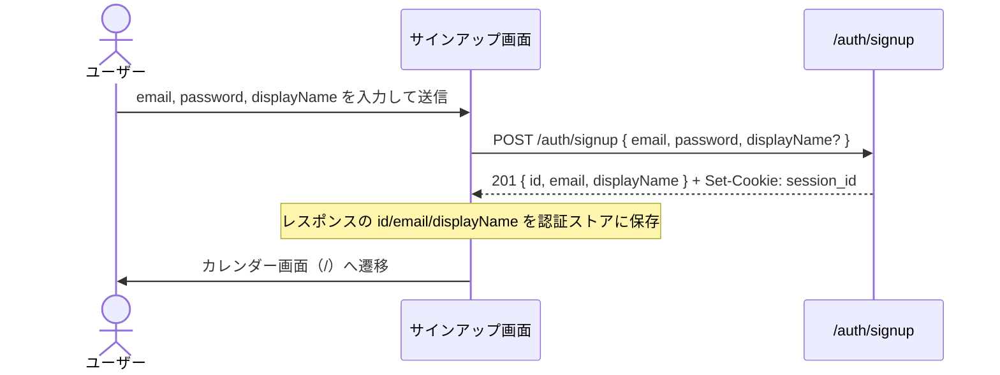
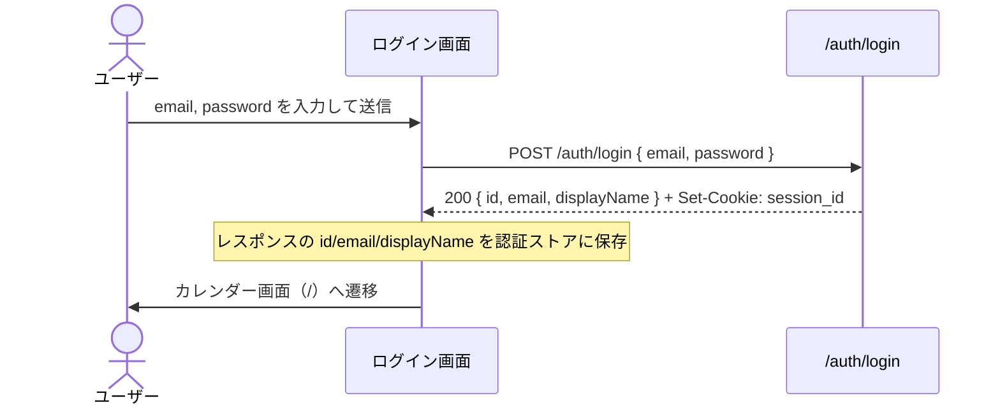
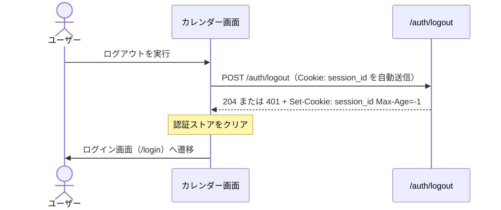
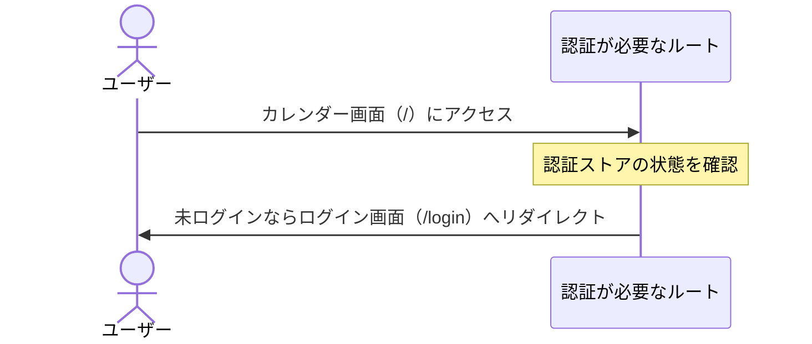

# ユーザー認証 仕様書

- 作成日: 2026-09-07
- 更新日: 2026-11-08（新テンプレートに追従し、設計セクションを追記。ステータス表記を統一）
- ステータス: PDM合意済
- 合意日: 2026-09-07

## PRD参照

- PRD: PRD-001 ログイン・認証（`docs/prd/PRD-001-auth.md`）
- Issue: #18

## 対象機能

メールアドレス + パスワードによるアカウント登録・ログイン・ログアウト機能。セッションをサーバーで管理し、複数端末からの同一アカウントアクセスを可能にする。ユーザーはUUID v4で識別し、表示名を任意で設定できる。

## 詳細仕様

### 基本フロー

#### サインアップ

1. ユーザーがメールアドレス・パスワード・表示名（任意）を入力してアカウント登録を送信する
2. メールアドレスの重複チェックを行う
3. UUID v4でユーザーIDを生成する
4. パスワードをハッシュ化してDBに保存する
5. セッションを発行してHTTP-Only Cookieに保存する
6. カレンダー画面へリダイレクトする

#### ログイン

1. ユーザーがメールアドレスとパスワードを入力してログインを送信する
2. メールアドレスでユーザーを検索する
3. パスワードとハッシュを照合する
4. セッションを発行してHTTP-Only Cookieに保存する
5. カレンダー画面へリダイレクトする

#### ログアウト

1. ユーザーがログアウトを実行する
2. サーバー側でセッションを無効化する
3. HTTP-Only Cookieからセッショントークンを削除する
4. ログイン画面へリダイレクトする

#### 未ログイン時のアクセス

1. 未ログイン状態でカレンダー画面にアクセスする
2. セッションCookieの有無・有効性を確認する
3. ログイン画面へリダイレクトする

### 制約条件

#### 入力バリデーション

- メールアドレス: RFC 5322 準拠の形式であること
- パスワード: 8文字以上72文字以下であること（bcrypt の72バイト上限に合わせる）
- パスワード: ASCII印字可能文字（コードポイント 32〜126）のみ使用可能
- パスワード: 英大文字・英小文字・数字・記号をそれぞれ1文字以上含むこと
- 表示名: 最大50文字以下であること（任意）

#### セキュリティ

- パスワードは bcrypt でハッシュ化して保存する（平文保存禁止）
- セッショントークンはHTTP-Only Cookieで管理する（JavaScriptからアクセス不可）
- セッション有効期限: 30日間（ブラウザを閉じても維持）

#### レート制限

- ログイン失敗: 同一IPアドレスから10回失敗で15分間ロック

### エッジケース・境界値

- 表示名を空欄で送信した場合 → メールアドレスの `@` より前のローカルパートを表示名として使用する
- 既に登録済みのメールアドレスでサインアップを試みた場合 → エラーメッセージを表示（「このメールアドレスは既に使用されています」）
- 存在しないメールアドレスでログインを試みた場合 → 汎用エラー表示（ユーザー存在の有無を漏らさない）
- パスワードが一致しない場合 → 汎用エラー表示（「メールアドレスまたはパスワードが正しくありません」）
- セッションCookieが改ざん・無効の場合 → ログイン画面へリダイレクト

## 設計

### ドメインモデル

- [User ドメイン](../domain/user.md) — `User` 集約。`Email`・`Password`・`LoginPassword`・表示名を持つ
- [Session ドメイン](../domain/session.md) — `Session` 集約。平文の `Token` をCookieで送り、DBには `TokenHash`（SHA-256、ADR-033）のみを保存する

### DB設計

| テーブル | カラム | 型 | 制約 | 備考 |
|---|---|---|---|---|
| users | id | UUID | PRIMARY KEY DEFAULT `uuid_generate_v4()` | |
| users | email | TEXT | NOT NULL UNIQUE | インデックス `users_email_idx` |
| users | display_name | TEXT | NOT NULL | |
| users | password_hash | TEXT | NOT NULL | bcrypt ハッシュ |
| users | created_at | TIMESTAMPTZ | NOT NULL DEFAULT `NOW()` | |
| users | updated_at | TIMESTAMPTZ | NOT NULL DEFAULT `NOW()` | `update_updated_at_column` トリガで更新 |
| sessions | id | UUID | PRIMARY KEY DEFAULT `uuid_generate_v4()` | 行識別子。Cookieには使わない |
| sessions | user_id | UUID | NOT NULL REFERENCES `users(id)` ON DELETE CASCADE | インデックス `sessions_user_id_idx` |
| sessions | token_hash | TEXT | NOT NULL UNIQUE | 平文トークンのSHA-256（ADR-033） |
| sessions | expires_at | TIMESTAMPTZ | NOT NULL | インデックス `sessions_expires_at_idx` |
| sessions | created_at | TIMESTAMPTZ | NOT NULL DEFAULT `NOW()` | |

### API設計

| メソッド | パス | 認証 | リクエスト | レスポンス | エラー（HTTPステータス） |
|---|---|---|---|---|---|
| POST | /auth/signup | 不要 | `email`, `password`, `displayName`（任意） | 201 `UserResponse`（`id`・`email`・`displayName`） | 400 `VALIDATION_ERROR` / 409 `CONFLICT` / 500 `INTERNAL_ERROR` |
| POST | /auth/login | 不要 | `email`, `password` | 200 `UserResponse` | 400 `VALIDATION_ERROR` / 401 `UNAUTHORIZED` / 500 `INTERNAL_ERROR` |
| POST | /auth/logout | セッションCookie | なし | 204 | 401 `UNAUTHORIZED` / 500 `INTERNAL_ERROR` |
| GET | /auth/me | セッションCookie | なし | 200 `UserResponse` | 401 `UNAUTHORIZED` / 500 `INTERNAL_ERROR` |

サインアップ・ログイン成功時のレスポンスには `Set-Cookie: session_id=<平文トークン>; Path=/; HttpOnly; Secure; SameSite=Strict; Max-Age=2592000`（30日）を付与する。ログアウト成功時は同じ属性で `Max-Age=-1` のCookieを返して失効させる。

#### API呼び出しシーケンス

##### サインアップ

##### ログイン

##### ログアウト

##### 未ログイン時のアクセス

