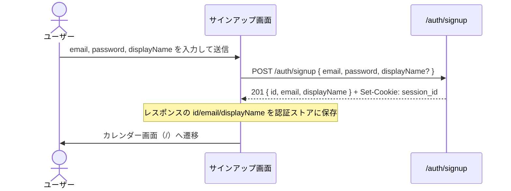
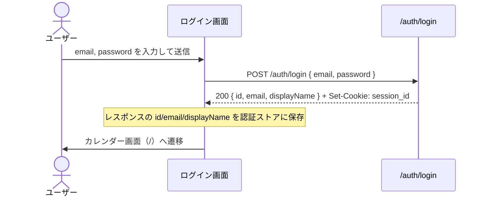
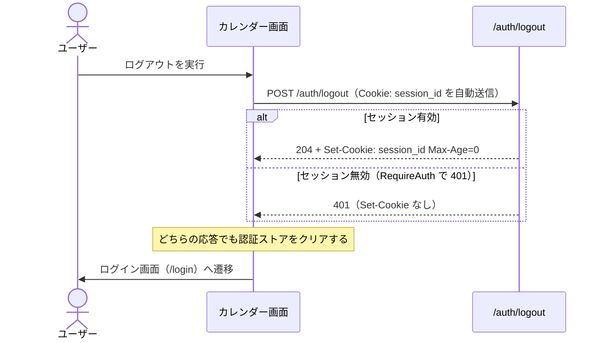
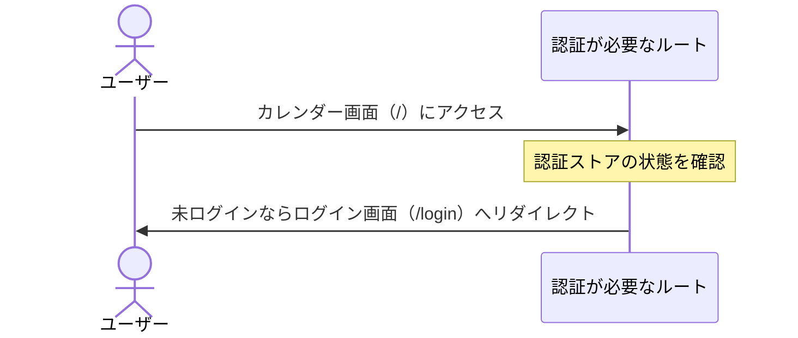

# ユーザー認証 仕様書

- 作成日: 2026-09-07
- 更新日: 2026-11-08（新テンプレートに追従し、設計セクションを追記。ステータス表記を統一）
- ステータス: PDM合意済

## PRD参照

- PRD: PRD-001 ログイン・認証（`docs/prd/PRD-001-auth.md`）
- Issue: #18

## 対象機能

メールアドレス + パスワードによるアカウント登録・ログイン・ログアウト機能。セッションをサーバーで管理し、複数端末からの同一アカウントアクセスを可能にする。ユーザーはUUID v4で識別し、表示名を任意で設定できる。

## 詳細仕様

### 基本フロー

#### サインアップ

1. ユーザーがメールアドレス・パスワード・表示名（任意）を入力してアカウント登録を送信する
2. メールアドレスの重複チェックを行う
3. UUID v4でユーザーIDを生成する
4. パスワードをハッシュ化してDBに保存する
5. セッションを発行してHTTP-Only Cookieに保存する
6. カレンダー画面へリダイレクトする

#### ログイン

1. ユーザーがメールアドレスとパスワードを入力してログインを送信する
2. メールアドレスでユーザーを検索する
3. パスワードとハッシュを照合する
4. セッションを発行してHTTP-Only Cookieに保存する
5. カレンダー画面へリダイレクトする

#### ログアウト

1. ユーザーがログアウトを実行する
2. サーバー側でセッションを無効化する
3. HTTP-Only Cookieからセッショントークンを削除する
4. ログイン画面へリダイレクトする

#### 未ログイン時のアクセス

1. 未ログイン状態でカレンダー画面にアクセスする
2. セッションCookieの有無・有効性を確認する
3. ログイン画面へリダイレクトする

### 制約条件

#### 入力バリデーション

- メールアドレス: RFC 5322 準拠の形式であること
- パスワード: 8文字以上72文字以下であること（bcrypt の72バイト上限に合わせる）
- パスワード: ASCII印字可能文字（コードポイント 32〜126）のみ使用可能
- パスワード: 英大文字・英小文字・数字・記号をそれぞれ1文字以上含むこと
- 表示名: 最大50文字以下であること（任意）

#### セキュリティ

- パスワードは bcrypt でハッシュ化して保存する（平文保存禁止）
- セッショントークンはHTTP-Only Cookieで管理する（JavaScriptからアクセス不可）
- セッション有効期限: 30日間（ブラウザを閉じても維持）

#### レート制限

- ログイン失敗: 同一IPアドレスから10回失敗で15分間ロック

### エッジケース・境界値

- 表示名を空欄で送信した場合 → メールアドレスの `@` より前のローカルパートを表示名として使用する
- 既に登録済みのメールアドレスでサインアップを試みた場合 → エラーメッセージを表示（「このメールアドレスは既に使用されています」）
- 存在しないメールアドレスでログインを試みた場合 → 汎用エラー表示（ユーザー存在の有無を漏らさない）
- パスワードが一致しない場合 → 汎用エラー表示（「メールアドレスまたはパスワードが正しくありません」）
- セッションCookieが改ざん・無効の場合 → ログイン画面へリダイレクト

## 設計

### ドメインモデル

- [User ドメイン](../domain/user.md) — `User` 集約。`Email`・`Password`・表示名を持つ
  - `LoginPassword`: ログイン照合に使う値オブジェクト。入力の形式チェックのみを行い bcrypt ハッシュ生成はしない。`Hash()` を持たないため、ユーザー作成経路に誤って渡されてもコンパイルエラーになる
- [Session ドメイン](../domain/session.md) — `Session` 集約。ユーザーIDと有効期限を持つ
  - `Token`: `crypto/rand` による 32 バイトのランダム値を base64url（パディングなし）でエンコードした平文トークン。Cookie で送受信する
  - `TokenHash`: `Token` の SHA-256（16 進文字列）。DB にはこちらのみ保存する（ADR-033）

### DB設計

| テーブル | カラム | 型 | 制約 | 備考 |
|---|---|---|---|---|
| users | id | UUID | PRIMARY KEY DEFAULT `uuid_generate_v4()` | |
| users | email | TEXT | NOT NULL UNIQUE | インデックス `users_email_idx` |
| users | display_name | TEXT | NOT NULL | |
| users | password_hash | TEXT | NOT NULL | bcrypt ハッシュ |
| users | created_at | TIMESTAMPTZ | NOT NULL DEFAULT `NOW()` | |
| users | updated_at | TIMESTAMPTZ | NOT NULL DEFAULT `NOW()` | トリガ `update_users_updated_at` で更新 |
| sessions | id | UUID | PRIMARY KEY DEFAULT `uuid_generate_v4()` | 行識別子。Cookieには使わない |
| sessions | user_id | UUID | NOT NULL REFERENCES `users(id)` ON DELETE CASCADE | インデックス `sessions_user_id_idx` |
| sessions | token_hash | TEXT | NOT NULL UNIQUE | 平文トークンのSHA-256（ADR-033） |
| sessions | expires_at | TIMESTAMPTZ | NOT NULL | インデックス `sessions_expires_at_idx` |
| sessions | created_at | TIMESTAMPTZ | NOT NULL DEFAULT `NOW()` | |

### API設計

| メソッド | パス | 認証 | リクエスト | レスポンス | エラー（HTTPステータス） |
|---|---|---|---|---|---|
| POST | /auth/signup | 不要 | `email`, `password`, `displayName`（任意） | 201 `UserResponse`（`id`・`email`・`displayName`） | 400 `VALIDATION_ERROR` / 409 `CONFLICT` / 500 `INTERNAL_ERROR` |
| POST | /auth/login | 不要 | `email`, `password` | 200 `UserResponse` | 400 `VALIDATION_ERROR` / 401 `UNAUTHORIZED` / 429 `TOO_MANY_REQUESTS` / 500 `INTERNAL_ERROR` |
| POST | /auth/logout | セッションCookie | なし | 204 | 401 `UNAUTHORIZED` / 500 `INTERNAL_ERROR` |
| GET | /auth/me | セッションCookie | なし | 200 `UserResponse` | 401 `UNAUTHORIZED` / 500 `INTERNAL_ERROR` |

エラーレスポンス（`code` / `message` / `details`）の共通構造は ADR-013 を参照する。

#### POST /auth/signup

##### リクエスト

| 場所 | フィールド | 型 | 必須 | 制約 | 説明 |
|---|---|---|---|---|---|
| body | email | string | 必須 | RFC 5322 準拠のメールアドレス形式 | メールアドレス |
| body | password | string | 必須 | 8〜72 文字、ASCII 印字可能文字（0x20〜0x7E）のみ、英大文字・英小文字・数字・記号を各 1 文字以上 | パスワード |
| body | displayName | string | 任意 | 最大 50 文字（文字数）。空欄時は `email` の `@` より前のローカルパートが設定される | 表示名 |

##### レスポンス（201 Created）

| フィールド | 型 | null許容 | 説明 |
|---|---|---|---|
| id | string（UUID v4） | 否 | 発行されたユーザーID |
| email | string（email） | 否 | 登録メールアドレス |
| displayName | string | 否 | 表示名 |
| Set-Cookie: session_id | header | 否 | `<平文トークン>; Path=/; HttpOnly; Secure; SameSite=Strict; Max-Age=2592000`（30 日） |

##### エラー

| HTTPステータス | code | details[].code | 発生条件 |
|---|---|---|---|
| 400 | VALIDATION_ERROR | - | リクエストボディの JSON デコードに失敗した（`email` を `net/mail.ParseAddress` で解釈できない場合を含む。例: `foo`） |
| 400 | VALIDATION_ERROR | INVALID_FORMAT | `email` は `net/mail.ParseAddress` で解釈できるが、ドメインの形式チェック（`user.NewEmail`）に通らない（例: `a@b`） |
| 400 | VALIDATION_ERROR | TOO_SHORT | `password` が 8 文字未満 |
| 400 | VALIDATION_ERROR | TOO_LONG | `password` が 72 バイト超、または `displayName` が 50 文字超 |
| 400 | VALIDATION_ERROR | INVALID_CHARACTER | `password` に ASCII 印字可能範囲外の文字が含まれる |
| 400 | VALIDATION_ERROR | INSUFFICIENT_COMPLEXITY | `password` に英大文字・英小文字・数字・記号のいずれかが含まれない |
| 409 | CONFLICT | - | `email` が既に登録済み |
| 500 | INTERNAL_ERROR | - | DB 障害・bcrypt 生成失敗・レスポンスのマーシャリング失敗など内部エラー |

#### POST /auth/login

##### リクエスト

| 場所 | フィールド | 型 | 必須 | 制約 | 説明 |
|---|---|---|---|---|---|
| body | email | string | 必須 | - | メールアドレス |
| body | password | string | 必須 | - | パスワード |

##### レスポンス（200 OK）

| フィールド | 型 | null許容 | 説明 |
|---|---|---|---|
| id | string（UUID v4） | 否 | ユーザーID |
| email | string（email） | 否 | メールアドレス |
| displayName | string | 否 | 表示名 |
| Set-Cookie: session_id | header | 否 | `<平文トークン>; Path=/; HttpOnly; Secure; SameSite=Strict; Max-Age=2592000`（30 日） |

##### エラー

| HTTPステータス | code | details[].code | 発生条件 |
|---|---|---|---|
| 400 | VALIDATION_ERROR | - | リクエストボディの JSON デコードに失敗した（`email` を `net/mail.ParseAddress` で解釈できない場合を含む。例: `foo`） |
| 401 | UNAUTHORIZED | - | `email` に該当するユーザーが存在しない、または `password` が不一致（識別情報はレスポンスで区別しない）。`password` の形式不正も同じ扱い |
| 429 | TOO_MANY_REQUESTS | - | 同一IPアドレスからのログイン失敗が10回に達してから15分以内に試行した（認証情報が正しくても拒否する）。`Retry-After` ヘッダにロック解除までの秒数を付ける |
| 500 | INTERNAL_ERROR | - | `email` は `net/mail.ParseAddress` で解釈できるが、ドメインの形式チェック（`user.NewEmail`）に通らない（例: `a@b`。`user.NewEmail` の `INVALID_FORMAT` を handler が分岐しないため）、DB 障害・bcrypt 比較失敗・レスポンスのマーシャリング失敗など内部エラー |

#### POST /auth/logout

##### リクエスト

| 場所 | フィールド | 型 | 必須 | 制約 | 説明 |
|---|---|---|---|---|---|
| cookie | session_id | string | 必須 | 平文のセッショントークン | 認証対象のセッションを特定する |

##### レスポンス（204 No Content）

ボディなし。`Set-Cookie: session_id=; Path=/; HttpOnly; Secure; SameSite=Strict; Max-Age=0` を付与して Cookie を失効させる。

##### エラー

| HTTPステータス | code | details[].code | 発生条件 |
|---|---|---|---|
| 401 | UNAUTHORIZED | - | `RequireAuth` がセッションを解決できない（Cookie 未送信・空・期限切れ・該当セッションなし・該当ユーザーなし・DB 障害などによる参照失敗）。`Set-Cookie` は付与しない |
| 500 | INTERNAL_ERROR | - | セッション削除失敗。`Set-Cookie` は付与しない |

#### GET /auth/me

##### リクエスト

| 場所 | フィールド | 型 | 必須 | 制約 | 説明 |
|---|---|---|---|---|---|
| cookie | session_id | string | 必須 | 平文のセッショントークン | 現在のユーザーを特定する |

##### レスポンス（200 OK）

| フィールド | 型 | null許容 | 説明 |
|---|---|---|---|
| id | string（UUID v4） | 否 | ユーザーID |
| email | string（email） | 否 | メールアドレス |
| displayName | string | 否 | 表示名 |

##### エラー

| HTTPステータス | code | details[].code | 発生条件 |
|---|---|---|---|
| 401 | UNAUTHORIZED | - | `RequireAuth` がセッションを解決できない（Cookie 未送信・空・期限切れ・該当セッションなし・該当ユーザーなし・DB 障害などによる参照失敗） |
| 500 | INTERNAL_ERROR | - | レスポンスのマーシャリング失敗 |

#### API呼び出しシーケンス

##### サインアップ

##### ログイン

##### ログアウト

##### 未ログイン時のアクセス

