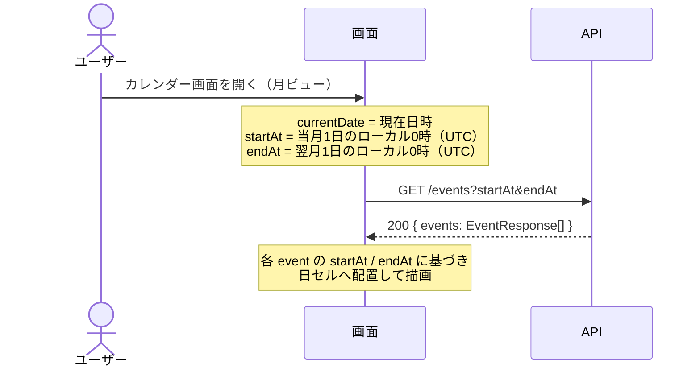
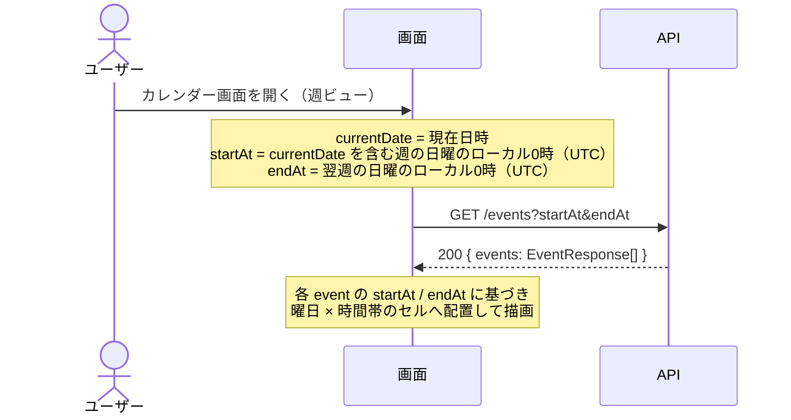
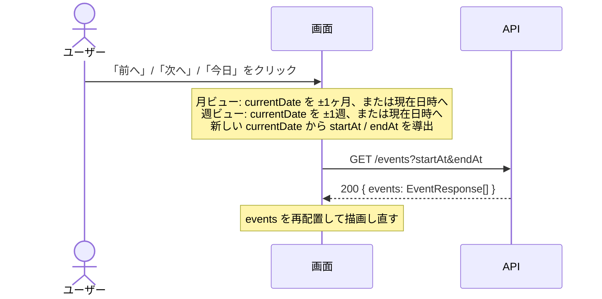
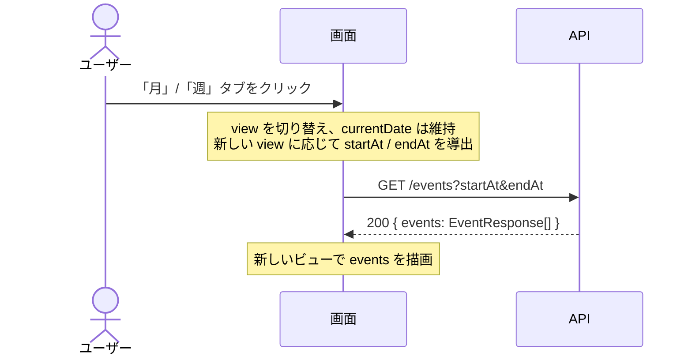
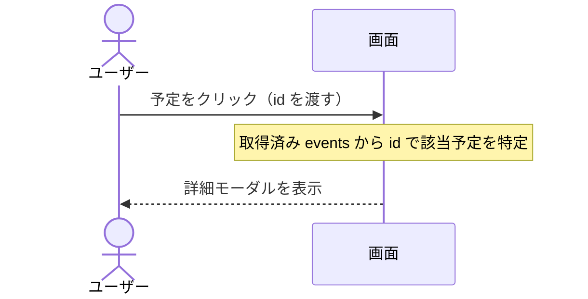

# カレンダービュー（月/週） 仕様書

- 作成日: 2026-09-13
- 更新日: 2026-11-08（新テンプレートに合わせて設計セクションを追加、ステータスをアーカイブに変更）
- ステータス: アーカイブ

## PRD参照

- PRD: PRD-002 カレンダービュー（`docs/prd/PRD-002-calendar-view.md`）
- Issue: #19

## 対象機能

月ビューと週ビューでスケジュールを一覧表示するカレンダーUI。月全体の予定密度の把握（月ビュー）と、時間帯ごとの予定の把握（週ビュー）を可能にする。

## 詳細仕様

### 基本フロー

#### 月ビュー

1. 画面を開くと現在月のカレンダーグリッドを表示する
2. グリッドは7列（日〜土）× 最大6行で構成される
3. 各日セルに、その日の予定タイトル（または件数）を表示する
4. 予定が多い場合は「+N件」の形式でオーバーフローを表示する
5. 予定タイトル/件数をクリックすると予定詳細を表示する
6. 「前へ」「次へ」ボタンで前後の月に移動する
7. 「今日」ボタンをクリックすると現在月に戻る

#### 週ビュー

1. 画面を開くと現在週のタイムラインを表示する
2. 縦軸は時間帯（0:00〜23:00）、横軸は曜日（日〜土）の7列で構成される
3. 各予定は開始・終了時刻に基づき、対応するセルにブロックとして表示する
4. 予定ブロックをクリックすると予定詳細を表示する
5. 「前へ」「次へ」ボタンで前後の週に移動する
6. 「今日」ボタンをクリックすると現在週に戻る

#### ビュー切り替え

1. 「月」「週」のタブまたはボタンを常時表示する
2. タブをクリックすると即座にビューを切り替える（1秒以内）
3. ビュー切り替え時は、直前に表示していた日付を含む月・週を表示する

### 制約条件

- PC/タブレットのブラウザ表示に最適化する（スマートフォンは対象外）
- ビュー切り替え・ナビゲーションのレンダリングは1秒以内に完了すること
- 週ビューは空き時間とブロック済み時間が視覚的に区別できること（PRD成功指標: 5秒以内に空き時間を判断できる）
- 日ビューはスコープ外（PRD-006 今日のタイムラインで対応）
- 印刷・エクスポート機能はスコープ外
- カレンダービューからの予定の新規作成・編集操作はスコープ外（詳細確認のみ）

### エッジケース・境界値

- 予定が存在しない日・時間帯は空として表示する（エラーにしない）
- 予定タイトルが長い場合は省略（`...`）して表示する
- 月ビューで1日に多数の予定がある場合、表示可能な件数を超えた分は「+N件」で表示する
- 週ビューで同一時間帯に複数予定が重なる場合、横並びまたは幅を縮小して並べて表示する
- 現在月・現在週の「今日」の日付を視覚的に強調表示する
- 月をまたぐ予定（複数日にわたる予定）は月ビューの各日セルに表示する
- 週ビューにおける複数日にわたる予定は、対象曜日を横断するブロックとして表示する
- 終日予定はスコープ外（PRDに定義がないため、後続PRDで定義された際に対応する）
- データ取得中はローディングインジケーターを表示し、エラー時はエラーメッセージを表示する（予定データが表示できない旨を明示）

## 設計

### ドメインモデル

- `Event`（エンティティ） — ユーザーごとの予定。識別子・ユーザーID・タイトル・開始日時・終了日時を核とし、月/週ビューに並べる単位になる。用語定義と不変条件は [docs/domain/event.md](../domain/event.md) を参照する。
- 本仕様で前提にする不変条件:
  - タイトルは空文字を許容しない
  - 終了日時は開始日時より後（コード上は `endAt > startAt` で検証）

### DB設計

| テーブル | カラム | 型 | 制約 | 備考 |
|---|---|---|---|---|
| `events` | `id` | `UUID` | PRIMARY KEY, DEFAULT `uuid_generate_v4()` | 予定の識別子 |
| `events` | `user_id` | `UUID` | NOT NULL, REFERENCES `users(id)` ON DELETE CASCADE | 作成者。ユーザー削除で予定も連鎖削除 |
| `events` | `title` | `TEXT` | NOT NULL | タイトル |
| `events` | `description` | `TEXT` | NULL 許容 | メモ（任意入力の受け取りは SPEC-003 で扱う） |
| `events` | `start_at` | `TIMESTAMPTZ` | NOT NULL | 開始日時 |
| `events` | `end_at` | `TIMESTAMPTZ` | NOT NULL | 終了日時 |
| `events` | `created_at` | `TIMESTAMPTZ` | NOT NULL, DEFAULT `NOW()` | 作成日時 |
| `events` | `updated_at` | `TIMESTAMPTZ` | NOT NULL, DEFAULT `NOW()` | 更新日時。トリガ `update_events_updated_at` で `BEFORE UPDATE` 時に更新 |

- インデックス: `events_user_time_range_idx` (`user_id`, `start_at`, `end_at`) — ログイン中ユーザーの指定期間の予定一覧クエリを支える。
- `location` / `url` カラムは SPEC-003（予定管理）で追加される。共有・購読関連のテーブル（`event_shares` / `event_subscriptions`）は SPEC-004（予定共有）で追加される。

### API設計

| メソッド | パス | 認証 | リクエスト | レスポンス | エラー（HTTPステータス） |
|---|---|---|---|---|---|
| GET | `/events` | セッションCookie必須 | クエリ: `startAt` (date-time UTC, 必須)、`endAt` (date-time UTC, 必須) | 200: `{ events: EventResponse[] }` — ログイン中ユーザーに紐づく期間内の予定一覧 | 400: クエリ不正 / 401: 未認証 / 500: 内部エラー |

- エラーレスポンスの共通構造（`code` / `message` / `details`）は [ADR-013](../adr/ADR-013-api-error-structure.md) を参照する。
- 日時の形式とタイムゾーンの扱いは [ADR-036](../adr/ADR-036-api-datetime-utc.md) を参照する。
- 予定の作成・更新・削除 API は SPEC-003、共有関連 API は SPEC-004 を参照する。

#### GET /events

ログイン中ユーザーに紐づく期間内の予定一覧を返す。

##### リクエスト

| 場所 | フィールド | 型 | 必須 | 制約 | 説明 |
|---|---|---|---|---|---|
| cookie | session_id | string | 必須 | 平文のセッショントークン | `RequireAuth` ミドルウェアが検証する |
| query | `startAt` | string | 必須 | RFC3339、末尾 `Z`（UTC） | 検索範囲の開始日時（この日時を含む）。クライアントは表示期間の初日のローカル0時をUTCに変換して送る |
| query | `endAt` | string | 必須 | RFC3339、末尾 `Z`（UTC）。`startAt` より後 | 検索範囲の終了日時（この日時を含まない）。クライアントは表示期間の翌日のローカル0時をUTCに変換して送る |

検索範囲と重なる予定（`end_at > startAt` かつ `start_at < endAt`）を返す。

##### レスポンス（200 OK）

| フィールド | 型 | null許容 | 説明 |
|---|---|---|---|
| `events` | `EventResponse[]` | 否 | 期間内の予定一覧。該当なしの場合は空配列 |
| `events[].id` | string (uuid) | 否 | 予定ID |
| `events[].title` | string | 否 | タイトル |
| `events[].startAt` | string (date-time, RFC3339, UTC) | 否 | 開始日時 |
| `events[].endAt` | string (date-time, RFC3339, UTC) | 否 | 終了日時 |
| `events[].description` | string | 否（空のときはフィールドごと省略する） | メモ |
| `events[].location` | string | 否（空のときはフィールドごと省略する） | 場所（SPEC-003で追加） |
| `events[].url` | string | 否（空のときはフィールドごと省略する） | 関連URL（SPEC-003で追加） |
| `events[].isSubscribed` | boolean | 否 | 共有リンク経由で追加された購読予定なら `true`。`true` の予定は閲覧専用（SPEC-004で追加） |
| `events[].subscriptionId` | string (uuid) | 可（`isSubscribed = false` のとき `null`） | 購読レコードID。`DELETE /subscriptions/{id}` に渡して自分のカレンダーから外す用途（SPEC-004で追加） |

##### エラー

| HTTPステータス | code | details[].code | 発生条件 |
|---|---|---|---|
| 400 | `VALIDATION_ERROR` | - | `startAt` または `endAt` が未指定、RFC3339として解釈できない、末尾が `Z` でない、または `endAt` が `startAt` 以前 |
| 401 | `UNAUTHORIZED` | - | セッションCookieが無い、無効、または対応するユーザーを解決できない |
| 500 | `INTERNAL_ERROR` | - | 下位層のクエリ実行失敗、またはレスポンスのJSONエンコードに失敗 |

#### API呼び出しシーケンス

##### 画面初期表示（月ビュー）

`currentDate` から当月の月初〜月末を期間として `GET /events` を1回呼び出し、各日セルに予定を配置する。

##### 画面初期表示（週ビュー）

`currentDate` を含む週の日曜〜土曜を期間として `GET /events` を1回呼び出し、曜日×時間帯のグリッドに予定を配置する。

##### 期間ナビゲーション（「前へ」「次へ」「今日」）

ボタン種別に応じて `currentDate` を更新し、新しい期間で `GET /events` を再取得して描画し直す。

##### ビュー切り替え（月 ⇄ 週）

`currentDate` は維持したまま `view` を切り替え、新しいビューの期間で `GET /events` を再取得する。

##### 予定クリック（詳細表示）

取得済みの `events` 配列から `id` で該当予定を特定し、詳細モーダルに渡して表示する（追加の API 呼び出しは行わない）。

