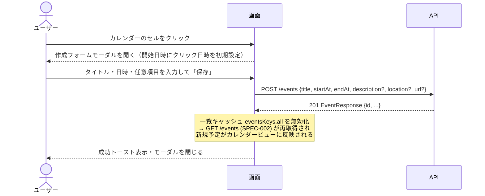
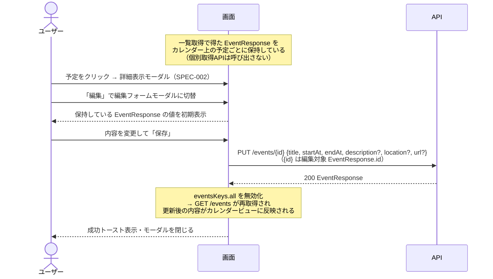
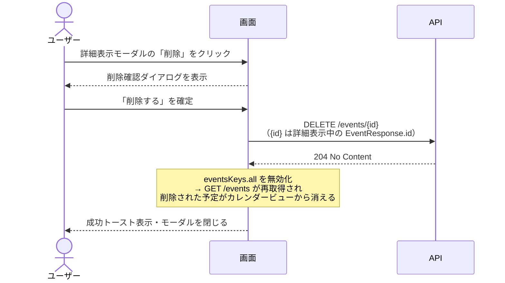

# 予定管理（作成・編集・削除） 仕様書

- 作成日: 2026-09-21
- 更新日: 2026-11-08（新テンプレートに追従。設計セクション追加・ステータス更新）
- ステータス: アーカイブ
- 合意日: 2026-09-21

## PRD参照

- PRD: PRD-003 予定管理（`docs/prd/PRD-003-event-management.md`）
- Issue: #20

## 対象機能

タイトルと日時（開始・終了）の3項目だけで素早く予定を登録し、後からメモ・場所・URLを追記できる機能。カレンダービュー上のクリック操作を起点として、登録・編集・削除の各操作をモーダルUIで提供し、画面遷移なしに完結する。

## 詳細仕様

### 基本フロー

#### 予定の新規作成

1. カレンダービュー上の任意の日付・時間帯セルをクリックする（Issue #166: カレンダークリックから作成フォームを開く導線、Issue #19 完了後に着手）
2. 作成フォームモーダルが開き、クリックした日時が開始日時に初期設定される
3. タイトルフィールドに自動フォーカスが当たる
4. タイトル・開始日時・終了日時を入力する
5. 必要に応じてメモ・場所・URLを入力する（いずれも任意）
6. 「保存」ボタンをクリックすると予定を登録し、モーダルを閉じる
7. 登録した予定がカレンダービューに即時反映される

#### 予定の編集

1. カレンダービュー上の予定をクリックすると詳細表示モーダルが開く（クリックによる詳細表示起動はSPEC-002のスコープに含まれる。SPEC-002は「詳細確認のみ」をスコープとしており、本仕様書（SPEC-003）が詳細表示・編集・削除の中身を定義する）
2. 詳細表示モーダルの「編集」ボタンをクリックすると編集フォームモーダルに切り替わる
3. 既存の内容が各フィールドに初期表示される
4. 内容を変更して「保存」ボタンをクリックすると更新し、モーダルを閉じる
5. 更新した予定がカレンダービューに即時反映される

#### 予定の削除

1. 詳細表示モーダルの「削除」ボタンをクリックする
2. 削除確認ダイアログが表示される（「削除する」「キャンセル」の2択）
3. 「削除する」をクリックすると予定を削除し、モーダルを閉じる
4. 削除した予定がカレンダービューから即時消える
5. 「キャンセル」をクリックすると確認ダイアログを閉じ、詳細表示モーダルに戻る

### 制約条件

- タイトル・開始日時・終了日時は必須入力
- メモ・場所・URLは任意入力
- 終了日時は開始日時より後でなければならない（同時刻は不可）
- 登録・編集フォームはモーダルで表示し、画面遷移を発生させない
- モーダルにはフォーカストラップを実装し、Escキーでモーダルを閉じるキーボード操作に対応する
- 削除前の確認ダイアログは省略不可
- 過去日時の予定も編集・削除の対象とする（日時による制限なし）
- タイトル + 日時入力から保存完了まで10秒以内に操作できること（PRD成功指標）
- APIエラー時はモーダル内にエラーメッセージを表示し、モーダルは閉じない
- SPEC-002との責務分担: カレンダービューからの予定の新規作成・編集操作はSPEC-002のスコープ外（「詳細確認のみ」）と明記されており、本仕様書（SPEC-003）がその詳細表示・編集・削除の実装仕様を定義する。カレンダービュー側はクリックイベントのトリガーのみを担い、モーダルの表示内容・操作フローはSPEC-003が責任を持つ

### エッジケース・境界値

- 終了日時が開始日時以前の場合: バリデーションエラーをフォーム内インラインで表示し、保存を阻止する
- タイトルが空の状態で保存しようとした場合: バリデーションエラーをフォーム内インラインで表示し、保存を阻止する
- モーダルを保存せずに閉じた場合（Escキー・背景クリック・「キャンセル」ボタン等）: 入力内容を破棄し、変更を保存しない
- 過去日時の予定を編集・削除する場合: 制限なく操作を許可する（通常フローと同一）
- カレンダービュー上で同一時間帯に予定が重なっている場合: 各予定をクリックするとそれぞれ個別の詳細表示モーダルを開く
- Issue #166（カレンダークリックから作成フォームを開く導線）はIssue #19（カレンダービュー）完了後に着手するため、それ以前の実装では別の作成トリガー（固定「新規作成」ボタン等）を暫定的に用いてよい

## 設計

### ドメインモデル

- `Event`（エンティティ） — 予定を表す集約ルート。`id` / `userId` / `title` / `description` / `startAt` / `endAt` / `location` / `url` を持つ。用語・不変条件・エラーは [Event ドメイン](../domain/event.md) を参照する
- 本仕様で守る不変条件（[Event ドメイン](../domain/event.md) で定義されるもののうち予定管理に関わる範囲）:
  - `title` は空文字を許容しない
  - `endAt` は `startAt` より厳密に後でなければならない（同時刻は不可）
  - 予定の変更・削除は作成したユーザー本人のみが行える

### DB設計

| テーブル | カラム | 型 | 制約 | 備考 |
|---|---|---|---|---|
| `events` | `id` | `UUID` | PRIMARY KEY, DEFAULT `uuid_generate_v4()` | 予定ID |
| `events` | `user_id` | `UUID` | NOT NULL, REFERENCES `users(id)` ON DELETE CASCADE | 作成者。作成者削除で予定も削除 |
| `events` | `title` | `TEXT` | NOT NULL | タイトル。空文字はドメイン層で拒否 |
| `events` | `description` | `TEXT` | NULL 許容 | メモ（任意） |
| `events` | `start_at` | `TIMESTAMPTZ` | NOT NULL | 開始日時 |
| `events` | `end_at` | `TIMESTAMPTZ` | NOT NULL | 終了日時。`start_at` より後であることはドメイン層で検証 |
| `events` | `location` | `TEXT` | NULL 許容 | 場所（任意） |
| `events` | `url` | `TEXT` | NULL 許容 | 関連URL（任意） |
| `events` | `created_at` | `TIMESTAMPTZ` | NOT NULL, DEFAULT `NOW()` | 作成日時 |
| `events` | `updated_at` | `TIMESTAMPTZ` | NOT NULL, DEFAULT `NOW()`, トリガー `update_events_updated_at` で UPDATE 時に自動更新 | 更新日時 |

インデックス: `events_user_time_range_idx (user_id, start_at, end_at)` — ユーザーごとの期間検索（カレンダー表示の一覧取得）で使用する。

### API設計

| メソッド | パス | 認証 | リクエスト | レスポンス | エラー（HTTPステータス） |
|---|---|---|---|---|---|
| POST | `/events` | セッション必須 | `CreateEventRequest`（`title` / `startAt` / `endAt` 必須、`description` / `location` / `url` 任意） | 201 `EventResponse` | 400 VALIDATION_ERROR / 401 UNAUTHORIZED / 500 INTERNAL_ERROR |
| PUT | `/events/{id}` | セッション必須 | `UpdateEventRequest`（`title` / `startAt` / `endAt` 必須、`description` / `location` / `url` 任意） | 200 `EventResponse` | 400 VALIDATION_ERROR / 401 UNAUTHORIZED / 404 NOT_FOUND / 500 INTERNAL_ERROR |
| DELETE | `/events/{id}` | セッション必須 | （なし） | 204 No Content | 400 VALIDATION_ERROR / 401 UNAUTHORIZED / 404 NOT_FOUND / 500 INTERNAL_ERROR |

エラーレスポンスの共通構造（`code` / `message` / `details`）は [ADR-013](../adr/ADR-013-api-error-structure.md) を参照する。404 は予定が存在しない場合と他ユーザーの予定にアクセスした場合をまとめて返し、所有関係の有無を漏らさない。

#### POST /events

##### リクエスト

| 場所 | フィールド | 型 | 必須 | 制約 | 説明 |
|---|---|---|---|---|---|
| cookie | セッションCookie | string | ◯ | 認証ミドルウェアで検証 | 認証に用いるセッションCookie |
| body | `title` | string | ◯ | `minLength: 1`（OpenAPI）、ドメイン層でも空文字を拒否 | 予定タイトル |
| body | `startAt` | string (date-time, RFC3339) | ◯ | - | 開始日時 |
| body | `endAt` | string (date-time, RFC3339) | ◯ | `startAt` より厳密に後（同時刻不可。ドメイン層で検証） | 終了日時 |
| body | `description` | string \| null | - | - | メモ |
| body | `location` | string \| null | - | - | 場所 |
| body | `url` | string \| null | - | - | 関連URL。形式検証なし |

##### レスポンス（201 Created）

| フィールド | 型 | null許容 | 説明 |
|---|---|---|---|
| `id` | string (uuid) | - | 作成された予定のID |
| `title` | string | - | タイトル |
| `description` | string | ◯ | メモ。実装は空文字のとき `omitempty` によりフィールド自体を省略する |
| `startAt` | string (date-time) | - | 開始日時 |
| `endAt` | string (date-time) | - | 終了日時 |
| `location` | string | ◯ | 場所。実装は空文字のとき `omitempty` によりフィールド自体を省略する |
| `url` | string | ◯ | 関連URL。実装は空文字のとき `omitempty` によりフィールド自体を省略する |
| `isSubscribed` | boolean | - | SPEC-004で追加。作成系は自ユーザーが所有する予定しか扱わないため常に `false` を返す |
| `subscriptionId` | string (uuid) | ◯ | SPEC-004で追加。作成系は常に `null` を返す |

##### エラー

| HTTPステータス | code | details[].code | 発生条件 |
|---|---|---|---|
| 400 | `VALIDATION_ERROR` | - | リクエストボディのJSONパースに失敗した場合（`details` は返さない） |
| 400 | `VALIDATION_ERROR` | `REQUIRED` | `title` が空文字（`details[].field = "title"`） |
| 400 | `VALIDATION_ERROR` | `INVALID_DATE_RANGE` | `endAt` が `startAt` 以前または同時刻（`details[].field = "endAt"`） |
| 401 | `UNAUTHORIZED` | - | 認証未通過（セッションCookieが無効または欠落） |
| 500 | `INTERNAL_ERROR` | - | 永続化失敗・レスポンスシリアライズ失敗などの予期しない内部エラー |

#### PUT /events/{id}

##### リクエスト

| 場所 | フィールド | 型 | 必須 | 制約 | 説明 |
|---|---|---|---|---|---|
| cookie | セッションCookie | string | ◯ | 認証ミドルウェアで検証 | 認証に用いるセッションCookie |
| path | `id` | string (uuid) | ◯ | UUID 形式 | 更新対象の予定ID |
| body | `title` | string | ◯ | ドメイン層で空文字を拒否（OpenAPIは `minLength` 未宣言） | 予定タイトル |
| body | `startAt` | string (date-time, RFC3339) | ◯ | - | 開始日時 |
| body | `endAt` | string (date-time, RFC3339) | ◯ | `startAt` より厳密に後 | 終了日時 |
| body | `description` | string \| null | - | - | メモ |
| body | `location` | string \| null | - | - | 場所 |
| body | `url` | string \| null | - | - | 関連URL |

##### レスポンス（200 OK）

フィールドは `POST /events` の 201 レスポンスと同一（`isSubscribed` は常に `false`、`subscriptionId` は常に `null`）。

##### エラー

| HTTPステータス | code | details[].code | 発生条件 |
|---|---|---|---|
| 400 | `VALIDATION_ERROR` | - | パスの `id` が UUID としてパースできない |
| 400 | `VALIDATION_ERROR` | - | リクエストボディのJSONパースに失敗した場合 |
| 400 | `VALIDATION_ERROR` | `REQUIRED` | `title` が空文字 |
| 400 | `VALIDATION_ERROR` | `INVALID_DATE_RANGE` | `endAt` が `startAt` 以前または同時刻 |
| 401 | `UNAUTHORIZED` | - | 認証未通過 |
| 404 | `NOT_FOUND` | - | 予定が存在しない、または呼び出しユーザーが所有していない（存在の有無を区別せず同一レスポンス） |
| 500 | `INTERNAL_ERROR` | - | 永続化失敗などの予期しない内部エラー |

#### DELETE /events/{id}

##### リクエスト

| 場所 | フィールド | 型 | 必須 | 制約 | 説明 |
|---|---|---|---|---|---|
| cookie | セッションCookie | string | ◯ | 認証ミドルウェアで検証 | 認証に用いるセッションCookie |
| path | `id` | string (uuid) | ◯ | UUID 形式 | 削除対象の予定ID |

リクエストボディ: なし。

##### レスポンス（204 No Content）

ボディなし。

##### エラー

| HTTPステータス | code | details[].code | 発生条件 |
|---|---|---|---|
| 400 | `VALIDATION_ERROR` | - | パスの `id` が UUID としてパースできない |
| 401 | `UNAUTHORIZED` | - | 認証未通過 |
| 404 | `NOT_FOUND` | - | 予定が存在しない、または呼び出しユーザーが所有していない（存在の有無を区別せず同一レスポンス） |
| 500 | `INTERNAL_ERROR` | - | 永続化失敗などの予期しない内部エラー |

#### API呼び出しシーケンス

予定の新規作成:

予定の編集:

予定の削除:

