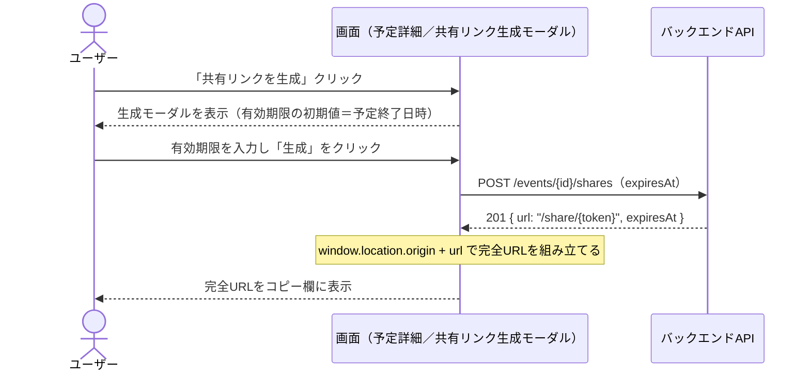
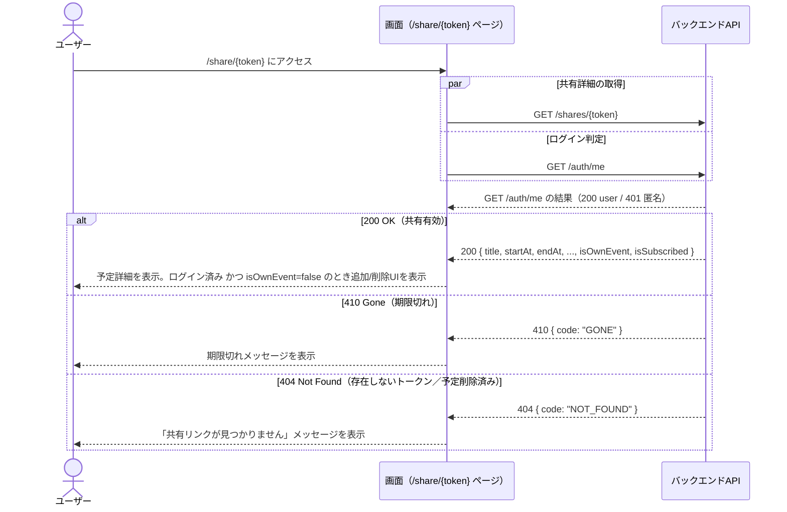
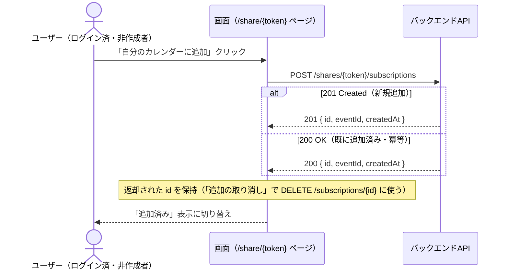
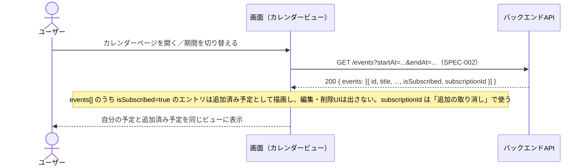
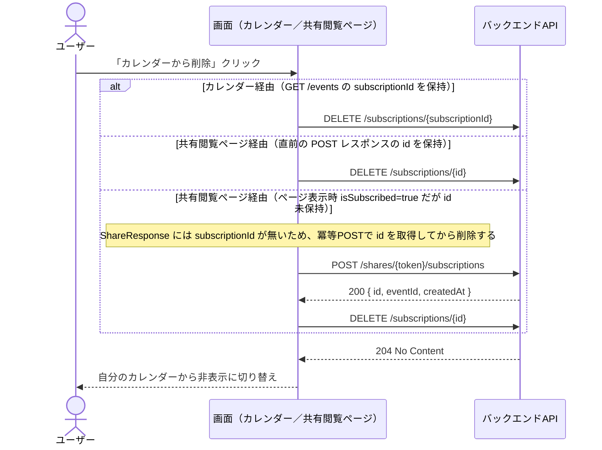
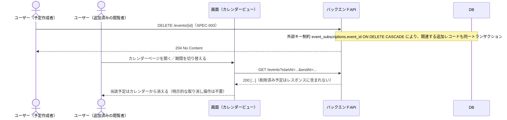

# 予定共有（URLシェア） 仕様書

- 作成日: 2026-09-26
- 更新日: 2026-11-08（新テンプレートに追従し、設計セクションを追記）
- ステータス: アーカイブ

## PRD参照

- PRD: PRD-004 予定共有（`docs/prd/PRD-004-event-sharing.md`）
- Issue: #21

## 対象機能

予定の詳細画面から共有リンクを生成し、URLを知っている第三者がログイン不要で予定情報（タイトル・日時・場所・メモ）を閲覧できる機能。共有リンクには有効期限があり、期限切れ後はアクセスできない。ログイン済みユーザーは、共有された予定を自分のカレンダーに追加でき、追加後も共有元の変更に同期する。

## 詳細仕様

### 基本フロー

#### 共有リンクの生成

1. 予定の詳細表示モーダルで「共有リンクを生成」ボタンをクリックする
2. メモ欄の内容も共有される旨の確認メッセージを表示する
3. 有効期限が予定終了日時であらかじめ入力された状態で表示され、ユーザーは任意の未来日時に変更できる
4. 生成を確定すると、ユニークなトークンを持つ共有リンク（URL）が発行される
5. 発行された共有リンクがコピー可能な形で画面に表示される
6. 同一の予定に対して複数回生成を行うと、既存の有効な共有リンクを失効させずに新しいリンクを追加発行する

#### 共有リンクの閲覧

1. 発行されたURL（`/share/{token}` 形式）にアクセスする
2. ログインなしで予定の詳細（タイトル・日時・場所・メモ）を閲覧できる
3. 編集・削除など操作系のUIは表示されない（閲覧専用）

#### 有効期限切れの場合

1. 有効期限を過ぎたトークンでアクセスすると、期限切れメッセージを表示する
2. 予定の詳細情報は表示しない

#### 予定の自分のカレンダーへの追加

1. ログイン済みユーザーが共有リンクの詳細閲覧画面を開くと、「自分のカレンダーに追加」ボタンが表示される
2. 予定作成者本人が自分の予定への共有リンクを開いた場合、このボタンは表示しない
3. ボタンをクリックすると、共有元の予定への参照を自分のカレンダーに追加する
4. 追加した予定は自分のカレンダービュー上に、共有元と同じタイトル・日時・場所・メモで表示される
5. 同じ共有元の予定に対して重ねて追加操作を行った場合、新たな重複エントリは作成せず、既存の追加済み状態のままとする

#### 追加した予定の表示・同期

1. 共有元の予定のタイトル・日時・場所・メモが変更されると、追加したユーザーのカレンダー表示にも反映される
2. 追加した予定はカレンダービュー上で編集・削除の操作ボタンを表示しない（閲覧のみ）

#### 追加の取り消し

1. 追加した予定の詳細表示から「カレンダーから削除」操作ができる
2. 取り消すと自分のカレンダーから当該予定の表示が消える
3. 取り消しは共有元の予定・共有リンクには一切影響しない

#### 共有元の予定が削除された場合（追加済み予定への影響）

1. 共有元の予定が削除されると、追加していた全ユーザーのカレンダーから当該予定の表示が消える（利用者側の明示的な取り消し操作は不要）

### 制約条件

- 共有リンクの閲覧者は予定の編集・削除ができない（閲覧専用）
- 共有リンク生成時にメモ欄の内容も共有される旨をユーザーに明示する（生成確定前に表示する）
- トークンは推測困難なランダム値とする。生成方式はADR-028で定める（`crypto/rand`によるランダム値、DBにはSHA-256ハッシュのみ保存）
- 1つの予定に対して複数の共有リンクを同時に有効な状態で発行できる（新規発行は既存リンクを失効させない）
- 有効期限は生成時にデフォルトで予定終了日時が設定され、ユーザーが任意の未来日時に変更できる
- 有効期限に指定できるのは予定の開始日時以降の未来日時のみとする
- 共有リンク生成から相手に送るまで30秒以内に完了できる操作フローとする（PRD成功指標）
- 「自分のカレンダーに追加」操作はログイン済みユーザーのみ利用できる
- 追加した予定は共有元への参照による同期表示専用であり、値を個別に編集・上書きすることはできない
- 追加は共有元予定1件につき、閲覧ユーザー1人あたり1エントリまでとする（重複追加不可）
- 追加後の同期は共有リンク（トークン）の有効期限に依存しない。有効期限は新規追加の入口を制御するものであり、有効期限が切れても既に追加済みの予定の同期表示は継続する
- 共有リンクの詳細画面から自分のカレンダーへの追加が3クリック以内で完了できる操作フローとする（PRD成功指標）

### エッジケース・境界値

- 存在しないトークンでアクセスした場合: 期限切れメッセージと同様に、予定の詳細情報を表示しない
- 有効期限ちょうどの日時にアクセスした場合: 期限切れ扱いとする（有効期限を含まない）
- 有効期限に予定の開始日時より前の日時を指定しようとした場合: バリデーションエラーを表示し、生成を阻止する
- 予定自体が削除された場合: 発行済みの共有リンクも無効化し、アクセス時に期限切れと同様のメッセージを表示する
- 追加操作時点で共有リンクが既に期限切れの場合: 詳細画面自体が表示されないため、追加操作を行えない
- 同一予定に対する複数の共有リンク（別トークン）経由でそれぞれ追加操作を行った場合: 新規エントリを作らず、既存の追加済み状態を維持する
- 共有元の予定が追加操作の直前に削除された場合: 対象が見つからないエラーとして扱う
- 予定作成者が自分の予定への共有リンクを開いた場合: 「自分のカレンダーに追加」ボタンを表示しない

## 設計

### ドメインモデル

- `EventShare`（エンティティ）— 共有リンク1件を表す。`Event` 集約とは別集約で、対象予定ID・トークンハッシュ・有効期限を持つ。用語・ビジネスルールは [`docs/domain/eventshare.md`](../domain/eventshare.md) を参照
- `EventSubscription`（エンティティ）— 共有リンク経由でユーザーが自分のカレンダーに追加した状態を表す。`Event` 集約とは別集約で、対象予定ID・追加したユーザーIDのみを持ち、タイトル等の表示値は常に `Event` 側を参照する。用語・ビジネスルールは [`docs/domain/eventsubscription.md`](../domain/eventsubscription.md) を参照
- トークンの生成・保存方式（ランダム32バイト＋base64url / DBはSHA-256ハッシュのみ）: [ADR-028](../adr/ADR-028-event-share-token.md)

### DB設計

| テーブル | カラム | 型 | 制約 | 備考 |
|---|---|---|---|---|
| event_shares | id | UUID | PRIMARY KEY, DEFAULT `uuid_generate_v4()` | 共有リンクID |
| event_shares | event_id | UUID | NOT NULL, REFERENCES `events(id)` ON DELETE CASCADE | 共有対象の予定。予定が削除されたら共有リンクも削除 |
| event_shares | token_hash | TEXT | NOT NULL, UNIQUE | トークンのSHA-256ハッシュ（ADR-028）。平文トークンはDBに保存しない |
| event_shares | expires_at | TIMESTAMPTZ | NOT NULL | 有効期限（この値ちょうども失効扱い） |
| event_shares | created_at | TIMESTAMPTZ | NOT NULL, DEFAULT `NOW()` | - |
| event_shares | （インデックス） | - | `idx_event_shares_event_id` on (`event_id`) | 予定単位の検索用 |
| event_subscriptions | id | UUID | PRIMARY KEY, DEFAULT `uuid_generate_v4()` | 追加レコードID。DELETE `/subscriptions/{id}` のパスパラメータに使う |
| event_subscriptions | event_id | UUID | NOT NULL, REFERENCES `events(id)` ON DELETE CASCADE | 追加対象の予定。予定が削除されたら追加も削除（「共有元の予定が削除された場合」の挙動） |
| event_subscriptions | user_id | UUID | NOT NULL, REFERENCES `users(id)` ON DELETE CASCADE | 追加したユーザー |
| event_subscriptions | created_at | TIMESTAMPTZ | NOT NULL, DEFAULT `NOW()` | - |
| event_subscriptions | （複合UNIQUE） | - | UNIQUE (`event_id`, `user_id`) | 同一予定を同一ユーザーが重複追加できないよう保証 |
| event_subscriptions | （インデックス） | - | `idx_event_subscriptions_user_id` on (`user_id`) | ユーザー単位の一覧（カレンダー表示）用 |

### API設計

エラーレスポンスの共通構造（`code` / `message` / `details`）は [ADR-013](../adr/ADR-013-api-error-structure.md) を参照。

| メソッド | パス | 認証 | リクエスト | レスポンス | エラー（HTTPステータス） |
|---|---|---|---|---|---|
| POST | /events/{id}/shares | セッションCookie（必須） | `expiresAt`（ISO 8601、省略可。省略時は予定終了日時） | 201: `{ url: "/share/{token}", expiresAt }` | 400（バリデーション: `BEFORE_EVENT_START`・`NOT_IN_FUTURE`、無効なpath id、リクエストボディ不正）、401、404（予定が存在しない／他ユーザーの予定）、500 |
| GET | /shares/{token} | 任意（[ADR-030](../adr/ADR-030-optional-auth-middleware.md) の `OptionalAuth`） | - | 200: `{ title, description?, startAt, endAt, location?, url?, isOwnEvent, isSubscribed }`。`isOwnEvent`・`isSubscribed` は未認証時は `false` | 404（トークン不一致・予定削除済み）、410（有効期限切れ）、500 |
| POST | /shares/{token}/subscriptions | セッションCookie（必須） | - | 201: `{ id, eventId, createdAt }`（新規作成）/ 200: 同じ形（既存を返す冪等呼び出し） | 401、403（作成者本人による自分の予定の追加）、404、410、500 |
| DELETE | /subscriptions/{id} | セッションCookie（必須） | - | 204: ボディ無し | 400（無効なpath id）、401、403（他ユーザーのサブスクリプション）、404、500 |

#### POST /events/{id}/shares

##### リクエスト

| 場所 | フィールド | 型 | 必須 | 制約 | 説明 |
|---|---|---|---|---|---|
| cookie | session_id | string | 必須 | 平文のセッショントークン | `RequireAuth` ミドルウェアが検証する |
| path | id | string(uuid) | 必須 | UUID形式 | 共有リンクを発行する予定のID |
| body | expiresAt | string(date-time) \| null | 任意 | ISO 8601、`BEFORE_EVENT_START`（予定の開始日時以降）と `NOT_IN_FUTURE`（現在時刻より後）の両方を満たすこと。省略／null時は予定終了日時を使い、この2バリデーションはスキップされる | 共有リンクの有効期限 |

リクエストボディ全体の省略も許容する（その場合は `expiresAt` 省略と同じ扱い）。

##### レスポンス（201 Created）

| フィールド | 型 | null許容 | 説明 |
|---|---|---|---|
| url | string | 否 | 共有リンクのパス（`/share/{token}` 形式）。クライアントは `window.location.origin` を前置して完全URLを組み立てる |
| expiresAt | string(date-time) | 否 | 発行された共有リンクの有効期限（ISO 8601） |

##### エラー

| HTTPステータス | code | details[].code | 発生条件 |
|---|---|---|---|
| 400 | VALIDATION_ERROR | - | path `id` がUUIDとしてパースできない |
| 400 | VALIDATION_ERROR | - | リクエストボディがJSONとしてデコードできない |
| 400 | VALIDATION_ERROR | BEFORE_EVENT_START | `expiresAt` が予定の開始日時より前 |
| 400 | VALIDATION_ERROR | NOT_IN_FUTURE | `expiresAt` が現在時刻以前 |
| 401 | UNAUTHORIZED | - | 未認証（セッションCookieが無い／無効） |
| 404 | NOT_FOUND | - | 指定したIDの予定が存在しない、または他ユーザーの予定（情報漏洩防止のため区別しない） |
| 500 | INTERNAL_ERROR | - | 想定外のサーバーエラー |

#### GET /shares/{token}

##### リクエスト

| 場所 | フィールド | 型 | 必須 | 制約 | 説明 |
|---|---|---|---|---|---|
| path | token | string | 必須 | - | 共有リンクのトークン（平文） |
| cookie | session_id | string | 任意 | - | 認証任意（[ADR-030](../adr/ADR-030-optional-auth-middleware.md) の `OptionalAuth`）。Cookieが無い／無効でも 401 にはならず、未認証として処理する |

##### レスポンス（200 OK）

| フィールド | 型 | null許容 | 説明 |
|---|---|---|---|
| title | string | 否 | 予定のタイトル |
| description | string | 否（空のときはフィールドごと省略する） | 予定のメモ |
| startAt | string(date-time) | 否 | 開始日時 |
| endAt | string(date-time) | 否 | 終了日時 |
| location | string | 否（空のときはフィールドごと省略する） | 場所 |
| url | string | 否（空のときはフィールドごと省略する） | 予定のURL |
| isOwnEvent | boolean | 否 | 認証済みの閲覧者が予定作成者本人のとき `true`。未認証時は `false` |
| isSubscribed | boolean | 否 | 認証済みの閲覧者が既に自分のカレンダーに追加済みのとき `true`。未認証時は `false` |

##### エラー

| HTTPステータス | code | details[].code | 発生条件 |
|---|---|---|---|
| 404 | NOT_FOUND | - | path `token` に一致する共有リンクが存在しない（`EVENT_SHARE_NOT_FOUND`）、または共有リンク取得後のロード直前で予定が削除されている（`EVENT_NOT_FOUND`。ON DELETE CASCADE により通常は起き得ないレアケース） |
| 410 | GONE | - | 共有リンクの有効期限が過ぎている（`EVENT_SHARE_EXPIRED`） |
| 500 | INTERNAL_ERROR | - | 想定外のサーバーエラー |

#### POST /shares/{token}/subscriptions

##### リクエスト

| 場所 | フィールド | 型 | 必須 | 制約 | 説明 |
|---|---|---|---|---|---|
| cookie | session_id | string | 必須 | 平文のセッショントークン | `RequireAuth` ミドルウェアが検証する |
| path | token | string | 必須 | - | 共有リンクのトークン（平文） |
| body | - | - | - | - | なし |

##### レスポンス（201 Created: 新規追加 / 200 OK: 既存を返す冪等呼び出し）

201・200 どちらも同じボディを返す。

| フィールド | 型 | null許容 | 説明 |
|---|---|---|---|
| id | string(uuid) | 否 | サブスクリプションID。クライアントは「追加の取り消し」で `DELETE /subscriptions/{id}` に渡す |
| eventId | string(uuid) | 否 | 追加した予定のID |
| createdAt | string(date-time) | 否 | 追加日時 |

##### エラー

| HTTPステータス | code | details[].code | 発生条件 |
|---|---|---|---|
| 401 | UNAUTHORIZED | - | 未認証（本エンドポイントは必須認証） |
| 403 | FORBIDDEN | - | 予定作成者本人が自分の予定を追加しようとした（`EVENT_SUBSCRIPTION_OWN_EVENT`） |
| 404 | NOT_FOUND | - | path `token` に一致する共有リンクが存在しない、または予定が削除されている |
| 410 | GONE | - | 共有リンクの有効期限が過ぎている |
| 500 | INTERNAL_ERROR | - | 想定外のサーバーエラー |

#### DELETE /subscriptions/{id}

##### リクエスト

| 場所 | フィールド | 型 | 必須 | 制約 | 説明 |
|---|---|---|---|---|---|
| cookie | session_id | string | 必須 | 平文のセッショントークン | `RequireAuth` ミドルウェアが検証する |
| path | id | string(uuid) | 必須 | UUID形式 | 削除対象のサブスクリプションID |
| body | - | - | - | - | なし |

##### レスポンス（204 No Content）

ボディなし。

##### エラー

| HTTPステータス | code | details[].code | 発生条件 |
|---|---|---|---|
| 400 | VALIDATION_ERROR | - | path `id` がUUIDとしてパースできない |
| 401 | UNAUTHORIZED | - | 未認証 |
| 403 | FORBIDDEN | - | 他ユーザーのサブスクリプションを削除しようとした（`EVENT_SUBSCRIPTION_NOT_OWNER`） |
| 404 | NOT_FOUND | - | 指定したIDのサブスクリプションが存在しない（`EVENT_SUBSCRIPTION_NOT_FOUND`） |
| 500 | INTERNAL_ERROR | - | 想定外のサーバーエラー |

#### GET /events（SPEC-004で追加したフィールド）

エンドポイント全体の仕様はSPEC-002を参照。SPEC-004の実装で各要素に追加したフィールドは以下。

| フィールド | 型 | null許容 | 説明 |
|---|---|---|---|
| events[].isSubscribed | boolean | 否 | 共有リンク経由で追加した予定なら `true`、自分で作成した予定なら `false` |
| events[].subscriptionId | string(uuid) | 可 | `isSubscribed=true` のときのみ非null。`DELETE /subscriptions/{id}` のパスパラメータに使う |

#### API呼び出しシーケンス

##### 共有リンクの生成

##### 共有リンクの閲覧（有効期限切れ・存在しないトークンを含む）

##### 予定の自分のカレンダーへの追加

##### 追加した予定の表示・同期

##### 追加の取り消し

##### 共有元の予定が削除された場合（追加済み予定への影響）

