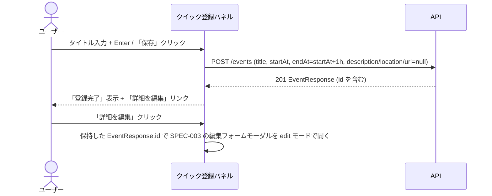

# クイック登録パネル 仕様書

- 作成日: 2026-09-26
- 更新日: 2026-11-08（新テンプレートに追従し、設計セクションを追記）
- ステータス: アーカイブ

## PRD参照

- PRD: PRD-005 クイック登録パネル（`docs/prd/PRD-005-quick-registration.md`）
- Issue: #22

## 対象機能

週ビューの時間軸上をクリックすると、タイトル入力のみのクイック登録パネルがクリック位置にポップアップし、Enterキーまたは「保存」ボタンで即座に予定を仮登録できる機能。登録後は「詳細を編集」リンクから通常の編集フォーム（SPEC-003）へ遷移できる。

## 詳細仕様

### 基本フロー

1. 週ビューの時間軸上の空きセルをクリックする
2. クリックした日時を開始日時として、クリック位置付近にクイック登録パネルがポップアップ表示される
3. パネルにはタイトル入力欄のみが表示され、自動的にフォーカスが当たる
4. タイトルを入力し、Enterキーまたは「保存」ボタンをクリックする
5. クリックした日時を開始日時、開始日時の1時間後を終了日時として予定を登録する
6. パネルは登録完了状態に切り替わり、「詳細を編集」リンクを表示する
7. 登録した予定がカレンダービューに即時反映される
8. 「詳細を編集」リンクをクリックすると、登録済みの予定の編集フォームモーダル（SPEC-003）が開く

### 制約条件

- 本機能は週ビューの時間軸クリックのみに適用する。月ビューの日付セルクリックは対象外とし、既存の動作（作成フォームモーダルを開く）を維持する
- 週ビューの既存予定をクリックした場合は対象外とし、既存の動作（詳細表示モーダルを開く）を維持する
- パネルの入力項目はタイトルのみとする。開始日時はクリック位置から自動設定し、終了日時は開始日時の1時間後を自動設定する（メモ・場所・URLは扱わない）
- タイトルは必須入力とする
- クリックからEnter押下（登録完了）まで10秒以内に操作できること（PRD成功指標）
- APIエラー時はパネル内にエラーメッセージを表示し、パネルは閉じない

### エッジケース・境界値

- タイトルが空の状態でEnterまたは「保存」を押した場合: バリデーションエラーをパネル内インラインで表示し、登録を阻止する
- パネルを保存前にEscキーまたはパネル外クリックで閉じた場合: 入力内容を破棄し、登録しない
- 登録完了後の状態でEscキーまたはパネル外クリックをした場合: パネルを閉じる（登録済みの予定は残る)
- パネルが開いている状態で別の時間帯セルをクリックした場合: 入力中の内容を破棄し、新しいクリック位置にパネルを開き直す
- 週ビュー上で同一時間帯に既存予定が重なっている場合: 既存予定の表示領域をクリックした場合は詳細表示モーダルを開き、空きセル部分をクリックした場合のみクイック登録パネルを開く

## 設計

### ドメインモデル

なし（SPEC-003 の `Event` エンティティをそのまま利用する）。

### DB設計

なし（SPEC-003 の `events` テーブルをそのまま利用する）。

### API設計

本機能では新規エンドポイントを追加しない。SPEC-003 の `POST /events` を、以下の固定値で呼び出す形で再利用する。

| メソッド | パス | 認証 | リクエスト | レスポンス | エラー（HTTPステータス） |
|---|---|---|---|---|---|
| POST | /events | セッションCookie | `title`（入力値）、`startAt`（クリック位置の日時をISO 8601で指定）、`endAt`（`startAt` + 1時間をISO 8601で指定）、`description`/`location`/`url`（すべて `null`） | 201: `EventResponse`（登録した予定。`id` を含む） | 400（バリデーション）、401（未認証）、500（サーバーエラー） |

#### POST /events

I/Fの全体は SPEC-003 を参照する。エラーレスポンスの共通構造は ADR-013 を参照する。

##### リクエスト（このパネルが送る値のみ）

| 場所 | フィールド | 型 | 必須 | 制約 | 説明 |
|---|---|---|---|---|---|
| body | `title` | string | 必須 | minLength 1 | パネルで入力されたタイトル |
| body | `startAt` | string（date-time, ISO 8601） | 必須 | — | クリックしたセルの日時 |
| body | `endAt` | string（date-time, ISO 8601） | 必須 | `startAt` より厳密に未来 | パネルが `startAt + 1時間` で自動設定する |
| body | `description` | string または null | 任意 | — | 固定で `null`（パネルでは扱わない） |
| body | `location` | string または null | 任意 | — | 固定で `null`（パネルでは扱わない） |
| body | `url` | string または null | 任意 | — | 固定で `null`（パネルでは扱わない） |

##### レスポンス（201 Created、このパネルが使うフィールドのみ）

全体は SPEC-003 を参照する。

| フィールド | 型 | null許容 | 説明 |
|---|---|---|---|
| `id` | string（UUID） | 不可 | 作成した予定のID。「詳細を編集」から SPEC-003 の編集フォームモーダルを `edit` モードで開く際に渡す |

##### エラー（このパネルの入力で起こりうるもの）

`endAt` は `startAt + 1時間` で自動設定するため、日時の逆転による `INVALID_DATE_RANGE` はこのパネルからは発生しない。

| HTTPステータス | code | details[].code | 発生条件 |
|---|---|---|---|
| 400 | `VALIDATION_ERROR` | `REQUIRED`（`details[].field = "title"`） | 空のタイトルが送信された場合（通常はクライアント側バリデーションで防ぐ） |
| 401 | `UNAUTHORIZED` | — | セッションCookieが未設定または無効な場合 |
| 500 | `INTERNAL_ERROR` | — | DB書き込み失敗・レスポンスのJSONエンコード失敗など、サーバー側の予期しないエラー |

#### API呼び出しシーケンス

