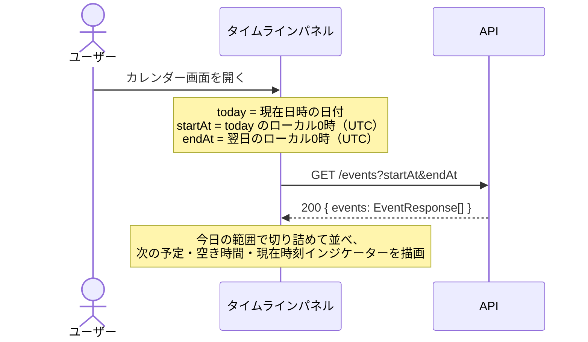
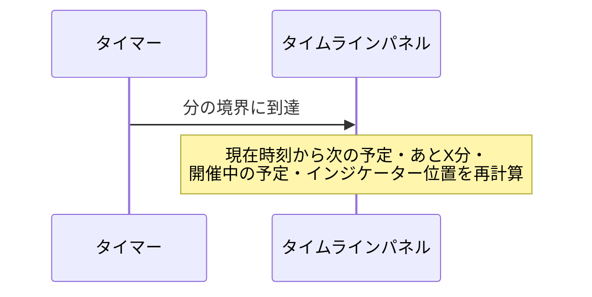
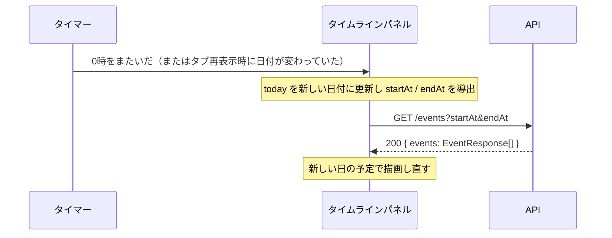
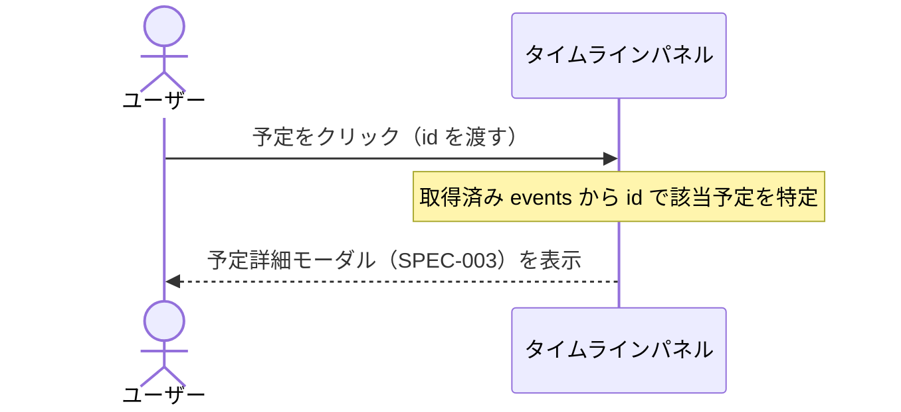

# 今日のタイムライン 仕様書

- 作成日: 2026-11-14
- 更新日: 2026-11-14
- ステータス: PDM合意済

## PRD参照

- PRD: PRD-007 今日のタイムライン（`docs/prd/PRD-007-day-timeline.md`）
- Issue: #25

## 対象機能

カレンダー画面の右側に、今日の予定を時系列リストで表示するタイムラインパネルを常時表示する。パネル上部に「次の予定まであとX分」を、予定と予定の間に空き時間を表示し、現在時刻に合わせて1分単位で更新する。

## 詳細仕様

### 基本フロー

1. カレンダー画面を開くと、月ビュー・週ビューの右側にタイムラインパネルを表示する
2. パネルは、今日（ローカルタイムゾーンの0時〜翌日0時）と重なる予定を開始日時の昇順で並べる。開始日時が同じ予定は終了日時の昇順で並べる
3. 各予定には開始時刻〜終了時刻（`HH:mm`）とタイトルを表示する
4. パネル上部に次の予定のタイトルと「あとX分」を表示する。次の予定は、開始日時が現在時刻より後で、今日の範囲内にある予定のうち最も早いものとする
5. 現在時刻の位置にインジケーター（線と `HH:mm`）を表示する。インジケーターは、開始日時が現在時刻以前の予定の後、開始日時が現在時刻より後の予定の前に置く
6. 開催中の予定（開始日時 ≦ 現在時刻 < 終了日時）を強調表示する
7. 連続する2件の予定の間に空き時間がある場合、その間に「N分の空き」を表示する
8. 予定をクリックすると、カレンダービューと同じ予定詳細モーダル（SPEC-003）を開く。詳細モーダルからの編集・削除・共有はカレンダービューと同じ動作とする
9. 1分ごと（ローカル時刻の分の境界）に、現在時刻インジケーター・「あとX分」・開催中の強調表示・次の予定を再計算して表示し直す

### 制約条件

- パネルはカレンダーのビュー（月・週）や表示期間（「前へ」「次へ」）に関わらず、常に今日の予定を表示する
- 「あとX分」のXは、現在時刻を分単位に切り捨てた時刻から次の予定の開始日時までの分数を切り上げた値とする。60分以上の場合は「あとH時間M分」と表示する
- 空き時間は、先行する予定までの終了日時の最大値から次の予定の開始日時までとする。重なっている予定の間には空き時間を表示しない
- 空き時間は予定と予定の間だけに表示し、0時〜最初の予定、最後の予定〜24時の間には表示しない
- 購読予定（`isSubscribed = true`）も自分の予定と同じように表示し、空き時間・次の予定の計算に含める
- タグによる絞り込みはパネルに適用しない。今日の全予定を表示する
- 予定の作成・編集・削除・購読の解除をした後は、カレンダービューと同じタイミングでパネルにも反映する
- PC・タブレットのブラウザ表示に最適化する（スマートフォンは対象外。SPEC-002と同じ）
- 画面を開いてから、今日の予定と次の予定までの時間が3秒以内に表示されること（PRD成功指標）

### エッジケース・境界値

- 今日の予定が0件の場合: パネル上部に「今日の予定はありません」を表示し、リストには現在時刻インジケーターだけを表示する
- 今日の残りの予定がない（次の予定がない）場合: パネル上部に「今日の予定はもうありません」を表示する
- 前日から続く予定・翌日まで続く予定: 今日と重なる部分だけを扱う。前日から続く予定の開始時刻は「前日から」、翌日まで続く予定の終了時刻は「翌日まで」と表示する。空き時間の計算には今日の範囲で切り詰めた日時を使う
- 開始日時と終了日時が同じ予定: 開始時刻だけを表示する。空き時間の計算では開始日時＝終了日時の予定として扱う
- 開始日時がちょうど現在時刻（分単位）の予定: 次の予定ではなく開催中の予定として扱う
- 日付が変わった場合（0時をまたいだ場合）: パネルの対象を新しい日に切り替え、予定を取得し直す
- ブラウザのタブが非表示の間に時刻が進んだ場合: タブが再表示された時点で現在時刻を再計算して表示し直す（日付が変わっていれば前項に従う）
- 予定の取得中: パネル内にローディング表示を出す
- 予定の取得に失敗した場合: パネル内にエラーメッセージを表示する。カレンダービュー側の表示には影響させない
- タイトルが長い場合: 省略（`...`）して表示する

## 設計

### ドメインモデル

なし（[Event ドメイン](../domain/event.md)をそのまま利用する）。今日の範囲・空き時間・次の予定はクライアントで計算する表示用の値で、ドメインには追加しない。

### DB設計

なし（SPEC-002・SPEC-003 の `events` テーブルをそのまま利用する）。

### API設計

本機能では新規エンドポイントを追加しない。SPEC-002 の `GET /events` を、今日の範囲を指定して呼び出す。

| メソッド | パス | 認証 | リクエスト | レスポンス | エラー（HTTPステータス） |
|---|---|---|---|---|---|
| GET | `/events` | セッションCookie必須 | クエリ: `startAt`（今日のローカル0時をUTCに変換）、`endAt`（翌日のローカル0時をUTCに変換） | 200: `{ events: EventResponse[] }` | 400: クエリ不正 / 401: 未認証 / 500: 内部エラー |

#### GET /events

I/Fの全体は SPEC-002（`tagId` は SPEC-008）を参照する。日時の形式は ADR-036 に従う。

##### リクエスト（このパネルが送る値のみ）

| 場所 | フィールド | 型 | 必須 | 制約 | 説明 |
|---|---|---|---|---|---|
| query | `startAt` | string | 必須 | RFC3339、末尾 `Z`（UTC） | 今日のローカル0時をUTCに変換した値 |
| query | `endAt` | string | 必須 | RFC3339、末尾 `Z`（UTC） | 翌日のローカル0時をUTCに変換した値 |

`tagId` は送らない。

##### レスポンス（200 OK、このパネルが使うフィールドのみ）

| フィールド | 型 | null許容 | 説明 |
|---|---|---|---|
| `events[].id` | string (uuid) | 否 | クリック時に詳細モーダルへ渡す予定を特定する |
| `events[].title` | string | 否 | リストと「次の予定」に表示する |
| `events[].startAt` | string (date-time, RFC3339, UTC) | 否 | 並び順・開始時刻・次の予定・空き時間の計算に使う |
| `events[].endAt` | string (date-time, RFC3339, UTC) | 否 | 終了時刻・開催中の判定・空き時間の計算に使う |

詳細モーダルには、取得した `EventResponse` をそのまま渡す。

##### エラー（このパネルのリクエストで起こりうるもの）

`startAt` / `endAt` はパネルが計算して送るため、400 は通常発生しない。

| HTTPステータス | code | details[].code | 発生条件 |
|---|---|---|---|
| 400 | `VALIDATION_ERROR` | - | `startAt` または `endAt` が RFC3339（UTC）として解釈できない、または `endAt` が `startAt` 以前 |
| 401 | `UNAUTHORIZED` | - | セッションCookieが無い、無効、または対応するユーザーを解決できない |
| 500 | `INTERNAL_ERROR` | - | 下位層のクエリ実行失敗、またはレスポンスのJSONエンコードに失敗 |

#### API呼び出しシーケンス

##### パネル初期表示

カレンダービュー用の `GET /events` とは別に、今日の範囲で1回呼び出す。

##### 1分ごとの更新

API は呼び出さず、取得済みの `events` から再計算する。

##### 日付の切り替え

##### 予定クリック（詳細表示）

