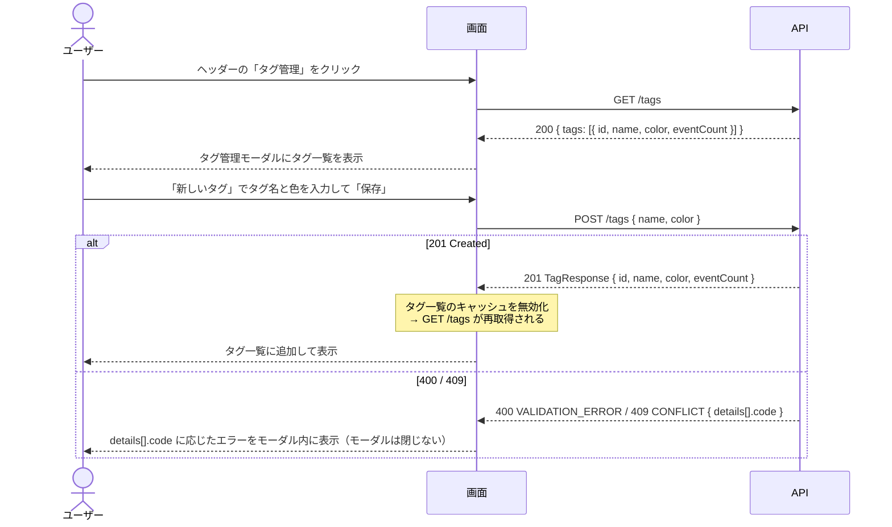
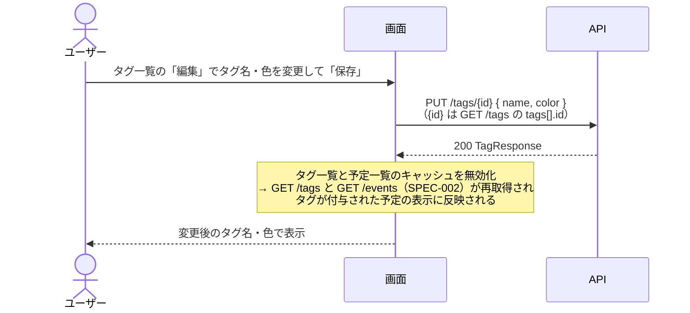
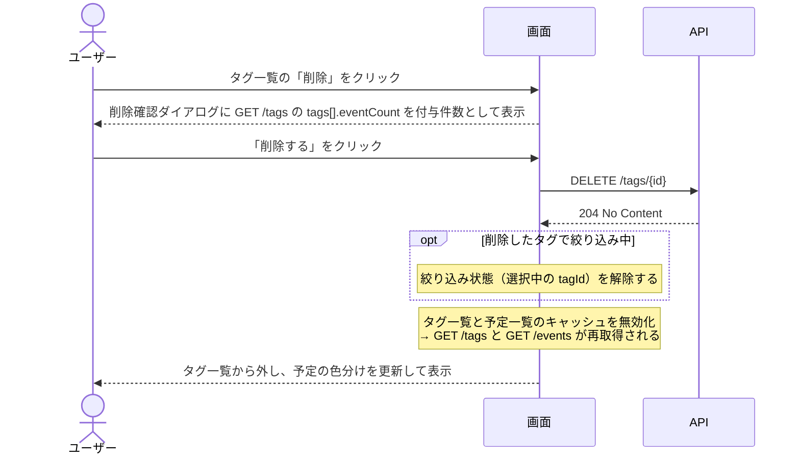
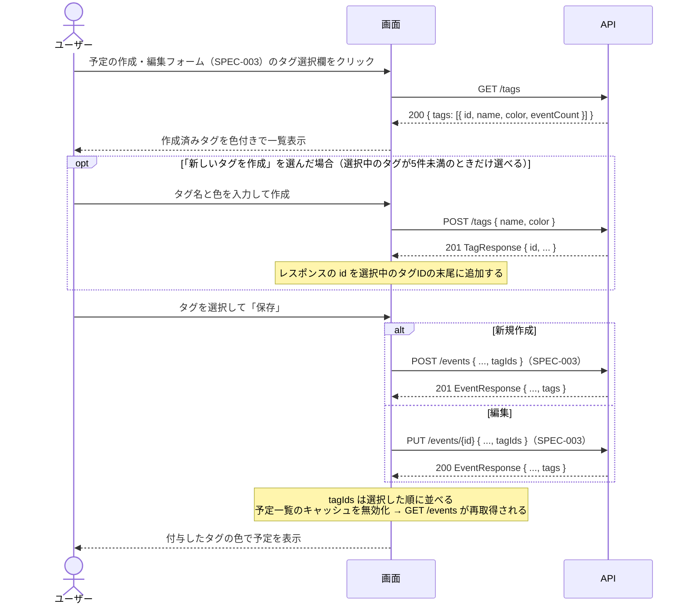
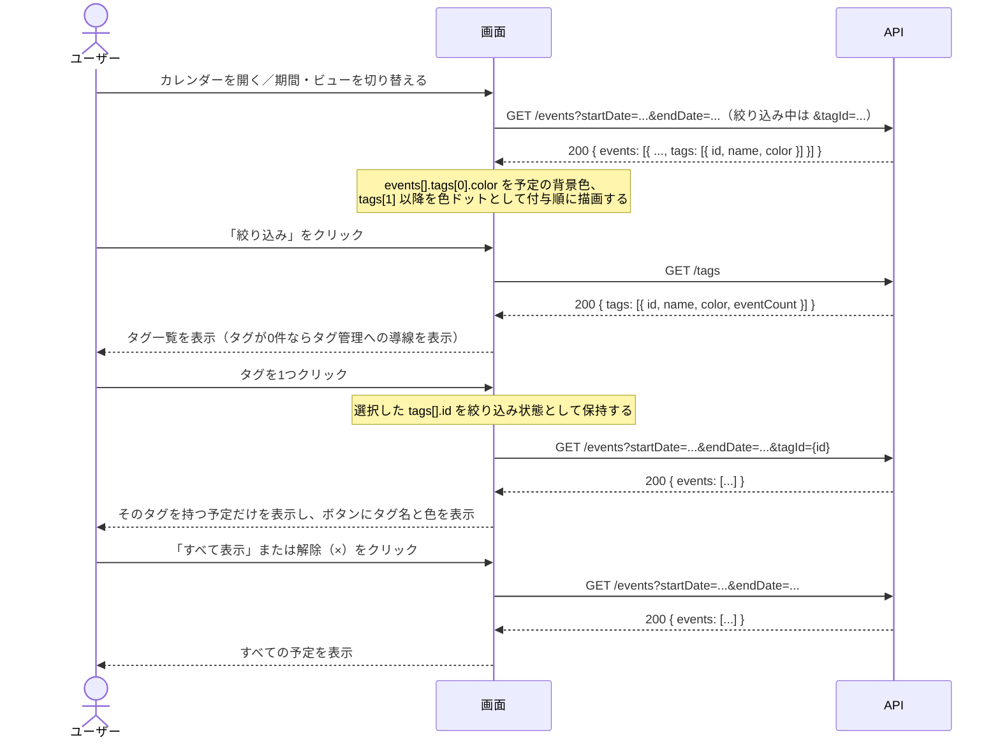

# タグ＆カラーラベル 仕様書

- 作成日: 2026-11-08
- 更新日: 2026-11-08（新テンプレートに追従し、設計セクションを追記）
- ステータス: PDM合意済

## PRD参照

- PRD: PRD-008 タグ＆カラーラベル（`docs/prd/PRD-008-tags-labels.md`）
- Issue: #24

## 対象機能

ユーザーが個人用のタグを作成し、プリセットパレットから色を割り当て、予定に最大5つまで付与できる機能。カレンダービュー（SPEC-002）上では予定がタグの色で色分け表示され、タグを1つ選んで絞り込むと、そのタグを持つ予定のみを表示できる。

## 詳細仕様

### 基本フロー

#### タグの作成

1. カレンダービューのヘッダーにある「タグ管理」ボタンをクリックすると、タグ管理モーダルが開く
2. 「新しいタグ」ボタンをクリックすると、タグ名入力欄とカラーパレットが表示される
3. タグ名を入力し、パレットから色を1つ選ぶ
4. 「保存」ボタンをクリックするとタグを登録し、タグ一覧に追加される

#### タグの編集

1. タグ管理モーダルのタグ一覧から対象タグの「編集」をクリックする
2. タグ名・色を変更して「保存」をクリックすると更新する
3. 変更はそのタグが付与されたすべての予定のカレンダー表示に即時反映される

#### タグの削除

1. タグ管理モーダルのタグ一覧から対象タグの「削除」をクリックする
2. 削除確認ダイアログが表示される（「削除する」「キャンセル」の2択）。そのタグが付与されている予定の件数を併せて表示する
3. 「削除する」をクリックするとタグを削除し、すべての予定からそのタグの付与を外す（予定自体は削除しない）
4. 削除したタグで絞り込み中だった場合、絞り込みを解除する

#### 予定へのタグ付与

1. 予定の作成・編集フォーム（SPEC-003）にタグ選択欄を表示する
2. タグ選択欄をクリックすると、作成済みタグの一覧（色付き）が表示され、チェックで複数選択できる
3. 選択した順にタグが並び、並び順をそのまま付与順として保存する
4. タグ選択欄から「新しいタグを作成」を選ぶと、フォームを離れずにタグ名と色を指定してタグを作成し、そのまま選択状態にできる
5. 予定の詳細表示モーダルには、付与されたタグを付与順に色付きラベルで表示する

#### カレンダー上の色分け表示

1. タグが付与された予定は、月ビュー・週ビューともに先頭（付与順1番目）のタグの色を予定の背景色として表示する
2. 2番目以降のタグは、予定表示内に小さな色ドットとして付与順に並べて表示する
3. タグが付与されていない予定は、従来どおりのデフォルト色で表示する

#### タグによる絞り込み

1. カレンダービューのヘッダーに「絞り込み」ボタンを常時表示する
2. 「絞り込み」ボタンをクリックすると、作成済みタグの一覧（色付き）が表示される
3. タグを1つクリックすると、そのタグを持つ予定のみをカレンダーに表示する（2タップで完了）
4. 絞り込み中は「絞り込み」ボタンに選択中のタグ名と色を表示する
5. 絞り込み中に別のタグを選ぶと、選んだタグの絞り込みに切り替わる（同時に選べるタグは1つのみ）
6. 一覧の「すべて表示」を選ぶか、ボタン上の解除（×）をクリックすると絞り込みを解除する

### 制約条件

- タグはユーザー個人の設定として管理し、他ユーザーとは共有しない
- タグはフラット構造のみとし、階層構造は持たない
- タグ名は必須入力で、1〜20文字とする（前後の空白は除去してから判定する）
- タグ名は同一ユーザー内で重複不可とする（大文字・小文字は区別しない）
- 1ユーザーが作成できるタグは最大50個とする（絞り込み一覧・タグ選択欄からタグを探して選べる量に収め、2タップ以内の絞り込み（PRD成功指標）を保つため。あわせて、1ユーザーあたりのデータ量に上限を設ける）
- タグの色は、文字とのコントラスト比を確保したプリセットパレット（12色）から選ぶ。任意の色（カラーピッカー）は指定できない
- 1予定に付与できるタグは最大5個とする（PRDの制約。タグが増えすぎるとカレンダー上の予定表示に色ドットが収まらず、色分けが一目でわからなくなる（PRD成功指標）ため）
- 絞り込みで同時に選択できるタグは1つのみとする
- 絞り込み状態は画面内の一時的な状態とし、ページ再読み込みやログアウトで解除する。月/週のビュー切り替えや前後移動の間は維持する
- 絞り込み操作は「絞り込み」ボタン → タグ選択の2タップ以内で完了すること（PRD成功指標）
- タグの作成・編集・削除・付与の各操作でAPIエラーが発生した場合は、モーダル内にエラーメッセージを表示し、モーダルは閉じない
- 共有リンクから自分のカレンダーに追加した予定（SPEC-004）はタグ付与の対象外とする（閲覧専用のため）
- 共有リンクの閲覧画面（SPEC-004）にはタグを表示しない（タグは個人の設定のため）

### エッジケース・境界値

- タグ名が空、または空白のみで保存しようとした場合: バリデーションエラーをインラインで表示し、保存を阻止する
- タグ名が21文字以上の場合: バリデーションエラーをインラインで表示し、保存を阻止する
- 既存タグと同名（大文字・小文字違いを含む）で作成・編集しようとした場合: 重複エラーをインラインで表示し、保存を阻止する
- タグが50個ある状態で新規作成しようとした場合: 上限に達した旨を表示し、作成を阻止する
- 予定にタグが5個付与された状態: 未選択のタグと「新しいタグを作成」を選択不可（無効表示）にし、上限に達した旨を表示する
- 異なるタグに同じ色を設定した場合: 許容する（色の重複は制限しない）
- タグが1つも作成されていない状態で「絞り込み」ボタンを押した場合: タグがない旨と「タグ管理」への導線を表示する
- 絞り込み中のタグを持つ予定が表示範囲（月・週）に1件もない場合: 空のカレンダーを表示し、絞り込み中であることがわかる状態を維持する
- 絞り込み中に予定を編集して、選択中のタグを外した場合: 保存後、その予定はカレンダーから非表示になる
- 絞り込み中は、タグが付与されていない予定と共有から追加した予定は表示しない
- 先頭タグを外した場合: 次のタグが先頭になり、背景色もそのタグの色に切り替わる
- 予定を削除した場合: その予定へのタグ付与も削除する（タグ自体は残る）
- 週ビューで予定ブロックが小さく色ドットを表示しきれない場合: 表示可能な分だけドットを表示し、残りは省略する（全タグは詳細表示モーダルで確認できる）
- クイック登録パネル（SPEC-005）で作成した予定: タグなしで登録され、「詳細を編集」から通常フォームで付与できる

## 設計

### ドメインモデル

- `Tag`（エンティティ）— ユーザーが作成するタグ1件を表す集約ルート。`Event` 集約とは別集約で、`id` / `userId` / `name`（`TagName`）/ `color`（`TagColor`）を持つ。用語・ビジネスルール・エラーは [Tag ドメイン](../domain/tag.md) を参照する
  - `TagName`（値オブジェクト）— 前後の空白を除去したうえで 1〜20 文字
  - `TagColor`（値オブジェクト）— プリセット12色の HEX 6 文字（大文字、`#` なし）のいずれか
- `EventTag`（エンティティ）— 予定へのタグ付与1件を表す。`Event` 集約の配下に置き、`tagId` / `position`（付与順）を持つ。付与に関するルールは [Event ドメイン](../domain/event.md) を参照する
- 本仕様で守る不変条件:
  - `TagName` は同一ユーザー内で一意（大文字・小文字を区別しない）
  - 1ユーザーが保有する `Tag` は最大50件
  - 1件の `Event` に付与する `EventTag` は最大5件で、同一 `Tag` を重複して付与できない
  - `position` は 1〜5 の範囲で、1件の `Event` 内で一意。`position` の昇順を付与順とする（タグの削除で欠番が生じても順序は保たれる）
  - `EventTag` が参照する `Tag` の所有ユーザーは、`Event` の所有ユーザーと一致する

### DB設計

| テーブル | カラム | 型 | 制約 | 備考 |
|---|---|---|---|---|
| `tags` | `id` | `UUID` | PRIMARY KEY, DEFAULT `uuid_generate_v4()` | タグID |
| `tags` | `user_id` | `UUID` | NOT NULL, REFERENCES `users(id)` ON DELETE CASCADE | 所有ユーザー。ユーザー削除でタグも削除 |
| `tags` | `name` | `TEXT` | NOT NULL | タグ名。前後の空白を除去して保存する。文字数はドメイン層で検証 |
| `tags` | `color` | `CHAR(6)` | NOT NULL | プリセット12色の HEX 6 文字。値域はアプリケーション層（OpenAPI の `TagColor` enum）で検証（ADR-019） |
| `tags` | `created_at` | `TIMESTAMPTZ` | NOT NULL, DEFAULT `NOW()` | 作成日時 |
| `tags` | `updated_at` | `TIMESTAMPTZ` | NOT NULL, DEFAULT `NOW()`, トリガー `update_tags_updated_at` で UPDATE 時に自動更新 | 更新日時 |
| `tags` | （UNIQUEインデックス） | - | `idx_tags_user_id_lower_name` UNIQUE on (`user_id`, `LOWER(name)`) | 大文字・小文字を区別しないタグ名の一意制約。ユーザー単位のタグ一覧取得にも使う |
| `event_tags` | `event_id` | `UUID` | NOT NULL, REFERENCES `events(id)` ON DELETE CASCADE | 付与先の予定。予定削除で付与も削除 |
| `event_tags` | `tag_id` | `UUID` | NOT NULL, REFERENCES `tags(id)` ON DELETE CASCADE | 付与するタグ。タグ削除で付与も削除（予定は残る） |
| `event_tags` | `position` | `SMALLINT` | NOT NULL | 付与順（1〜5）。範囲はドメイン層で検証 |
| `event_tags` | `created_at` | `TIMESTAMPTZ` | NOT NULL, DEFAULT `NOW()` | 付与日時 |
| `event_tags` | （主キー） | - | PRIMARY KEY (`event_id`, `tag_id`) | 同一予定への同一タグの重複付与を防ぐ |
| `event_tags` | （複合UNIQUE） | - | UNIQUE (`event_id`, `position`) | 1予定内で付与順を一意にする。予定ごとのタグを付与順で取得するときにも使う |
| `event_tags` | （インデックス） | - | `idx_event_tags_tag_id` on (`tag_id`) | タグごとの付与件数の集計と、タグによる絞り込みに使う |

### API設計

エラーレスポンスの共通構造（`code` / `message` / `details`）は [ADR-013](../adr/ADR-013-api-error-structure.md) を参照する。404 はタグが存在しない場合と他ユーザーのタグを指定した場合をまとめて返し、所有関係の有無を漏らさない。

| メソッド | パス | 認証 | リクエスト | レスポンス | エラー（HTTPステータス） |
|---|---|---|---|---|---|
| GET | `/tags` | セッション必須 | （なし） | 200 `{ tags: TagResponse[] }`（各タグの付与件数 `eventCount` を含む） | 401 UNAUTHORIZED / 500 INTERNAL_ERROR |
| POST | `/tags` | セッション必須 | `CreateTagRequest`（`name` / `color` 必須） | 201 `TagResponse` | 400 VALIDATION_ERROR / 401 UNAUTHORIZED / 409 CONFLICT / 500 INTERNAL_ERROR |
| PUT | `/tags/{id}` | セッション必須 | `UpdateTagRequest`（`name` / `color` 必須） | 200 `TagResponse` | 400 VALIDATION_ERROR / 401 UNAUTHORIZED / 404 NOT_FOUND / 409 CONFLICT / 500 INTERNAL_ERROR |
| DELETE | `/tags/{id}` | セッション必須 | （なし） | 204 No Content | 400 VALIDATION_ERROR / 401 UNAUTHORIZED / 404 NOT_FOUND / 500 INTERNAL_ERROR |
| GET | `/events`（SPEC-002 を拡張） | セッション必須 | クエリに `tagId`（任意）を追加 | 200 `{ events: EventResponse[] }`（各予定に `tags` を追加） | SPEC-002 のエラーに 400 / 404 を追加 |
| POST | `/events`（SPEC-003 を拡張） | セッション必須 | `CreateEventRequest` に `tagIds`（任意）を追加 | 201 `EventResponse`（`tags` を追加） | SPEC-003 のエラーに 400 を追加 |
| PUT | `/events/{id}`（SPEC-003 を拡張） | セッション必須 | `UpdateEventRequest` に `tagIds`（任意）を追加 | 200 `EventResponse`（`tags` を追加） | SPEC-003 のエラーに 400 を追加 |

#### GET /tags

ログイン中ユーザーのタグ一覧を作成日時の昇順で返す。

##### リクエスト

| 場所 | フィールド | 型 | 必須 | 制約 | 説明 |
|---|---|---|---|---|---|
| cookie | session_id | string | 必須 | 平文のセッショントークン | `RequireAuth` ミドルウェアが検証する |

##### レスポンス（200 OK）

| フィールド | 型 | null許容 | 説明 |
|---|---|---|---|
| `tags` | `TagResponse[]` | no | タグ一覧。タグがない場合は空配列 |
| `tags[].id` | string (uuid) | no | タグID |
| `tags[].name` | string | no | タグ名 |
| `tags[].color` | string (`TagColor`) | no | プリセット12色の HEX 6 文字 |
| `tags[].eventCount` | integer | no | このタグが付与されている予定の件数。削除確認ダイアログに表示する |

##### エラー

| HTTPステータス | code | details[].code | 発生条件 |
|---|---|---|---|
| 401 | `UNAUTHORIZED` | - | 認証未通過（セッションCookieが無効または欠落） |
| 500 | `INTERNAL_ERROR` | - | クエリ実行失敗などの予期しない内部エラー |

#### POST /tags

同時に作成されても50件を超えないよう、1トランザクション内で `users` の該当行を `SELECT ... FOR UPDATE` でロックしてから保有件数を数え、タグを登録する（ADR-024）。

##### リクエスト

| 場所 | フィールド | 型 | 必須 | 制約 | 説明 |
|---|---|---|---|---|---|
| cookie | session_id | string | 必須 | 平文のセッショントークン | `RequireAuth` ミドルウェアが検証する |
| body | `name` | string | 必須 | 前後の空白を除去して 1〜20 文字。同一ユーザー内で一意（大文字・小文字を区別しない） | タグ名 |
| body | `color` | string (`TagColor`) | 必須 | プリセット12色の enum | タグの色 |

##### レスポンス（201 Created）

| フィールド | 型 | null許容 | 説明 |
|---|---|---|---|
| `id` | string (uuid) | no | 作成したタグのID |
| `name` | string | no | 前後の空白を除去したタグ名 |
| `color` | string (`TagColor`) | no | タグの色 |
| `eventCount` | integer | no | 作成直後のため常に `0` |

##### エラー

| HTTPステータス | code | details[].code | 発生条件 |
|---|---|---|---|
| 400 | `VALIDATION_ERROR` | - | リクエストボディのJSONパースに失敗した場合 |
| 400 | `VALIDATION_ERROR` | `REQUIRED` | `name` が空、または空白のみ（`details[].field = "name"`） |
| 400 | `VALIDATION_ERROR` | `TOO_LONG` | `name` が前後の空白除去後に 20 文字超（`details[].field = "name"`） |
| 400 | `VALIDATION_ERROR` | `INVALID_FORMAT` | `color` がプリセット12色のいずれでもない（`details[].field = "color"`） |
| 401 | `UNAUTHORIZED` | - | 認証未通過 |
| 409 | `CONFLICT` | `TAG_NAME_TAKEN` | 同一ユーザー内に同名（大文字・小文字違いを含む）のタグがある（`details[].field = "name"`） |
| 409 | `CONFLICT` | `TAG_LIMIT_EXCEEDED` | ユーザーのタグが既に50件ある（`details[].field = "name"`） |
| 500 | `INTERNAL_ERROR` | - | 永続化失敗などの予期しない内部エラー |

#### PUT /tags/{id}

##### リクエスト

| 場所 | フィールド | 型 | 必須 | 制約 | 説明 |
|---|---|---|---|---|---|
| cookie | session_id | string | 必須 | 平文のセッショントークン | `RequireAuth` ミドルウェアが検証する |
| path | `id` | string (uuid) | 必須 | UUID 形式 | 更新対象のタグID |
| body | `name` | string | 必須 | `POST /tags` と同じ。自分自身との重複は許容する | タグ名 |
| body | `color` | string (`TagColor`) | 必須 | プリセット12色の enum | タグの色 |

##### レスポンス（200 OK）

フィールドは `POST /tags` の 201 レスポンスと同一（`eventCount` は現在の付与件数）。

##### エラー

| HTTPステータス | code | details[].code | 発生条件 |
|---|---|---|---|
| 400 | `VALIDATION_ERROR` | - | パスの `id` が UUID としてパースできない |
| 400 | `VALIDATION_ERROR` | - | リクエストボディのJSONパースに失敗した場合 |
| 400 | `VALIDATION_ERROR` | `REQUIRED` | `name` が空、または空白のみ |
| 400 | `VALIDATION_ERROR` | `TOO_LONG` | `name` が前後の空白除去後に 20 文字超 |
| 400 | `VALIDATION_ERROR` | `INVALID_FORMAT` | `color` がプリセット12色のいずれでもない |
| 401 | `UNAUTHORIZED` | - | 認証未通過 |
| 404 | `NOT_FOUND` | - | タグが存在しない、または他ユーザーのタグ |
| 409 | `CONFLICT` | `TAG_NAME_TAKEN` | 同一ユーザー内に同名（大文字・小文字違いを含む）の別のタグがある |
| 500 | `INTERNAL_ERROR` | - | 永続化失敗などの予期しない内部エラー |

#### DELETE /tags/{id}

タグを削除し、そのタグの付与をすべての予定から外す（`event_tags` の ON DELETE CASCADE）。

##### リクエスト

| 場所 | フィールド | 型 | 必須 | 制約 | 説明 |
|---|---|---|---|---|---|
| cookie | session_id | string | 必須 | 平文のセッショントークン | `RequireAuth` ミドルウェアが検証する |
| path | `id` | string (uuid) | 必須 | UUID 形式 | 削除対象のタグID |

リクエストボディ: なし。

##### レスポンス（204 No Content）

ボディなし。

##### エラー

| HTTPステータス | code | details[].code | 発生条件 |
|---|---|---|---|
| 400 | `VALIDATION_ERROR` | - | パスの `id` が UUID としてパースできない |
| 401 | `UNAUTHORIZED` | - | 認証未通過 |
| 404 | `NOT_FOUND` | - | タグが存在しない、または他ユーザーのタグ |
| 500 | `INTERNAL_ERROR` | - | 永続化失敗などの予期しない内部エラー |

#### GET /events（SPEC-008で追加するフィールド）

エンドポイント全体の仕様は SPEC-002 を参照。SPEC-008 で追加するクエリ・フィールド・エラーは以下。

##### リクエスト

| 場所 | フィールド | 型 | 必須 | 制約 | 説明 |
|---|---|---|---|---|---|
| query | `tagId` | string (uuid) | 任意 | UUID 形式 | 指定した場合、このタグが付与された予定だけを返す。共有から追加した予定（`isSubscribed = true`）は返さない |

##### レスポンス（200 OK）

| フィールド | 型 | null許容 | 説明 |
|---|---|---|---|
| `events[].tags` | `EventTagResponse[]` | no | 付与されたタグを付与順で返す。タグがない予定と共有から追加した予定は空配列 |
| `events[].tags[].id` | string (uuid) | no | タグID |
| `events[].tags[].name` | string | no | タグ名 |
| `events[].tags[].color` | string (`TagColor`) | no | タグの色 |

##### エラー

| HTTPステータス | code | details[].code | 発生条件 |
|---|---|---|---|
| 400 | `VALIDATION_ERROR` | - | `tagId` が UUID としてパースできない |
| 404 | `NOT_FOUND` | - | `tagId` のタグが存在しない、または他ユーザーのタグ |

#### POST /events・PUT /events/{id}（SPEC-008で追加するフィールド）

エンドポイント全体の仕様は SPEC-003 を参照。SPEC-008 で追加するフィールド・エラーは以下。

##### リクエスト

| 場所 | フィールド | 型 | 必須 | 制約 | 説明 |
|---|---|---|---|---|---|
| body | `tagIds` | string (uuid)[] | 任意 | 最大5件、重複不可、自分のタグのみ | 付与するタグのID。配列の順序を付与順として保存する。`POST` で省略した場合はタグなし、`PUT` で省略した場合は既存の付与を変更しない。`PUT` で指定した場合は付与をこの配列で置き換え、予定本体の更新と同一トランザクションで実行する（ADR-024） |

##### レスポンス（POST: 201 Created / PUT: 200 OK）

`EventResponse` に `GET /events` の `events[].tags` と同じ形の `tags` を追加する。

##### エラー

| HTTPステータス | code | details[].code | 発生条件 |
|---|---|---|---|
| 400 | `VALIDATION_ERROR` | `TOO_MANY` | `tagIds` が5件を超える（`details[].field = "tagIds"`） |
| 400 | `VALIDATION_ERROR` | `DUPLICATED` | `tagIds` に同じIDが複数ある（`details[].field = "tagIds"`） |
| 400 | `VALIDATION_ERROR` | `TAG_NOT_FOUND` | `tagIds` に存在しないタグ、または他ユーザーのタグのIDがある（`details[].field = "tagIds"`） |

#### API呼び出しシーケンス

タグの作成:

タグの編集:

タグの削除:

予定へのタグ付与:

カレンダー上の色分け表示とタグによる絞り込み:

