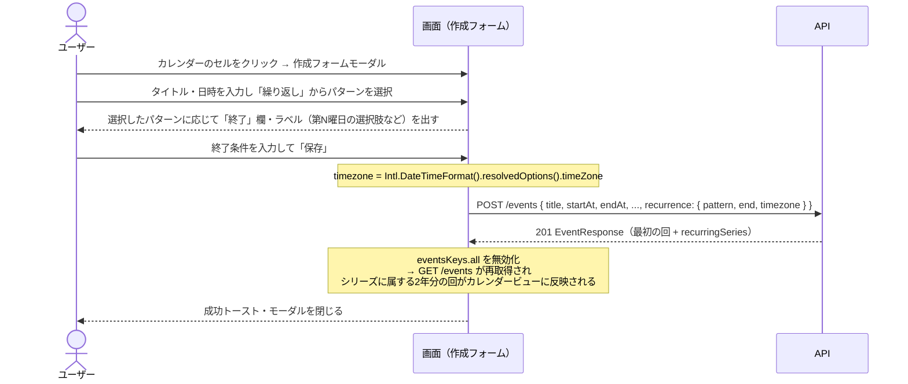
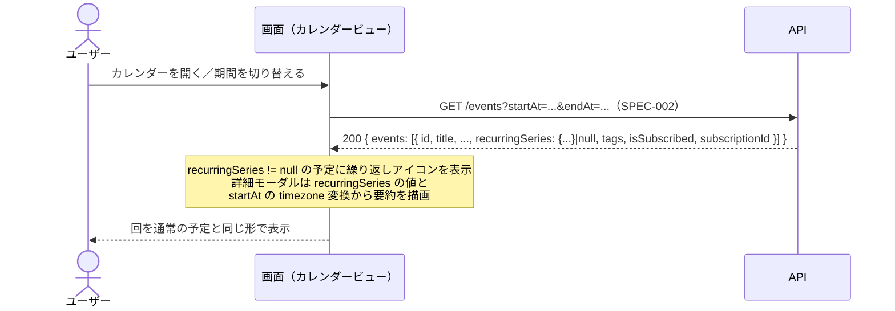
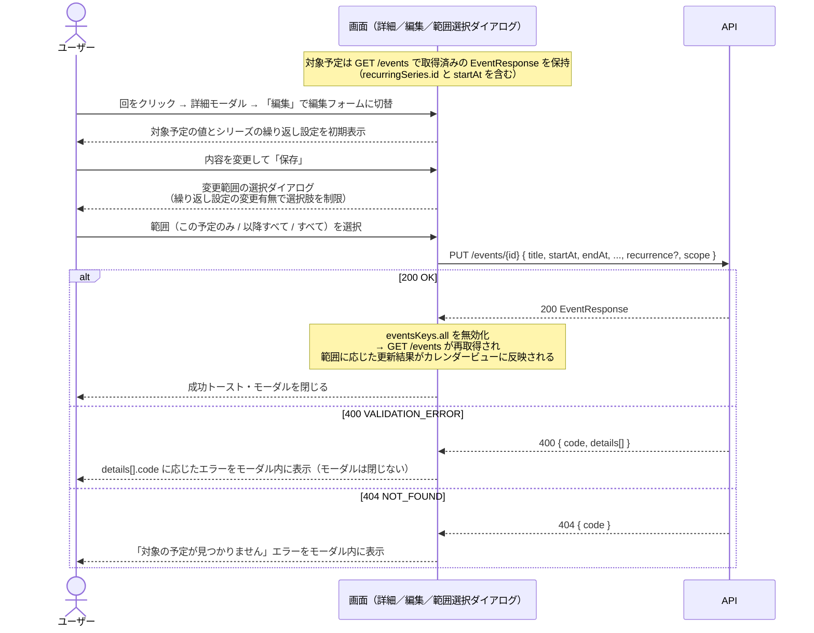
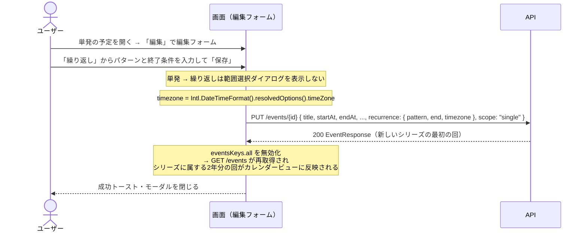
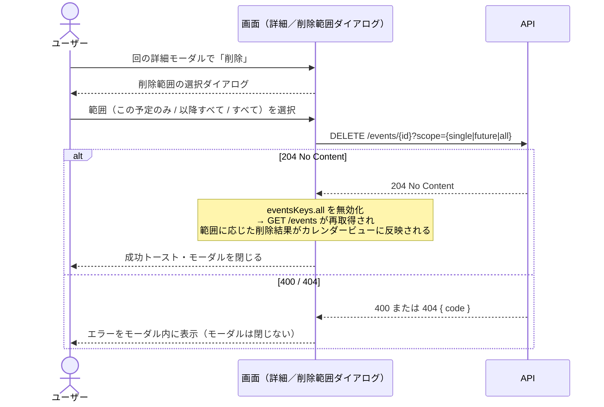

# 繰り返し予定 仕様書

- 作成日: 2026-11-14
- 更新日: 2026-11-14
- ステータス: PDM合意済

## PRD参照

- PRD: PRD-009 繰り返し予定（`docs/prd/PRD-009-recurring-events.md`）
- Issue: #26

## 対象機能

予定の作成・編集フォーム（SPEC-003）で繰り返しパターンと終了条件を指定し、1回の登録で繰り返し予定をまとめて登録できる機能。繰り返し予定の編集・削除では「この予定のみ」「以降すべて」「すべて」から対象範囲を選べる。

本仕様で用いる用語（「シリーズ」「回」「除外日」「切り離し」など）と、守るべき不変条件は [RecurringEventSeries ドメイン](../domain/recurring_event_series.md) に定義する。詳細仕様を読む前に合わせて参照すること。

## 詳細仕様

### 基本フロー

#### 繰り返し予定の作成

1. 予定の作成フォーム（SPEC-003）に「繰り返し」選択欄を表示する。初期値は「繰り返さない」
2. 「繰り返し」選択欄で、次のパターンから1つを選ぶ。各選択肢のラベルには、フォームの開始日時から決まる曜日・日付を含める
   - 毎日
   - 毎週（例: 毎週 月曜日）
   - 隔週（例: 隔週 月曜日）
   - 毎月 同日（例: 毎月 15日）
   - 毎月 第N曜日（例: 毎月 第2月曜日、毎月 最終月曜日）
3. 繰り返しパターンを選ぶと「終了」選択欄が表示される。「無期限」（初期値）・「終了日を指定」・「回数を指定」から選び、「終了日を指定」では終了日、「回数を指定」では回数を入力する
4. 「保存」ボタンをクリックすると繰り返し予定を登録し、モーダルを閉じる
5. 登録した繰り返し予定の各回がカレンダービューに即時反映される

#### 繰り返し予定の表示

1. カレンダービュー（SPEC-002）では、繰り返し予定の各回を通常の予定と同じ形で表示し、繰り返しアイコンを付ける
2. 詳細表示モーダルには、その回の日時に加えて繰り返し設定の要約（例: 「毎週 月曜日・10回」「隔週 木曜日・2027/03/31まで」）を表示する

#### 繰り返し予定の編集

1. 繰り返し予定の回の詳細表示モーダルで「編集」をクリックすると、編集フォームモーダルに切り替わる。フォームにはその回の内容と、シリーズの繰り返し設定を初期表示する
2. 内容を変更して「保存」をクリックすると、変更範囲の選択ダイアログ（「この予定のみ変更」「以降すべて変更」「すべて変更」「キャンセル」）を表示する
3. 選んだ範囲に応じて次のとおり更新し、モーダルを閉じる
   - この予定のみ変更: その回をシリーズから切り離し、変更後の内容で繰り返しのない単発の予定にする。シリーズにはその回の日付を除外日として残す
   - 以降すべて変更: シリーズを編集対象の回の直前で終了させ、編集対象の回以降を変更後の内容・繰り返し設定の新しいシリーズにする
   - すべて変更: シリーズのすべての回を変更後の内容・繰り返し設定に更新する
4. 「キャンセル」をクリックするとダイアログを閉じ、編集フォームモーダルに戻る
5. 更新結果がカレンダービューに即時反映される

#### 単発の予定を繰り返し予定にする

1. 繰り返しのない予定の編集フォームで「繰り返し」選択欄からパターンを選び、「保存」をクリックする
2. 変更範囲の選択ダイアログは表示せず、その予定を最初の回とする繰り返し予定として更新する

#### 繰り返し予定の削除

1. 繰り返し予定の回の詳細表示モーダルで「削除」をクリックすると、削除範囲の選択ダイアログ（「この予定のみ削除」「以降すべて削除」「すべて削除」「キャンセル」）を表示する
2. 選んだ範囲に応じて次のとおり削除し、モーダルを閉じる
   - この予定のみ削除: シリーズにその回の日付を除外日として追加する
   - 以降すべて削除: シリーズを削除対象の回の直前で終了させる
   - すべて削除: シリーズを削除する
3. 「キャンセル」をクリックするとダイアログを閉じ、詳細表示モーダルに戻る
4. 削除結果がカレンダービューに即時反映される

### 制約条件

- 繰り返しパターンは「毎日」「毎週」「隔週」「毎月 同日」「毎月 第N曜日」の5種類とする。曜日の組み合わせ（例: 月・水・金）は指定できない
- 曜日・日付・第N週は最初の回の開始日時から決める。毎週・隔週は最初の回と同じ曜日、毎月 同日は最初の回と同じ日、毎月 第N曜日は最初の回と同じ「第N週の曜日」に繰り返す
- 毎月 第N曜日のNは第1〜第4と「最終」から選ぶ。「繰り返し」選択欄には、最初の回の開始日に当てはまるものだけを表示する（例: 第4月曜日がその月の最終月曜日でもある場合は「第4月曜日」と「最終月曜日」の両方、第5週の月曜日の場合は「最終月曜日」のみ）
- 繰り返しの日付・時刻は、シリーズを作成したときの端末のタイムゾーンで計算する。各回の開始・終了の時刻（壁時計時刻）は最初の回と同じにし、夏時間の切り替えをまたいでも時刻をずらさない
- 各回の所要時間（終了日時 − 開始日時）は最初の回と同じにする
- 繰り返しの回は、最初の回の開始日から2年以内に開始するものだけを生成する。「無期限」は最初の回から2年分を生成する
- 「終了日を指定」の終了日は、最初の回の開始日以降、かつ最初の回の開始日から2年以内の日付とする。終了日当日に開始する回までを生成する
- 「回数を指定」の回数は2以上の整数とし、最後の回が最初の回の開始日から2年以内に収まる回数までとする。除外日・スキップした月の回は回数に含めない
- 繰り返し設定の入力は「繰り返し」パターンの選択 → 終了条件の選択 → 「保存」の3ステップ以内で完了すること（PRD成功指標）。終了条件を「無期限」のまま保存する場合は2ステップで完了する
- 「この予定のみ変更」でシリーズから切り離した予定は単発の予定として扱い、以降の「以降すべて変更」「すべて変更」「以降すべて削除」「すべて削除」の対象に含めない
- 編集フォームで繰り返し設定（パターン・終了条件）を変更した場合、変更範囲の選択ダイアログでは「以降すべて変更」「すべて変更」だけを選べる
- 編集フォームで「繰り返し」を「繰り返さない」に変更した場合、変更範囲の選択ダイアログでは「以降すべて変更」だけを選べる。シリーズを編集対象の回の直前で終了させ、編集対象の回を単発の予定にする
- 「すべて変更」で開始日時を変更した場合、変更前後の開始日時の差だけ、シリーズのすべての回の開始日時をずらす
- 「以降すべて変更」で繰り返し設定を変更せず、元のシリーズの終了条件が「回数を指定」の場合、新しいシリーズの回数は元のシリーズの残りの回数（編集対象の回を含む）とする（例: 10回のシリーズの4回目で変更した場合は7回）
- タグ（SPEC-008）はシリーズ単位で付与する。「この予定のみ変更」で切り離した予定には、切り離した時点のタグを引き継ぐ
- 共有リンク（SPEC-004）は、繰り返し予定の回1件を対象に生成する
- 過去の回も編集・削除の対象とする（日時による制限なし）
- 変更範囲・削除範囲の選択ダイアログは省略不可
- APIエラー時はモーダル内にエラーメッセージを表示し、モーダル・ダイアログは閉じない

### エッジケース・境界値

- 毎月 同日で、その日付がない月（例: 31日始まりで2月・4月）: その月の回は生成しない
- 毎月 第N曜日の「最終」: その月の最後の該当曜日に生成する（第4週・第5週のどちらでもよい）
- 「終了日を指定」で終了日が最初の回の開始日より前、または2年を超える場合: バリデーションエラーをフォーム内インラインで表示し、保存を阻止する
- 「回数を指定」で回数が2未満、または最後の回が2年を超える回数の場合: バリデーションエラーをフォーム内インラインで表示し、保存を阻止する
- 最初の回に対して「以降すべて変更」を選んだ場合: 「すべて変更」と同じ結果にする
- 最初の回に対して「以降すべて削除」を選んだ場合: 「すべて削除」と同じ結果にする
- 「この予定のみ削除」「この予定のみ変更」を繰り返して、シリーズに残る回が0件になった場合: シリーズを削除する
- 所要時間が繰り返し間隔より長く、回同士の期間が重なる場合（例: 2日間の予定を毎日繰り返す）: 制限せずに登録する
- 「この予定のみ変更」で、切り離した予定の日時をシリーズの別の回と同じ日時にした場合: 制限せずに登録する
- 編集・削除の操作中に、別の端末でシリーズの削除や対象の回の除外が行われ、対象の回が存在しなくなった場合: 404エラーとしてモーダル内にエラーメッセージを表示する
- 共有リンクを生成済みの回を「この予定のみ削除」「以降すべて削除」「すべて削除」で削除した場合: その回の共有リンクは無効になる（SPEC-004の予定削除時と同じ扱い）
- 「すべて変更」で繰り返し設定（パターン・終了条件）を変更した場合: シリーズの回をすべて作り直すため、各回の共有リンク（SPEC-004）と、他ユーザーがカレンダーに追加した購読は無効になる。タイトル・メモ・場所・URL・タグ・日時だけを変更した場合は無効にならない

## 設計

### ドメインモデル

- `Event`（エンティティ）— SPEC-002/SPEC-003 で定義された既存集約。シリーズに属する各回は `Event` として実体化し、属さない予定と同じ仕組みで表示・編集・削除・共有・タグ付与できる。シリーズへの所属は `Event` 側からの参照（`series_id`）で表現する
- `RecurringEventSeries`（エンティティ）— 繰り返しルール（`RecurrencePattern`）・終了条件（`RecurrenceEnd`）・シリーズ作成時のタイムゾーン（`SeriesTimezone`）・除外日集合（`ExcludedDate` の集合）を持つ別集約のルート。用語・集約の境界・ビジネスルール・エラーは [RecurringEventSeries ドメイン](../domain/recurring_event_series.md) を参照する
- 実体化方式の採用: シリーズの各回は `events` テーブルの行として物理的に実体化し、シリーズのルールは `recurring_event_series` テーブルに別途保存する（下記のDB設計）。共有リンク（SPEC-004 `event_shares.event_id`）・購読（`event_subscriptions.event_id`）・タグ（SPEC-008 `event_tags.event_id`）・本日タイムライン（SPEC-007）・カレンダー表示（SPEC-002 `GET /events`）がいずれも「単一の `events` 行」を前提に設計されているため、既存の問い合わせ・集約境界をそのまま使える
- 本仕様で守る不変条件（[Event ドメイン](../domain/event.md) および [RecurringEventSeries ドメイン](../domain/recurring_event_series.md) で定義されるもののうち本仕様に関わる範囲）:
  - シリーズに属する回は最初の回の開始日から2年以内、所要時間と壁時計時刻はシリーズ内で同一
  - 「この予定のみ変更」はシリーズから切り離した単発の `Event` と、シリーズ側の除外日の追加として表す
  - 「以降すべて変更」は現在のシリーズを対象回の直前で終了させ、対象回以降を新しいシリーズとして扱う
  - 「すべて削除」はシリーズと紐づく回・除外日を一括削除する
  - タグ付与はシリーズ単位の意味で、シリーズに属するすべての回で Tag 集合を揃える。切り離した回は切り離し時点のタグを保持する

### DB設計

| テーブル | カラム | 型 | 制約 | 備考 |
|---|---|---|---|---|
| `recurring_event_series` | `id` | `UUID` | PRIMARY KEY, DEFAULT `uuid_generate_v4()` | シリーズID |
| `recurring_event_series` | `user_id` | `UUID` | NOT NULL, REFERENCES `users(id)` ON DELETE CASCADE | 所有ユーザー。ユーザー削除でシリーズも削除 |
| `recurring_event_series` | `pattern_type` | `VARCHAR` | NOT NULL | `daily` / `weekly` / `biweekly` / `monthly_day` / `monthly_nth_weekday`。値域はアプリケーション層（OpenAPI enum から生成する Go 定数）で検証（ADR-019） |
| `recurring_event_series` | `monthly_nth` | `VARCHAR` | NULL 許容 | `pattern_type = monthly_nth_weekday` のときのみ必須で `1` / `2` / `3` / `4` / `last` のいずれかを取る。他のパターンでは NULL。値域はアプリケーション層で検証（ADR-019） |
| `recurring_event_series` | `end_type` | `VARCHAR` | NOT NULL | `indefinite` / `until_date` / `count`。値域はアプリケーション層で検証（ADR-019） |
| `recurring_event_series` | `end_until_date` | `DATE` | NULL 許容 | `end_type = until_date` のときのみ必須。`timezone` のローカル日付で保持する |
| `recurring_event_series` | `end_count` | `SMALLINT` | NULL 許容 | `end_type = count` のときのみ必須。2以上。除外日・スキップ月は数えない |
| `recurring_event_series` | `timezone` | `TEXT` | NOT NULL | シリーズ作成時の端末タイムゾーン（IANA名、例: `Asia/Tokyo`）。各回の壁時計時刻と除外日の解釈に使う |
| `recurring_event_series` | `created_at` | `TIMESTAMPTZ` | NOT NULL, DEFAULT `NOW()` | 作成日時 |
| `recurring_event_series` | `updated_at` | `TIMESTAMPTZ` | NOT NULL, DEFAULT `NOW()`, トリガー `update_recurring_event_series_updated_at` で UPDATE 時に自動更新 | 更新日時 |
| `recurring_event_series` | （インデックス） | - | `idx_recurring_event_series_user_id` on (`user_id`) | ユーザー単位の一覧取得用 |
| `recurring_series_exceptions` | `series_id` | `UUID` | NOT NULL, REFERENCES `recurring_event_series(id)` ON DELETE CASCADE | 除外日が属するシリーズ。シリーズ削除で除外日も削除 |
| `recurring_series_exceptions` | `excluded_date` | `DATE` | NOT NULL | シリーズの `timezone` におけるローカル日付 |
| `recurring_series_exceptions` | `created_at` | `TIMESTAMPTZ` | NOT NULL, DEFAULT `NOW()` | 追加日時 |
| `recurring_series_exceptions` | （主キー） | - | PRIMARY KEY (`series_id`, `excluded_date`) | 同一シリーズ内の除外日の重複防止 |
| `events` | `series_id` | `UUID` | NULL 許容, REFERENCES `recurring_event_series(id)` ON DELETE CASCADE | SPEC-009 で追加。属するシリーズのID。NULL は単発の予定。シリーズ削除で回も削除。「この予定のみ変更」で NULL に戻す（切り離し） |
| `events` | （インデックス） | - | `idx_events_series_id` on (`series_id`) | シリーズ内の回を一括取得（「以降すべて」「すべて」）する用 |

パターン判定に必要な「曜日」「日付」はシリーズに保存せず、各回の `start_at` を `recurring_event_series.timezone` のローカル時刻へ変換して導出する（同じシリーズ内のどの回を使っても同じ結果が得られる）。「毎月 第N曜日」の `N` だけは「第4月曜日」と「最終月曜日」が同じ日に重なる月では日付からの判別ができないため、`monthly_nth` としてユーザーの明示的な選択を保存する。

### API設計

エラーレスポンスの共通構造（`code` / `message` / `details`）は [ADR-013](../adr/ADR-013-api-error-structure.md) を参照する。日時の形式とタイムゾーンの扱いは [ADR-036](../adr/ADR-036-api-datetime-utc.md) を参照する。繰り返しの各回の日時をサーバーで計算する方針は [ADR-037](../adr/ADR-037-recurrence-timezone-calculation.md) を参照する。404 は対象が存在しない場合と他ユーザーの対象を指定した場合をまとめて返し、所有関係の有無を漏らさない。

SPEC-009 では新規エンドポイントを追加せず、既存の SPEC-002・SPEC-003 の予定系エンドポイントを拡張する。拡張するフィールド・パラメータ・エラーは以下。

| メソッド | パス | 認証 | リクエスト | レスポンス | エラー（HTTPステータス） |
|---|---|---|---|---|---|
| POST | `/events`（SPEC-003 を拡張） | セッション必須 | `CreateEventRequest` に `recurrence`（任意）を追加 | 201 `EventResponse`（`recurringSeries` を追加） | SPEC-003 のエラーに `recurrence` のバリデーションを追加 |
| PUT | `/events/{id}`（SPEC-003 を拡張） | セッション必須 | `UpdateEventRequest` に `recurrence`（任意）と `scope`（任意）を追加 | 200 `EventResponse`（`recurringSeries` を追加） | SPEC-003 のエラーに `recurrence` / `scope` のバリデーションを追加 |
| DELETE | `/events/{id}`（SPEC-003 を拡張） | セッション必須 | クエリに `scope`（任意）を追加 | 204 No Content | SPEC-003 のエラーに `scope` のバリデーションを追加 |
| GET | `/events`（SPEC-002 を拡張） | セッション必須 | （変更なし） | 200 `{ events: EventResponse[] }`（各予定に `recurringSeries` を追加） | （変更なし） |

#### 共通: `RecurrenceSpec` スキーマ

`POST /events` と `PUT /events/{id}` の `recurrence` フィールド、および各エンドポイントが返す `recurringSeries` フィールドは、以下の構造を共有する（`recurringSeries` は所有者情報を持たないため、`id` フィールドが追加される点のみ異なる）。

| フィールド | 型 | 必須 | 制約 | 説明 |
|---|---|---|---|---|
| `pattern` | object | 必須 | - | 繰り返しパターン |
| `pattern.type` | string | 必須 | `daily` / `weekly` / `biweekly` / `monthly_day` / `monthly_nth_weekday` | 繰り返しの種類 |
| `pattern.monthlyNth` | string | `pattern.type = monthly_nth_weekday` のとき必須、それ以外は省略 | `1` / `2` / `3` / `4` / `last` | 「毎月 第N曜日」の N の明示指定 |
| `end` | object | 必須 | - | 終了条件 |
| `end.type` | string | 必須 | `indefinite` / `until_date` / `count` | 終了条件の種類 |
| `end.untilDate` | string (date, `YYYY-MM-DD`) | `end.type = until_date` のとき必須、それ以外は省略 | `timezone` のローカル日付。`startAt` を `timezone` に変換した日付以降、かつ `startAt` から2年以内 | 終了日 |
| `end.count` | integer | `end.type = count` のとき必須、それ以外は省略 | 2 以上。除外日・スキップ月は含めない | 回数 |
| `timezone` | string | 必須 | IANA タイムゾーン名（`time.LoadLocation` で解釈可能なもの、例: `Asia/Tokyo`） | シリーズ作成時の端末タイムゾーン |

`recurringSeries`（レスポンス）では上記に加えて `id`（string, uuid）が返る。`recurringSeries` は、対象予定がシリーズに属していないとき `null` を返す。

曜日・日付は `pattern` に含めない。これらは対象予定の `startAt` を `timezone` のローカル時刻に変換した日・曜日から一意に決まる（例: `pattern.type = weekly` なら、各回は `startAt` と同じ曜日で繰り返す）。

#### POST /events（SPEC-009 で追加するフィールド）

エンドポイント全体の仕様は SPEC-003 を参照。SPEC-009 で追加するフィールド・エラーは以下。

##### リクエスト

| 場所 | フィールド | 型 | 必須 | 制約 | 説明 |
|---|---|---|---|---|---|
| body | `recurrence` | `RecurrenceSpec` \| null | 任意 | 省略または `null` のときは単発の予定を作成する。オブジェクトのときは繰り返しシリーズを作成し、`startAt` / `endAt` を最初の回として、`recurrence.timezone` のもとで2年以内に発生する回をすべて `events` 行として実体化する | 繰り返し設定 |

##### レスポンス（201 Created）

`EventResponse` に以下を追加する。

| フィールド | 型 | null許容 | 説明 |
|---|---|---|---|
| `recurringSeries` | object | 可 | 作成した予定がシリーズに属する場合はそのシリーズの `RecurrenceSpec`（`id` 付き）。単発の予定では `null`。レスポンスとして返す予定は、シリーズを作成した場合は「最初の回」とする |

##### エラー

| HTTPステータス | code | details[].code | 発生条件 |
|---|---|---|---|
| 400 | `VALIDATION_ERROR` | `REQUIRED` | `recurrence.pattern.type` / `recurrence.end.type` / `recurrence.timezone` が未指定（`details[].field` はそれぞれ対応フィールド） |
| 400 | `VALIDATION_ERROR` | `INVALID_FORMAT` | `recurrence.pattern.type` / `recurrence.end.type` / `recurrence.pattern.monthlyNth` がスキーマ定義の列挙値でない、`recurrence.timezone` が IANA 名として解釈できない、`recurrence.end.untilDate` が `YYYY-MM-DD` として解釈できない |
| 400 | `VALIDATION_ERROR` | `REQUIRED` | `recurrence.pattern.type = monthly_nth_weekday` で `recurrence.pattern.monthlyNth` が未指定、`recurrence.end.type = until_date` で `recurrence.end.untilDate` が未指定、`recurrence.end.type = count` で `recurrence.end.count` が未指定 |
| 400 | `VALIDATION_ERROR` | `OUT_OF_RANGE` | `recurrence.end.count` が 2 未満、`recurrence.end.untilDate` が `startAt` のローカル日付より前、`recurrence.end.untilDate` が `startAt` のローカル日付から2年を超える |
| 400 | `VALIDATION_ERROR` | `TOO_FEW_OCCURRENCES` | 指定したパターン・終了条件で2年以内に生成される回が 2 回未満（例: `monthly_day` で `startAt` のローカル日付が 30 日・終了日が同月中など） |

`TOO_FEW_OCCURRENCES` は `ValidationErrorDetail.code`（`packages/schema/components/schemas/ValidationErrorDetail.yaml`）の enum に追加する。

#### PUT /events/{id}（SPEC-009 で追加するフィールド）

エンドポイント全体の仕様は SPEC-003 を参照。SPEC-009 で追加するフィールド・エラーは以下。

##### リクエスト

| 場所 | フィールド | 型 | 必須 | 制約 | 説明 |
|---|---|---|---|---|---|
| body | `recurrence` | `RecurrenceSpec` \| null | 任意 | 省略時は現在の繰り返し設定を維持する。`null` は繰り返しを解除（繰り返さない）。オブジェクトは繰り返し設定を指定（既存シリーズと差分があれば変更として扱う） | 繰り返し設定の変更 |
| body | `scope` | string | 任意（対象予定がシリーズに属するときは必須） | `single` / `future` / `all` | 「この予定のみ変更」/「以降すべて変更」/「すべて変更」。対象予定が単発のとき、省略または `single` のみ許容する |

`scope = single` と `scope = future` の意味分けのために、対象予定（path `id`）の現在のシリーズ所属は、更新前にサーバー側で `events.series_id` から読み取る。

リクエストボディで送るその他のフィールド（`title`・`startAt`・`endAt`・`description`・`location`・`url`・`tagIds`）の制約は SPEC-003 / SPEC-008 を参照。

`scope` ごとの意味は以下。

| `scope` | 対象予定の状態 | 動作 |
|---|---|---|
| `single` / 省略 | 単発 | 対象予定を更新する（SPEC-003 の動作と同じ）。`recurrence` がオブジェクトなら、対象予定を最初の回とする新しいシリーズを作成し、2年以内の回を実体化する（基本フロー「単発の予定を繰り返し予定にする」） |
| `single` | シリーズに属する | 対象予定をシリーズから切り離し、送られたフィールドで更新する。シリーズに同日付の除外日を追加する（`recurrence` と差分がある場合は 400、`recurrence` が `null` の場合も 400） |
| `future` | シリーズに属する | 現在のシリーズを対象予定の直前で終了させ（除外日のうち対象予定以降を破棄）、対象予定以降を新しいシリーズとして作り直す。`recurrence` が省略のときは現在のシリーズと同じルールを引き継ぐ（`end.type = count` の場合、`end.count` は対象予定を含む残りの回数にする）。`recurrence` が `null` のときは対象予定を単発に変換して現在のシリーズを終了させる。対象予定が最初の回のときは `scope = all` と同じ扱いにする |
| `all` | シリーズに属する | シリーズのすべての回を、送られたフィールドで同じ値に更新する。`recurrence` が省略のときはルールを維持し、タイトル・メモ・場所・URL・タグ・時刻（`startAt`/`endAt` の差分だけずらす）を揃える。`recurrence` がオブジェクトのときはルールと除外日を破棄して回を再生成する |
| `future` / `all` | 単発 | 400 `VALIDATION_ERROR`（`NOT_IN_SERIES`） |

##### レスポンス（200 OK）

`EventResponse` に `POST /events` と同じ `recurringSeries` を追加する。返却する予定は以下の通り。

| ケース | 返却する予定 |
|---|---|
| `scope = single` で対象予定が単発のまま（`recurrence` 省略） | 対象予定（path `id`） |
| `scope = single` で対象予定を単発から繰り返しに変換（`recurrence` オブジェクト） | 新しいシリーズの最初の回（path `id` と同一） |
| `scope = single` で対象予定をシリーズから切り離し | 切り離した対象予定（path `id`、`recurringSeries = null`） |
| `scope = future` | 新しいシリーズの最初の回（対象予定の `id` を引き継ぐ） |
| `scope = all` で `recurrence` を変更しない | 対象予定（path `id`。`startAt` 変更時は差分適用後の値） |
| `scope = all` で `recurrence` を変更（再生成） | 再生成後のシリーズの最初の回（新しい `id`。クライアントは `GET /events` の再取得でカレンダーを更新するため、`id` の連続性は保証しない） |

##### エラー

SPEC-003 のエラーに加えて以下を返す。`recurrence` 自体のバリデーションエラーは `POST /events` と共通。

| HTTPステータス | code | details[].code | 発生条件 |
|---|---|---|---|
| 400 | `VALIDATION_ERROR` | `INVALID_FORMAT` | `scope` が `single` / `future` / `all` のいずれでもない |
| 400 | `VALIDATION_ERROR` | `NOT_IN_SERIES` | 対象予定が単発なのに `scope = future` または `scope = all` を指定した（`details[].field = "scope"`） |
| 400 | `VALIDATION_ERROR` | `SCOPE_NOT_ALLOWED` | 対象予定がシリーズに属するときに次のいずれか: 繰り返し設定（`recurrence` のルール）を変更する `scope = single`、`recurrence = null` を `scope = all` や省略で送った（`details[].field = "scope"`） |

`NOT_IN_SERIES` / `SCOPE_NOT_ALLOWED` は `ValidationErrorDetail.code` の enum に追加する。

#### DELETE /events/{id}（SPEC-009 で追加するフィールド）

エンドポイント全体の仕様は SPEC-003 を参照。SPEC-009 で追加するクエリ・エラーは以下。

##### リクエスト

| 場所 | フィールド | 型 | 必須 | 制約 | 説明 |
|---|---|---|---|---|---|
| query | `scope` | string | 任意（対象予定がシリーズに属するときは必須） | `single` / `future` / `all` | 削除範囲 |

`scope` ごとの意味は以下。

| `scope` | 対象予定の状態 | 動作 |
|---|---|---|
| `single` / 省略 | 単発 | 対象予定を削除する（SPEC-003 の動作と同じ） |
| `single` | シリーズに属する | 対象予定を削除し、シリーズに同日付の除外日を追加する |
| `future` | シリーズに属する | 対象予定と、対象予定より後の同じシリーズの回をすべて削除する。シリーズの `end_type` を `until_date` に、`end_until_date` を対象予定のローカル日付の前日に書き換え、`end_count` を NULL にする。対象予定が最初の回のときは `scope = all` と同じ扱い |
| `all` | シリーズに属する | シリーズと紐づく回・除外日を一括削除（`ON DELETE CASCADE`） |
| `future` / `all` | 単発 | 400 `VALIDATION_ERROR`（`NOT_IN_SERIES`） |

シリーズに属する最後の回が削除されてシリーズの回が 0 件になった場合は、同一トランザクションでシリーズも削除する（ADR-024）。

##### レスポンス（204 No Content）

ボディなし。

##### エラー

SPEC-003 のエラーに加えて以下を返す。

| HTTPステータス | code | details[].code | 発生条件 |
|---|---|---|---|
| 400 | `VALIDATION_ERROR` | `INVALID_FORMAT` | クエリの `scope` が `single` / `future` / `all` のいずれでもない |
| 400 | `VALIDATION_ERROR` | `NOT_IN_SERIES` | 対象予定が単発なのに `scope = future` または `scope = all` を指定した（`details[].field = "scope"`） |

#### GET /events（SPEC-009 で追加するフィールド）

エンドポイント全体の仕様は SPEC-002・SPEC-008 を参照。SPEC-009 で追加するフィールドは以下。

##### レスポンス（200 OK）

| フィールド | 型 | null許容 | 説明 |
|---|---|---|---|
| `events[].recurringSeries` | object | 可 | 予定がシリーズに属するときは `RecurrenceSpec`（`id` 付き）。単発の予定では `null` |

カレンダーの各セルは `recurringSeries != null` のとき繰り返しアイコンを表示する。詳細表示モーダルは `recurringSeries` の値と、その予定の `startAt` を `recurringSeries.timezone` のローカル時刻に変換した日・曜日から繰り返し設定の要約（「毎週 月曜日・10回」等）を描画する。

#### API呼び出しシーケンス

##### 繰り返し予定の作成

##### 繰り返し予定の表示

##### 繰り返し予定の編集（この予定のみ / 以降すべて / すべて）

##### 単発の予定を繰り返し予定にする

##### 繰り返し予定の削除（この予定のみ / 以降すべて / すべて）

