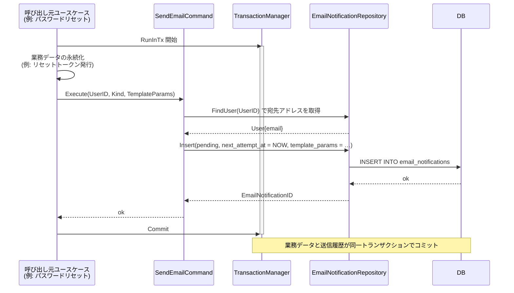
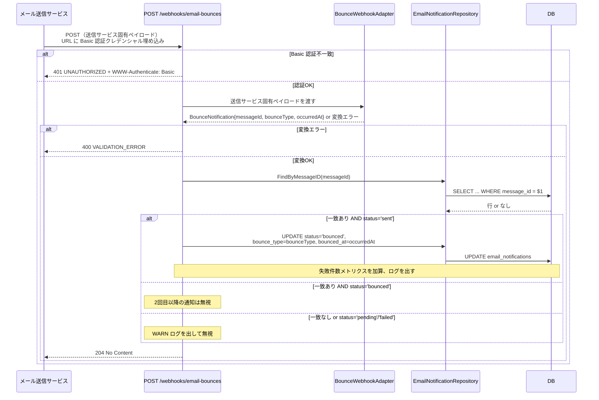

# メール通知基盤 仕様書

- 作成日: 2026-11-23
- 更新日: 2026-11-23
- ステータス: 作成中

## PRD参照

- PRD: PRD-010 メール通知基盤（`docs/prd/PRD-010-email-notification.md`）
- Issue: #460

## 対象機能

バックエンドのユースケースが、ユーザーIDとメールの種類を指定してメールの送信を要求すると、そのユーザーの登録メールアドレスへ非同期でメールを送る機能。一時的な失敗は自動で再送し、送信の結果（送信完了・送信失敗・バウンス）を送信履歴に記録する。

## 詳細仕様

### 基本フロー

#### 送信要求

1. ユースケースが、宛先のユーザーID・メールの種類・本文に埋め込むパラメータを指定して送信を要求する
2. ユーザーIDから登録メールアドレスを取得し、宛先として確定する
3. 送信履歴を「送信待ち」で作成し、送信要求時刻を記録する
4. 送信要求の処理は送信の完了を待たずに終わる

#### 送信

1. 送信処理が「送信待ち」の送信履歴を取り出す
2. メールの種類に対応するテンプレートにパラメータを埋め込み、件名・本文を作る
3. メール送信サービスへメールを渡す
4. メール送信サービスが受け付けたら、送信履歴を「送信完了」にし、送信完了時刻を記録する
5. 送信履歴から本文用のパラメータを削除する

#### 一時的な失敗時の再送

1. メール送信サービスへの送信が一時的な失敗（下記「制約条件」の分類）で終わった場合、試行回数と失敗理由を記録し、送信履歴を「送信待ち」のまま次の送信予定時刻を設定する
2. 次の送信予定時刻を過ぎたら、送信処理が再度送信する
3. 最大試行回数に達しても送れなかった場合、送信履歴を「送信失敗」にし、失敗理由を記録する
4. 送信履歴から本文用のパラメータを削除する

#### バウンス通知の受信

1. メール送信サービスから、送信完了したメールのバウンス通知を受け取る
2. 通知に含まれるメッセージIDから送信履歴を特定する
3. 送信履歴を「バウンス」にし、バウンスの種別（受信者起因かどうか）と通知時刻を記録する

#### 運用者による送信失敗の確認

1. 送信履歴が「送信失敗」または「バウンス」になったとき、送信履歴ID・ユーザーID・メールの種類・失敗理由をログに出し、失敗件数のメトリクスを加算する
2. 運用者は失敗件数のメトリクスで送信失敗に気付き、ログと送信履歴で失敗理由を確認する

### 制約条件

#### 宛先・差出人

- 宛先は、送信要求時点のユーザーの登録メールアドレスだけにする。ユースケースから任意のアドレスを指定できない
- 差出人名・差出人アドレスは環境変数で設定した1組だけを使う。差出人名はサービス名、差出人アドレスはサービスのドメインのアドレスにする
- 差出人アドレスのドメインはSPF・DKIM・DMARCを設定し、DMARCはSPFまたはDKIMのドメインが差出人アドレスのドメインと一致する（アラインメントが取れる）構成にする

#### 件名・本文

- 件名・本文は、メールの種類ごとに定義したテンプレートからだけ作る。ユースケースから件名・本文の文字列を直接渡せない
- テンプレートとパラメータにパスワードを含めない
- 本文に入れる値（リセット用URLなど）は、送信完了・送信失敗のどちらかになった時点で送信履歴から削除する。送信待ちの間だけ保持する

#### 再送

- 一時的な失敗: メール送信サービスへの接続失敗・タイムアウト・レート制限・サービス側の一時エラー。再送する
- 恒久的な失敗: 宛先アドレスの形式不正・送信サービスが宛先を拒否・認証設定エラーなど、再送しても結果が変わらない失敗。再送せず即座に「送信失敗」にする
- 最大試行回数は3回（初回＋再送2回）。再送の間隔は1回目の失敗から10秒後、2回目の失敗から20秒後とする

#### 記録

- 送信履歴には、送信履歴ID・ユーザーID・宛先メールアドレス・メールの種類・状態・試行回数・送信要求時刻・次の送信予定時刻・送信完了時刻・失敗理由・メッセージID・バウンス種別・バウンス通知時刻・本文に入れる値を記録する
- 本文に入れる値は送信待ちの間だけ保持し、送信完了・送信失敗・バウンスのいずれかになった時点で削除する
- 送信履歴に件名・本文を保存しない
- ログ・トレースには宛先メールアドレス・本文に入れる値を出さず、送信履歴IDとユーザーIDを出す（`docs/guidelines/data-handling-guidelines.md`）
- 成功指標の計測のため、送信要求から送信完了までの所要時間をメトリクスに記録する

### エッジケース・境界値

- 送信要求時に指定したユーザーが存在しない場合 → 送信要求をエラーにし、送信履歴を作成しない
- 送信待ちの間にユーザーが登録メールアドレスを変更した場合 → 送信要求時点のアドレスへ送る
- 送信処理が複数動いている場合 → 同じ送信履歴を二重に送らない
- 送信処理がメール送信サービスへ渡した後、送信履歴を「送信完了」にする前に停止した場合 → 再起動後に同じメールを再送しうる（二重送信は許容し、未送信を防ぐことを優先する）。この場合、メッセージIDは最後に送信した分だけを送信履歴に保持する（それ以前の送信分のメッセージIDは記録しない）
- 3回目の試行が一時的な失敗で終わった場合 → 「送信失敗」にする
- バウンス通知のメッセージIDに一致する送信履歴がない場合 → 通知を無視し、WARNログを出す
- 同じメッセージIDのバウンス通知を複数回受け取った場合 → 最初の通知だけを記録する
- 「送信失敗」の送信履歴にバウンス通知が届いた場合 → メッセージIDを持たないため一致せず、無視する

## 設計

### ドメインモデル

- `EmailNotification`（エンティティ、集約ルート）— 送信履歴1件を表す。用語・集約の不変条件・状態遷移のルールは [EmailNotification ドメイン](../domain/emailnotification.md) を参照
- 送信要求は `UserID`・`EmailKind`・`TemplateParams` を受け取るユースケース層のコマンド（`SendEmailCommand`）として公開し、呼び出し元ユースケースのトランザクションに参加する（トランザクショナルアウトボックス方式）。これにより、業務データの永続化と送信履歴の `pending` 作成が原子的になる（[ADR-024](../adr/ADR-024-transaction-management.md)・[ADR-039](../adr/ADR-039-email-async-outbox.md)）
- 実際の送信・再送・状態遷移・本文に入れる値のクリアは、送信ワーカー（APIサーバーと同一プロセス内の常駐コンポーネント）が担う。ワーカーは `pending` の履歴を `FOR UPDATE SKIP LOCKED` で1件ずつ排他取得し、`EmailTransport` インターフェース経由でメールを送る。送信プロトコルは SMTP に固定し、送信先のSMTPエンドポイント（送信サービス）は設定で差し替える（[ADR-038](../adr/ADR-038-email-transport-protocol.md)・[ADR-039](../adr/ADR-039-email-async-outbox.md)）
- `EmailKind` と対応する `EmailTemplate`（件名・本文・埋め込みパラメータ）はアプリケーション起動時に静的レジストリへ登録する。登録のない `EmailKind` を指定した送信要求はエラーにし、集約を生成しない

### DB設計

| テーブル | カラム | 型 | 制約 | 備考 |
|---|---|---|---|---|
| `email_notifications` | `id` | `UUID` | PRIMARY KEY, DEFAULT `uuid_generate_v4()` | 送信履歴ID |
| `email_notifications` | `user_id` | `UUID` | NOT NULL, REFERENCES `users(id)` ON DELETE CASCADE | 宛先ユーザー。ユーザー削除で履歴も削除 |
| `email_notifications` | `recipient_email` | `TEXT` | NOT NULL | 送信要求時点の登録メールアドレスのスナップショット（情報取り扱いガイドラインの「個人情報」として平文で保存。ログ・トレースには出さない） |
| `email_notifications` | `kind` | `VARCHAR` | NOT NULL | メール種別。値域はアプリケーション層（Goの定数）で管理する（[ADR-019](../adr/ADR-019-enum-management.md)）。具体的な値はメールの種類を追加する仕様書で定義する |
| `email_notifications` | `status` | `VARCHAR` | NOT NULL | `pending` / `sent` / `failed` / `bounced`。値域はアプリケーション層で管理（ADR-019） |
| `email_notifications` | `template_params` | `JSONB` | NOT NULL, DEFAULT `'{}'::jsonb` | 本文に入れる値（リセット用URL等）。`pending` の間だけ値を持ち、終端状態（`sent` / `failed` / `bounced`）へ遷移時に `'{}'` にクリアする（[ADR-040](../adr/ADR-040-email-template-params-storage.md)） |
| `email_notifications` | `attempt_count` | `SMALLINT` | NOT NULL, DEFAULT `0`, CHECK (`attempt_count >= 0`) | 試行回数（送信ワーカーがサービスへ渡した回数） |
| `email_notifications` | `requested_at` | `TIMESTAMPTZ` | NOT NULL, DEFAULT `NOW()` | 送信要求時刻 |
| `email_notifications` | `next_attempt_at` | `TIMESTAMPTZ` | NULL 許容 | 次に送信を試す最早時刻。`status = pending` のときだけ非null |
| `email_notifications` | `sent_at` | `TIMESTAMPTZ` | NULL 許容 | 送信完了時刻。`status = sent` または `bounced` のとき非null |
| `email_notifications` | `last_failure_reason` | `TEXT` | NULL 許容 | 直近の試行で発生した失敗理由。アプリ側の分類コード（`transient` / `permanent`）と送信サービスから返ったエラー文字列をまとめた文字列（個人情報・本文に入れる値は含めない） |
| `email_notifications` | `message_id` | `TEXT` | UNIQUE, NULL 許容 | メール送信サービスから払い出される一意のメッセージID。`status = sent` または `bounced` のとき非null。バウンス通知のペイロードと突合する。二重送信で複数回メールを送った場合は、最後に送信した分のメッセージIDだけを保持する |
| `email_notifications` | `bounce_type` | `VARCHAR` | NULL 許容 | `permanent` / `transient` / `undetermined`。`status = bounced` のとき非null（ADR-019） |
| `email_notifications` | `bounced_at` | `TIMESTAMPTZ` | NULL 許容 | バウンス発生時刻（送信サービスから受け取る `occurredAt`）。`status = bounced` のとき非null |
| `email_notifications` | `created_at` | `TIMESTAMPTZ` | NOT NULL, DEFAULT `NOW()` | 作成日時 |
| `email_notifications` | `updated_at` | `TIMESTAMPTZ` | NOT NULL, DEFAULT `NOW()`, トリガー `update_email_notifications_updated_at` で UPDATE 時に自動更新 | 更新日時 |
| `email_notifications` | （チェック制約） | - | CHECK (`(status = 'pending' AND next_attempt_at IS NOT NULL) OR (status <> 'pending' AND next_attempt_at IS NULL)`) | `pending` の間だけ `next_attempt_at` が入っていることを保証 |
| `email_notifications` | （チェック制約） | - | CHECK (`status <> 'bounced' OR (bounce_type IS NOT NULL AND bounced_at IS NOT NULL AND message_id IS NOT NULL)`) | `bounced` のとき付随カラムが揃っていることを保証 |
| `email_notifications` | （チェック制約） | - | CHECK (`status = 'pending' OR template_params = '{}'::jsonb`) | 終端状態のレコードに本文用パラメータが残らないことを保証 |
| `email_notifications` | （インデックス） | - | `idx_email_notifications_due` on (`next_attempt_at`) WHERE `status = 'pending'` | 送信ワーカーが送信待ちを取り出すときの部分インデックス |
| `email_notifications` | （インデックス） | - | `idx_email_notifications_user_id_requested_at` on (`user_id`, `requested_at` DESC) | ユーザー単位の履歴取得・運用調査用 |

### API設計

本機能で外部に公開するHTTPエンドポイントは、メール送信サービスからのバウンス通知を受けるWebhookの1本のみ。エラーレスポンスの共通構造（`code` / `message` / `details`）は [ADR-013](../adr/ADR-013-api-error-structure.md)、日時の形式とタイムゾーンの扱いは [ADR-036](../adr/ADR-036-api-datetime-utc.md) を参照。認証方式と、送信サービス固有ペイロードから内部形式への変換は [ADR-041](../adr/ADR-041-bounce-webhook-auth.md) を参照。

| メソッド | パス | 認証 | リクエスト | レスポンス | エラー（HTTPステータス） |
|---|---|---|---|---|---|
| POST | `/webhooks/email-bounces` | Basic 認証（URL埋め込み、[ADR-041](../adr/ADR-041-bounce-webhook-auth.md)） | 送信サービス固有のペイロード。アダプタで内部形式 `{messageId, bounceType, occurredAt}` に変換 | 204 No Content | 400 `VALIDATION_ERROR` / 401 `UNAUTHORIZED` / 500 `INTERNAL_ERROR` |

バックエンド内部のユースケース層は以下のインターフェースを公開する（HTTPで公開しない）。

- `SendEmailCommand.Execute(ctx, SendEmailInput{UserID, Kind, TemplateParams})` — 送信履歴を `pending` で永続化する。呼び出し元のユースケースが張るトランザクションに参加する
- `EmailSenderWorker.Run(ctx)` — APIサーバーと同一プロセスの常駐goroutine。`pending` の履歴をポーリングし、送信・再送・状態遷移・本文に入れる値のクリアを行う（[ADR-039](../adr/ADR-039-email-async-outbox.md)）
- `BounceWebhookAdapter` — Infrastructure層。送信サービス固有のWebhookペイロードを受け取り、内部形式 `BounceNotification{messageId, bounceType, occurredAt}` に変換してユースケースに渡す

#### POST /webhooks/email-bounces

送信サービス固有のペイロード形式は、送信サービス選定時に本仕様書へ追記する。アダプタ層で以下の内部形式に変換したうえでユースケースに渡す。

##### リクエスト

| 場所 | フィールド | 型 | 必須 | 制約 | 説明 |
|---|---|---|---|---|---|
| URL | ユーザー情報 | string | 必須 | `https://<user>:<password>@<host>/webhooks/email-bounces` の形で埋め込む。`user`・`password` は環境変数 `EMAIL_BOUNCE_WEBHOOK_USER`・`EMAIL_BOUNCE_WEBHOOK_PASSWORD` と `crypto/subtle.ConstantTimeCompare` で比較（[ADR-041](../adr/ADR-041-bounce-webhook-auth.md)） | バウンス通知送信元の Basic 認証クレデンシャル |
| body | （送信サービス固有のペイロード） | - | 必須 | 送信サービスごとに異なる。アダプタ層で下記の内部形式へ変換する | バウンス通知本体 |

内部形式（アダプタ変換後の `BounceNotification`）:

| フィールド | 型 | 必須 | 制約 | 説明 |
|---|---|---|---|---|
| messageId | string | 必須 | 非空文字 | 送信時にメール送信サービスが払い出した一意のメッセージID |
| bounceType | string | 必須 | `permanent` / `transient` / `undetermined` のいずれか | バウンス種別。`permanent` は受信者起因 |
| occurredAt | string(date-time) | 必須 | RFC 3339、末尾 `Z`（UTC、ADR-036） | バウンスが発生した時刻 |

##### レスポンス（204 No Content）

ボディなし。

受理後の挙動は以下のとおり。いずれのケースでも通知元に対しては 204 を返す（送信サービスのリトライ暴発を防ぐ）。

| 受理時の履歴状態 | 挙動 |
|---|---|
| `status = sent`、`message_id` 一致 | `status = bounced` へ遷移。`bounce_type = bounceType`、`bounced_at = occurredAt` を保存。失敗件数のメトリクスを加算し、送信履歴ID・ユーザーID・メール種別・失敗理由をログに出す（[オブザーバビリティガイドライン](../guidelines/observability-guidelines.md)） |
| `status = bounced`、`message_id` 一致 | 無視（同じメッセージIDの2回目以降の通知。最初の通知だけを記録する） |
| 一致する `message_id` が存在しない、または `status = pending` / `failed` | 無視して WARN ログを出す（本来発生しないが、受信者から任意の `messageId` が送られる可能性を考慮） |

##### エラー

| HTTPステータス | code | details[].code | 発生条件 |
|---|---|---|---|
| 400 | `VALIDATION_ERROR` | - | リクエストボディが送信サービス固有のペイロードとして解釈できない、または内部形式への変換で `messageId` が空、`bounceType` が列挙値以外、`occurredAt` がRFC 3339で末尾 `Z` のUTCとして解釈できない、など必須項目を満たさない |
| 401 | `UNAUTHORIZED` | - | Basic認証クレデンシャルが欠落・形式不正・不一致。`WWW-Authenticate: Basic realm="email-bounces"` を付ける。環境変数が未設定（空文字）のときも 401（fail closed、[ADR-041](../adr/ADR-041-bounce-webhook-auth.md)） |
| 500 | `INTERNAL_ERROR` | - | 想定外のサーバーエラー |

#### API呼び出しシーケンス

本機能のシーケンスは外部UIを介さない。呼び出し元ユースケース・送信ワーカー・メール送信サービス・バウンスWebhookの間のやり取りを示す。

##### 送信要求（呼び出し元ユースケース → 送信履歴の作成）



##### 送信（ワーカーの1件分、成功パス）

```mermaid
sequenceDiagram
    participant Worker as EmailSenderWorker
    participant DB
    participant Transport as EmailTransport
    participant Svc as メール送信サービス

    loop ポーリング間隔ごと
        Worker->>DB: BEGIN; SELECT ... WHERE status='pending' AND next_attempt_at<=NOW()<br/>LIMIT 1 FOR UPDATE SKIP LOCKED
        DB-->>Worker: 1行 or なし
        alt 対象あり
            Worker->>Worker: EmailTemplate[Kind] に template_params を埋め、件名・本文を作成
            Worker->>Transport: Send(recipient_email, 件名, 本文)
            Transport->>Svc: SMTP送信
            Svc-->>Transport: 受理 (message_id)
            Transport-->>Worker: message_id
            Worker->>DB: UPDATE status='sent', sent_at=NOW,<br/>message_id=…, next_attempt_at=NULL,<br/>template_params='{}', attempt_count=attempt_count+1
            Worker->>DB: COMMIT
            Note over Worker,DB: 送信要求〜送信完了の所要時間をメトリクスに記録
        else 対象なし
            Worker->>DB: COMMIT（アイドルスリープ）
        end
    end
```

##### 一時的な失敗と再送

```mermaid
sequenceDiagram
    participant Worker as EmailSenderWorker
    participant DB
    participant Transport as EmailTransport

    Worker->>DB: BEGIN; SELECT ... FOR UPDATE SKIP LOCKED
    DB-->>Worker: 1行
    Worker->>Transport: Send(...)
    Transport-->>Worker: 一時的失敗 (接続失敗・タイムアウト・5xx 等)
    alt attempt_count+1 < 3（再送余地あり）
        Worker->>DB: UPDATE attempt_count=attempt_count+1,<br/>last_failure_reason=分類+詳細,<br/>next_attempt_at=NOW+バックオフ(10s→20s)
    else attempt_count+1 = 3（再送なし）
        Worker->>DB: UPDATE status='failed', next_attempt_at=NULL,<br/>last_failure_reason=…, template_params='{}',<br/>attempt_count=attempt_count+1
        Note over Worker,DB: 失敗件数メトリクスを加算、送信履歴ID・ユーザーID・種別・理由をERRORログに出す
    end
    Worker->>DB: COMMIT
```

##### 恒久的な失敗（即 failed）

```mermaid
sequenceDiagram
    participant Worker as EmailSenderWorker
    participant DB
    participant Transport as EmailTransport

    Worker->>DB: BEGIN; SELECT ... FOR UPDATE SKIP LOCKED
    DB-->>Worker: 1行
    Worker->>Transport: Send(...)
    Transport-->>Worker: 恒久的失敗 (宛先アドレス拒否・認証エラー等)
    Worker->>DB: UPDATE status='failed', next_attempt_at=NULL,<br/>last_failure_reason=permanent+詳細,<br/>template_params='{}', attempt_count=attempt_count+1
    Worker->>DB: COMMIT
    Note over Worker,DB: 失敗件数メトリクスを加算、ログを出す
```

##### バウンス通知の受信


