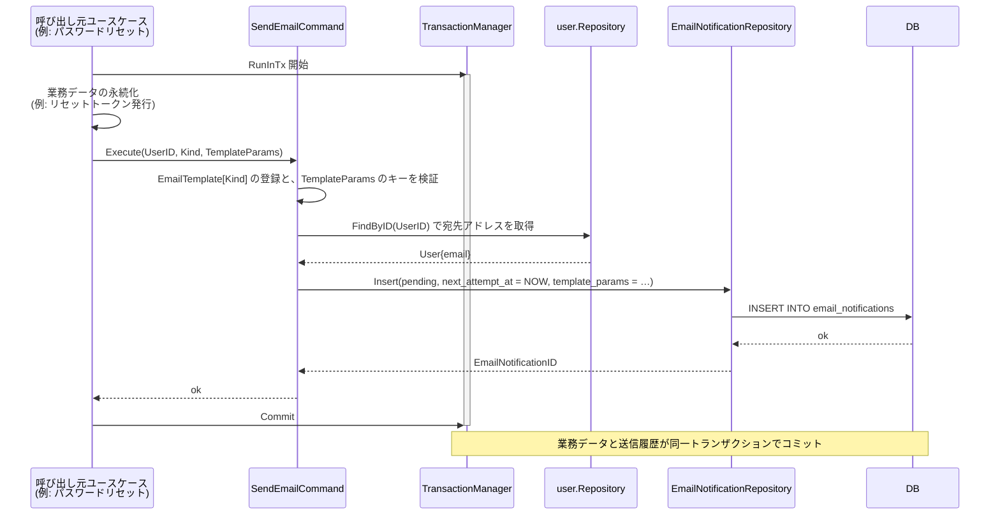

# メール通知基盤 仕様書

- 作成日: 2026-11-23
- 更新日: 2026-11-28
- ステータス: PDM合意済

## PRD参照

- PRD: PRD-010 メール通知基盤（`docs/prd/PRD-010-email-notification.md`）
- Issue: #460

## 対象機能

バックエンドのユースケースが、ユーザーIDとメールの種類を指定してメールの送信を要求すると、そのユーザーの登録メールアドレスへ非同期でメールを送る機能。メールは `EmailTransport` インターフェースを通して送り、一時的な失敗は自動で再送し、送信の結果（送信完了・送信失敗）を送信履歴に記録する。

## 詳細仕様

### 基本フロー

#### 送信要求

1. ユースケースが、宛先のユーザーID・メールの種類・本文に埋め込むパラメータを指定して送信を要求する
2. ユーザーIDから登録メールアドレスを取得し、宛先として確定する
3. 送信履歴を「送信待ち」で作成し、送信要求時刻を記録する
4. 送信要求の処理は送信の完了を待たずに終わる

#### 送信

1. 送信処理が、次の送信予定時刻を過ぎた「送信待ち」の送信履歴を1件確保する。確保するときに試行回数を1加算し、次の送信予定時刻を確保の有効期限まで進めて、確保を確定する
2. メールの種類に対応するテンプレートにパラメータを埋め込み、件名・本文を作る
3. `EmailTransport` へメールを渡す
4. `EmailTransport` が受け付けたら、送信履歴を「送信完了」にし、送信完了時刻を記録する
5. 送信履歴から本文用のパラメータを削除する

#### 一時的な失敗時の再送

1. `EmailTransport` が一時的な失敗（下記「制約条件」の分類）を返し、試行回数（確保時に加算した後の値）が3未満の場合、失敗コードを記録し、送信履歴を「送信待ち」のまま次の送信予定時刻を設定する
2. 次の送信予定時刻を過ぎたら、送信処理が再度送信する
3. 試行回数が3の試行も一時的な失敗で終わった場合、送信履歴を「送信失敗」にし、失敗コードを記録する
4. 送信履歴から本文用のパラメータを削除する

#### 運用者による送信失敗の確認

1. 送信履歴が「送信失敗」になったとき、送信履歴ID・ユーザーID・メールの種類・失敗コードをログに出し、失敗件数のメトリクスを加算する
2. 運用者は失敗件数のメトリクスで送信失敗に気付き、ログと送信履歴で失敗コードを確認する

### 制約条件

#### 宛先・差出人

- 宛先は、送信要求時点のユーザーの登録メールアドレスだけにする。ユースケースから任意のアドレスを指定できない
- 差出人名・差出人アドレスは環境変数で設定した1組だけを使う。差出人名はサービス名、差出人アドレスはサービスのドメインのアドレスにする

#### 件名・本文

- 件名・本文は、メールの種類ごとに定義したテンプレートからだけ作る。ユースケースから件名・本文の文字列を直接渡せない
- テンプレートは埋め込むパラメータのキーを定義する。送信要求のパラメータのキーがテンプレートの定義と一致しない（不足・余分がある）場合、送信要求をエラーにする
- テンプレートとパラメータにパスワードを含めない
- 本文に入れる値（リセット用URLなど）は、送信完了・送信失敗のどちらかになった時点で送信履歴から削除する。送信待ちの間だけ保持する

#### 再送

- 失敗のとき、`EmailTransport` の実装は下表の失敗コードのいずれかを返す。一時的か恒久的かは失敗コードで決まる
- 一時的な失敗は再送する。恒久的な失敗は再送せず即座に「送信失敗」にする

| 失敗コード | 分類 | 発生条件 |
|---|---|---|
| `connection_failed` | 一時的 | 送信先へ接続できない |
| `timeout` | 一時的 | 1回の受け渡しがタイムアウトした |
| `rate_limited` | 一時的 | 送信先がレート制限で拒否した |
| `temporary_rejection` | 一時的 | 送信先が一時的なエラーで拒否した |
| `invalid_recipient` | 恒久的 | 宛先アドレスの形式が不正 |
| `recipient_rejected` | 恒久的 | 送信先が宛先を拒否した |
| `auth_failed` | 恒久的 | 送信先への認証に失敗した |
| `permanent_rejection` | 恒久的 | 上記以外の恒久的なエラーで拒否された |

- `EmailTransport` 以外の原因で送信失敗にする場合は、以下の失敗コードを記録する。どちらも恒久的な失敗として扱う
  - `template_render_failed`: テンプレートへのパラメータの埋め込みに失敗した
  - `worker_interrupted`: 試行中に送信処理が停止し、3回目の試行の結果を記録できなかった
- 最大試行回数は3回（初回＋再送2回）。再送の間隔は1回目の失敗から10秒後、2回目の失敗から20秒後とする
- 試行回数は送信履歴を確保するときに加算する。送信中に送信処理が停止しても、試行回数は戻らない

#### 確保とタイムアウト

- `EmailTransport` への1回の受け渡しは30秒でタイムアウトさせ、一時的な失敗として扱う
- 確保の有効期限は確保から60秒とする。有効期限を過ぎても結果が記録されない送信履歴は、送信処理が途中で停止したものとみなし、再び確保の対象にする
- 送信結果は、確保したときの試行回数と送信履歴の試行回数が一致し、状態が「送信待ち」の場合だけ記録する

#### 記録

- 送信履歴には、送信履歴ID・ユーザーID・宛先メールアドレス・メールの種類・状態・試行回数・送信要求時刻・次の送信予定時刻・送信完了時刻・失敗コード・本文に入れる値を記録する
- 送信履歴に件名・本文を保存しない
- 送信先が返したエラー文は宛先アドレスを含みうるため、送信履歴に保存せず、ログ・トレースにも出さない。失敗は失敗コードだけで記録する
- ログ・トレースには宛先メールアドレス・本文に入れる値を出さず、送信履歴IDとユーザーIDを出す（`docs/guidelines/data-handling-guidelines.md`）
- 成功指標の計測のため、送信要求から送信完了までの所要時間をメトリクスに記録する

### エッジケース・境界値

- 送信要求時に指定したユーザーが存在しない場合 → 送信要求をエラーにし、送信履歴を作成しない
- 送信要求時に指定したメールの種類のテンプレートが登録されていない、またはパラメータのキーがテンプレートの定義と一致しない場合 → 送信要求をエラーにし、送信履歴を作成しない
- 送信時にテンプレートへのパラメータの埋め込みに失敗した場合 → 送信せずに「送信失敗」にし、失敗コード `template_render_failed` を記録する
- 送信待ちの間にユーザーが登録メールアドレスを変更した場合 → 送信要求時点のアドレスへ送る
- 送信処理が複数動いている場合 → 確保済みで有効期限内の送信履歴は、他の送信処理が確保しない
- 送信処理が `EmailTransport` へ渡した後、送信履歴を「送信完了」にする前に停止した場合 → 確保の有効期限を過ぎたあと、同じメールを再送しうる（二重送信は許容し、未送信を防ぐことを優先する。配送は少なくとも1回で、ちょうど1回は保証しない）
- 確保した時点で試行回数がすでに3の場合（3回目の試行中に送信処理が停止した） → 送信せずに「送信失敗」にし、失敗コード `worker_interrupted` を記録する
- 3回目の試行が一時的な失敗で終わった場合 → 「送信失敗」にする
- 送信結果を記録するときに、確保したときの試行回数と一致する「送信待ち」の送信履歴がない場合（有効期限を過ぎて別の送信処理が確保した、またはユーザーの削除で送信履歴が消えた） → 結果を記録せず、WARNログを出す

## 設計

### ドメインモデル

- `EmailNotification`（エンティティ、集約ルート）— 送信履歴1件を表す。用語・集約の不変条件・状態遷移のルールは [EmailNotification ドメイン](../domain/emailnotification.md) を参照
- 送信要求は `UserID`・`EmailKind`・`TemplateParams` を受け取るユースケース層のコマンド（`SendEmailCommand`）として公開し、呼び出し元ユースケースのトランザクションに参加する（トランザクショナルアウトボックス方式）。これにより、業務データの永続化と送信履歴の `pending` 作成が原子的になる（[ADR-024](../adr/ADR-024-transaction-management.md)・[ADR-038](../adr/ADR-038-email-async-outbox.md)）
- 実際の送信・再送・状態遷移・本文に入れる値のクリアは、送信ワーカー（APIサーバーと同一プロセス内の常駐コンポーネント）が担う。ワーカーは `pending` の履歴を `FOR UPDATE SKIP LOCKED` で1件確保して試行回数を加算し、確保をコミットしてから `EmailTransport` インターフェース経由でメールを送り、結果を別のトランザクションで記録する。`EmailTransport` の呼び出し中はDBのトランザクションを開かない（[ADR-038](../adr/ADR-038-email-async-outbox.md)）
- `EmailTransport` は宛先・差出人・件名・本文を受け取り、「受け付けた」「一時的な失敗」「恒久的な失敗」のいずれかを返す。失敗のときは失敗コード（「制約条件」の表）を返す。送信サービス・送信プロトコルに依存する処理はこの実装に閉じ込める
- `EmailKind` と対応する `EmailTemplate`（件名・本文・埋め込むパラメータのキー）はアプリケーション起動時に静的レジストリへ登録する。登録のない `EmailKind`、またはキーがテンプレートの定義と一致しない `TemplateParams` を指定した送信要求はエラーにし、集約を生成しない。宛先アドレスは `user.Repository.FindByID` で取得する

### DB設計

| テーブル | カラム | 型 | 制約 | 備考 |
|---|---|---|---|---|
| `email_notifications` | `id` | `UUID` | PRIMARY KEY, DEFAULT `uuid_generate_v4()` | 送信履歴ID |
| `email_notifications` | `user_id` | `UUID` | NOT NULL, REFERENCES `users(id)` ON DELETE CASCADE | 宛先ユーザー。ユーザー削除で履歴も削除 |
| `email_notifications` | `recipient_email` | `TEXT` | NOT NULL | 送信要求時点の登録メールアドレスのスナップショット（情報取り扱いガイドラインの「個人情報」として平文で保存。ログ・トレースには出さない） |
| `email_notifications` | `kind` | `VARCHAR` | NOT NULL | メール種別。値域はアプリケーション層（Goの定数）で管理する（[ADR-019](../adr/ADR-019-enum-management.md)）。具体的な値はメールの種類を追加する仕様書で定義する |
| `email_notifications` | `status` | `VARCHAR` | NOT NULL | `pending` / `sent` / `failed`。値域はアプリケーション層で管理（ADR-019） |
| `email_notifications` | `template_params` | `JSONB` | NOT NULL, DEFAULT `'{}'::jsonb` | 本文に入れる値（リセット用URL等）。`pending` の間だけ値を持ち、終端状態（`sent` / `failed`）へ遷移時に `'{}'` にクリアする（[ADR-039](../adr/ADR-039-email-template-params-storage.md)） |
| `email_notifications` | `attempt_count` | `SMALLINT` | NOT NULL, DEFAULT `0`, CHECK (`attempt_count >= 0`) | 試行回数（送信ワーカーが `EmailTransport` へ渡した回数） |
| `email_notifications` | `requested_at` | `TIMESTAMPTZ` | NOT NULL, DEFAULT `NOW()` | 送信要求時刻 |
| `email_notifications` | `next_attempt_at` | `TIMESTAMPTZ` | NULL 許容 | 次に送信を試す最早時刻。`status = pending` のときだけ非null |
| `email_notifications` | `sent_at` | `TIMESTAMPTZ` | NULL 許容 | 送信完了時刻。`status = sent` のとき非null |
| `email_notifications` | `last_failure_code` | `VARCHAR` | NULL 許容 | 直近の試行の失敗コード（「制約条件」の表）。値域はアプリケーション層で管理（ADR-019）。`status = failed` のとき非null |
| `email_notifications` | `created_at` | `TIMESTAMPTZ` | NOT NULL, DEFAULT `NOW()` | 作成日時 |
| `email_notifications` | `updated_at` | `TIMESTAMPTZ` | NOT NULL, DEFAULT `NOW()`, トリガー `update_email_notifications_updated_at` で UPDATE 時に自動更新 | 更新日時 |
| `email_notifications` | （チェック制約） | - | CHECK (`(status = 'pending' AND next_attempt_at IS NOT NULL) OR (status <> 'pending' AND next_attempt_at IS NULL)`) | `pending` の間だけ `next_attempt_at` が入っていることを保証 |
| `email_notifications` | （チェック制約） | - | CHECK (`status <> 'sent' OR sent_at IS NOT NULL`) | `sent` のとき送信完了時刻が入っていることを保証 |
| `email_notifications` | （チェック制約） | - | CHECK (`status <> 'failed' OR last_failure_code IS NOT NULL`) | `failed` のとき失敗コードが入っていることを保証 |
| `email_notifications` | （チェック制約） | - | CHECK (`status = 'pending' OR template_params = '{}'::jsonb`) | 終端状態のレコードに本文用パラメータが残らないことを保証 |
| `email_notifications` | （インデックス） | - | `idx_email_notifications_due` on (`next_attempt_at`) WHERE `status = 'pending'` | 送信ワーカーが送信待ちを取り出すときの部分インデックス |
| `email_notifications` | （インデックス） | - | `idx_email_notifications_user_id_requested_at` on (`user_id`, `requested_at` DESC) | ユーザー単位の履歴取得・運用調査用 |

### API設計

追加・変更するHTTPエンドポイントはない。

バックエンド内部のユースケース層は以下のインターフェースを公開する。

- `SendEmailCommand.Execute(ctx, SendEmailInput{UserID, Kind, TemplateParams})` — 送信履歴を `pending` で永続化する。呼び出し元のユースケースが張るトランザクションに参加する
- `EmailSenderWorker.Run(ctx)` — APIサーバーと同一プロセスの常駐goroutine。`pending` の履歴をポーリングし、送信・再送・状態遷移・本文に入れる値のクリアを行う（[ADR-038](../adr/ADR-038-email-async-outbox.md)）
- `EmailTransport.Send(ctx, Email{To, From, Subject, Body})` — メールを送る。結果は「受け付けた」「一時的な失敗」「恒久的な失敗」のいずれかで、失敗のときは失敗コードを返す

#### API呼び出しシーケンス

本機能のシーケンスは外部UIを介さない。呼び出し元ユースケース・送信ワーカー・`EmailTransport` の間のやり取りを示す。

##### 送信要求（呼び出し元ユースケース → 送信履歴の作成）



##### 送信（ワーカーの1件分）

```mermaid
sequenceDiagram
    participant Worker as EmailSenderWorker
    participant DB
    participant Transport as EmailTransport

    loop ポーリング間隔ごと
        Note over Worker,DB: 確保（短いトランザクション）
        Worker->>DB: BEGIN; SELECT ... WHERE status='pending' AND next_attempt_at<=NOW()<br/>LIMIT 1 FOR UPDATE SKIP LOCKED
        DB-->>Worker: 1行 or なし
        alt 対象なし
            Worker->>DB: COMMIT（アイドルスリープ）
        else 確保時点で attempt_count = 3（前回の試行中に停止）
            Worker->>DB: UPDATE status='failed', next_attempt_at=NULL,<br/>last_failure_code='worker_interrupted', template_params='{}'
            Worker->>DB: COMMIT
            Note over Worker,DB: 失敗件数メトリクスを加算、ERRORログを出す
        else 確保できた
            Worker->>DB: UPDATE attempt_count=attempt_count+1,<br/>next_attempt_at=NOW+60s（確保の有効期限）
            Worker->>DB: COMMIT
            Worker->>Worker: EmailTemplate[Kind] に template_params を埋め、件名・本文を作成
            Note over Worker,DB: 埋め込みに失敗したら送信せず status='failed'<br/>（last_failure_code='template_render_failed'）を記録する
            Worker->>Transport: Send(recipient_email, 差出人, 件名, 本文)（タイムアウト30秒）
            Note over Worker,DB: 結果の記録（短いトランザクション）。<br/>WHERE id=… AND status='pending' AND attempt_count=確保時の値
            alt 受け付けた
                Transport-->>Worker: 受け付けた
                Worker->>DB: UPDATE status='sent', sent_at=NOW,<br/>next_attempt_at=NULL, template_params='{}'
                Note over Worker,DB: 送信要求〜送信完了の所要時間をメトリクスに記録
            else 一時的な失敗 かつ attempt_count < 3
                Transport-->>Worker: 一時的な失敗
                Worker->>DB: UPDATE last_failure_code=…,<br/>next_attempt_at=NOW+バックオフ(10s→20s)
            else 一時的な失敗 かつ attempt_count = 3、または恒久的な失敗
                Transport-->>Worker: 失敗
                Worker->>DB: UPDATE status='failed', next_attempt_at=NULL,<br/>last_failure_code=…, template_params='{}'
                Note over Worker,DB: 失敗件数メトリクスを加算、ERRORログを出す
            end
            Note over Worker,DB: 更新が0行なら結果を記録せず WARN ログを出す
        end
    end
```
