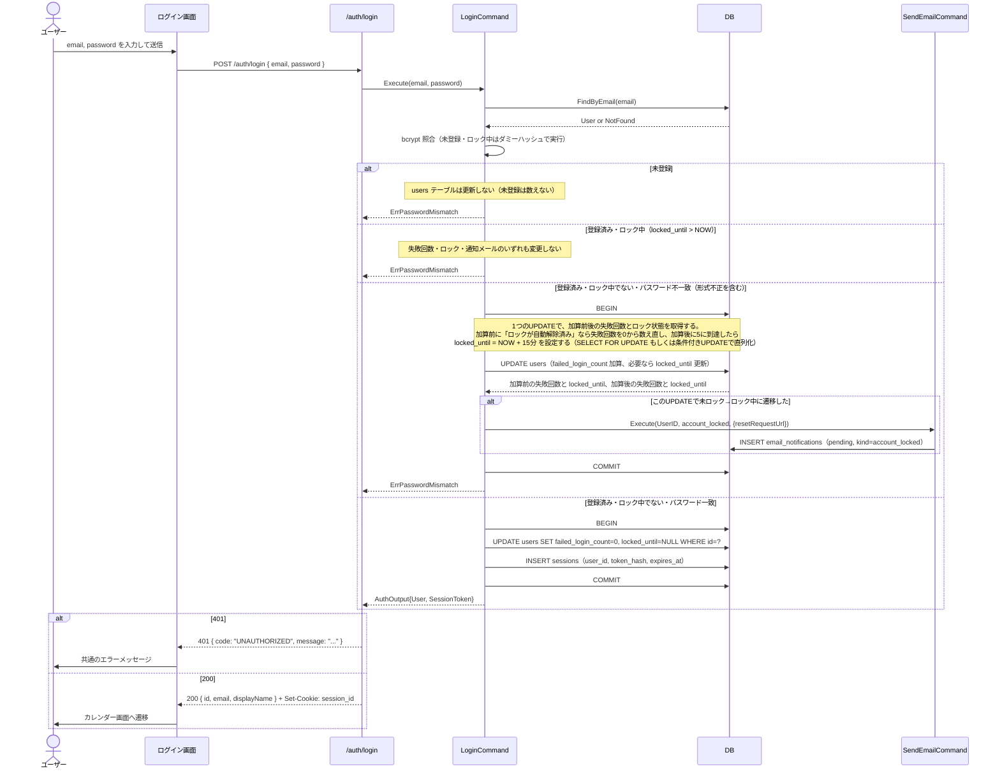
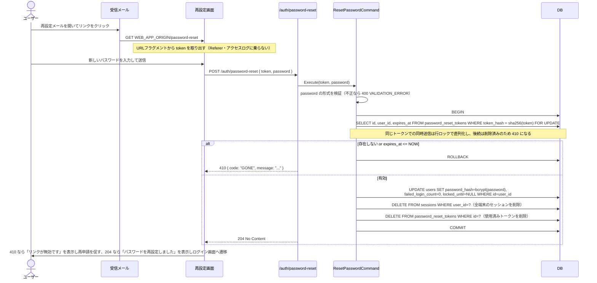

# アカウントロック・パスワードリセット 仕様書

- 作成日: 2026-11-28
- 更新日: 2026-11-28
- ステータス: PDM合意済

## PRD参照

- PRD: PRD-011 アカウントロック・パスワードリセット（`docs/prd/PRD-011-account-lock-password-reset.md`）
- Issue: #461

## 対象機能

パスワードを5回連続で間違えたアカウントを15分間ロックし、ロックしたことを登録メールアドレスへ知らせる機能と、メールで届くリンクからパスワードを再設定する機能。ロックしたことはログイン画面に出さず、通常のログイン失敗と同じ表示にする。メールの送信には [SPEC-010 メール通知基盤](./SPEC-010-email-notification.md) を使う。

## 詳細仕様

### 基本フロー

#### ログイン（SPEC-001 のログインを変更する）

1. ユーザーがメールアドレスとパスワードを入力してログインを送信する
2. メールアドレスでユーザーを検索する
3. パスワードとハッシュを照合する。ユーザーが存在しない場合もダミーのハッシュと照合する
4. アカウントがロック中でなく、パスワードが一致した場合、失敗回数を0に戻し、セッションを発行してHTTP-Only Cookieに保存する
5. カレンダー画面へリダイレクトする

#### ログイン失敗とアカウントロック

1. 登録済みのアカウントで、ロック中でないときにパスワードが一致しなかった場合、そのアカウントの失敗回数を1加算する
2. 加算後の失敗回数が5になった場合、そのアカウントをその時点から15分間ロックする
3. ロックしたのと同じ処理の中で、ロック通知メールの送信を要求する
4. ログイン画面には「メールアドレスまたはパスワードが正しくありません」を表示する（パスワードの不一致・未登録のメールアドレス・ロック中のどれでも同じ表示にする）

#### ロック中のログイン

1. ロック中のアカウントでログインを送信する
2. パスワードの照合は行うが、一致してもしなくてもログインを拒否する
3. 失敗回数の加算・ロックの延長・ロック通知メールの送信は行わない
4. ログイン画面には通常のログイン失敗と同じ表示を出す

#### ロックの自動解除

1. ロックしてから15分経過すると、そのアカウントはロック中ではなくなる
2. ロックが解除された後の最初のログイン試行では、失敗回数を0から数え直す

#### パスワード再設定の申請

1. ユーザーがログイン画面の「パスワードを忘れた方」から再設定申請画面を開く
2. メールアドレスを入力して申請を送信する
3. 登録済みのメールアドレスの場合、そのアカウントの未使用の再設定リンクをすべて無効にし、新しい再設定リンクを発行し、再設定メールの送信を要求する
4. 未登録のメールアドレスの場合、何もしない
5. 登録の有無にかかわらず、画面に「登録済みのメールアドレスであれば、パスワード再設定用のメールを送信しました」を表示する

#### パスワードの再設定

1. ユーザーが再設定メールのリンクを開き、再設定画面を表示する
2. 新しいパスワードを入力して送信する
3. 再設定リンクが有効（発行から30分以内・未使用・より新しいリンクが発行されていない）であることを確認する
4. 新しいパスワードでパスワードハッシュを更新する
5. 失敗回数を0に戻し、ロックを解除する
6. そのアカウントのログインセッションをすべて削除する
7. 使った再設定リンクを無効にする
8. 4〜7は1つのトランザクションで行う
9. 「パスワードを再設定しました」を表示し、ログイン画面へ遷移する。自動ではログインしない

### 制約条件

#### アカウントロック

- 失敗回数は登録済みのアカウントごとに数える。未登録のメールアドレスでの失敗は数えない
- ロックするのは、ロック中でないときの連続失敗が5回になったとき。ロック時間は15分で固定し、失敗回数に応じて延長しない
- 失敗回数を0に戻すのは、ログインに成功したとき・ロックが解除された後に試行したとき・パスワードを再設定したとき
- 同じアカウントへの同時のログイン試行でも、失敗回数の加算漏れでロックを回避できないようにする
- ロック通知メールの送信要求は、失敗回数の更新・ロックと同じトランザクションで行う（SPEC-010 のアウトボックス方式）
- ロック通知メールは1回のロックにつき1通だけ送る

#### 表示とタイミング

- ログイン失敗時の表示は、メールアドレスとパスワードのどちらが誤っているか、アカウントがロック中かどうかを区別しない
- ロック中のアカウント・未登録のメールアドレスでも、パスワードの照合（bcrypt）を1回行い、応答時間で区別できないようにする（#240 のタイミング対策と同じ方針）
- パスワード再設定の申請画面の表示・APIの応答は、メールアドレスの登録の有無で区別しない

#### パスワード再設定

- 新しいパスワードの条件は、SPEC-001 のサインアップと同じにする（8〜72文字、ASCII印字可能文字のみ、英大文字・英小文字・数字・記号を各1文字以上）
- 再設定リンクの有効期限は発行から30分とする
- 再設定リンクは1回使ったら無効にする
- 同じアカウントで新しく再設定を申請したら、それ以前に発行した未使用のリンクを無効にする
- 再設定リンクのトークンは平文でDBに保存しない
- 同じアカウントへの再設定の申請は間引かない（申請のたびにメールを送る）

#### メール

- ロック通知メールには、ロックしたことと、15分後に自動で解除されることと、パスワード再設定申請画面へのリンクを含める。身に覚えがない場合は第三者による試行の可能性があることも書く
- ロック通知メールのリンクは再設定申請画面へのリンクとし、再設定リンク（トークン）は発行しない
- 再設定メールには、再設定リンクと、30分で失効することを含める。申請に覚えがない場合はメールを無視してよいことも書く
- 再設定リンクのトークンをログ・トレースに出さない（`docs/guidelines/data-handling-guidelines.md`）

### エッジケース・境界値

- 失敗回数が4のときにパスワードが一致した → ログインに成功し、失敗回数を0に戻す
- 失敗回数が4のときに同じアカウントへ同時に2回失敗した → 失敗回数は5以上になってロックされ、ロック通知メールは1通だけ送る
- ロックからちょうど15分経過した時点の試行 → ロック中ではないものとして扱う
- ロック中に正しいパスワードを入力した → ログインを拒否し、通常のログイン失敗と同じ表示にする
- ロック中にパスワードを再設定した → ロックを解除し、新しいパスワードでログインできる
- 未登録のメールアドレスで5回以上失敗した → ロックせず、表示も登録済みの場合と同じにする
- メールアドレスの形式が不正なまま再設定を申請した → 入力エラーを表示する（登録の有無には関係しない）
- 発行から30分を過ぎた再設定リンクで再設定した → 再設定せず、リンクが無効であることと、もう一度申請するよう表示する
- 使用済みの再設定リンク・より新しいリンクが発行されて無効になったリンクで再設定した → 30分を過ぎた場合と同じ表示にする
- 新しいパスワードが条件を満たさない → 条件を満たしていない項目を表示し、再設定リンクは無効にしない
- 新しいパスワードが現在のパスワードと同じ → 再設定を受け付ける（同じパスワードの再利用は禁止しない）
- 再設定中に別の端末でログインしていた → その端末のセッションも削除され、次の操作で未ログインとして扱われる
- 再設定リンクを開いたままの状態で、同じアカウントのユーザーが削除された → リンクが無効な場合と同じ表示にする
- ロック通知メール・再設定メールの送信に失敗した → SPEC-010 の再送・送信失敗の扱いに従う。ログイン・申請の応答には影響しない

## 設計

### ドメインモデル

- [User ドメイン](../domain/user.md) — 既存の `User` 集約に連続ログイン失敗回数 (`failed_login_count`) とロック解除時刻 (`locked_until`) を追加する。ロック判定・加算・自動解除のルールは `docs/domain/user.md` の「アカウントロック」節を参照
- [PasswordResetToken ドメイン](../domain/passwordresettoken.md) — 再設定トークン1件を表す新規集約ルート。`User` 集約とは別集約で、トークンハッシュ・有効期限を持つ
  - `Token`: `crypto/rand` による32バイトのランダム値を base64url（パディングなし）でエンコードした平文トークン。メール本文のリンクに1度だけ埋め込む
  - `TokenHash`: `Token` の SHA-256（16進文字列）。DBにはこちらのみ保存する（[ADR-033](../adr/ADR-033-session-token-hashing.md) と同一パターン）
- [EmailNotification ドメイン](../domain/emailnotification.md) — ロック通知・再設定リンクの送信は [SPEC-010](./SPEC-010-email-notification.md) の `SendEmailCommand` を呼び出し元のトランザクションで呼ぶ（アウトボックス方式、[ADR-038](../adr/ADR-038-email-async-outbox.md)）。本仕様で `EmailKind` に以下2つを追加する

| `EmailKind` | 用途 | `TemplateParams` のキー |
|---|---|---|
| `account_locked` | ロック通知メール | `resetRequestUrl`（再設定申請画面の完全URL。トークンは含まない） |
| `password_reset` | 再設定リンクメール | `resetUrl`（再設定画面の完全URL。URLフラグメントに平文トークンを含む） |

- トークンの平文・トークンハッシュ・`TemplateParams` の値はログ・トレース・レスポンスに出さない（[情報取り扱いガイドライン](../guidelines/data-handling-guidelines.md)）

### DB設計

| テーブル | カラム | 型 | 制約 | 備考 |
|---|---|---|---|---|
| users | failed_login_count | INTEGER | NOT NULL, DEFAULT `0`, CHECK (`failed_login_count >= 0`) | 連続ログイン失敗回数。既存ユーザーは DEFAULT `0` で埋める |
| users | locked_until | TIMESTAMPTZ | NULL 許容 | ロック解除時刻。NULL または `now` 以下は未ロック扱い |
| password_reset_tokens | id | UUID | PRIMARY KEY, DEFAULT `uuid_generate_v4()` | 再設定トークンID |
| password_reset_tokens | user_id | UUID | NOT NULL, REFERENCES `users(id)` ON DELETE CASCADE | 対象ユーザー。ユーザー削除でトークンも削除 |
| password_reset_tokens | token_hash | TEXT | NOT NULL, UNIQUE | 平文トークンのSHA-256（[ADR-033](../adr/ADR-033-session-token-hashing.md) と同一パターン）。平文トークンは保存しない |
| password_reset_tokens | expires_at | TIMESTAMPTZ | NOT NULL | 有効期限。`created_at + 30分` を格納する |
| password_reset_tokens | created_at | TIMESTAMPTZ | NOT NULL, DEFAULT `NOW()` | 発行時刻 |
| password_reset_tokens | （インデックス） | - | `idx_password_reset_tokens_user_id` on (`user_id`) | 新規申請時に同じユーザーの既存トークンを削除する SQL で使う |

### API設計

エラーレスポンスの共通構造（`code` / `message` / `details`）は [ADR-013](../adr/ADR-013-api-error-structure.md) を参照。

| メソッド | パス | 認証 | リクエスト | レスポンス | エラー（HTTPステータス） |
|---|---|---|---|---|---|
| POST | /auth/password-reset/requests | 不要 | `email` | 202（ボディなし） | 400 `VALIDATION_ERROR` / 500 `INTERNAL_ERROR` |
| POST | /auth/password-reset | 不要 | `token`, `password` | 204 No Content | 400 `VALIDATION_ERROR` / 410 `GONE` / 500 `INTERNAL_ERROR` |

`POST /auth/login` は既存エンドポイント（[SPEC-001](./SPEC-001-auth.md)）。本仕様で 401 `UNAUTHORIZED` の発生条件に「対象アカウントがロック中」を追加する（レスポンスボディは従来と同一で、ロック中であることをレスポンスから区別させない）。

#### POST /auth/password-reset/requests

再設定申請画面から送信する。登録の有無を区別しないため、登録済みでも未登録でも常に 202 を返す。

##### リクエスト

| 場所 | フィールド | 型 | 必須 | 制約 | 説明 |
|---|---|---|---|---|---|
| body | email | string | 必須 | RFC 5322 準拠のメールアドレス形式 | 再設定申請のメールアドレス |

##### レスポンス（202 Accepted）

ボディなし。送信は非同期で、送信履歴の `pending` 作成はレスポンスまでに完了する（[SPEC-010](./SPEC-010-email-notification.md)）。

##### エラー

| HTTPステータス | code | details[].code | 発生条件 |
|---|---|---|---|
| 400 | VALIDATION_ERROR | - | リクエストボディの JSON デコードに失敗した、または `email` を `net/mail.ParseAddress` で解釈できない |
| 400 | VALIDATION_ERROR | INVALID_FORMAT | `email` は `net/mail.ParseAddress` で解釈できるが、ドメインの形式チェック（`user.NewEmail`）に通らない |
| 500 | INTERNAL_ERROR | - | DB 障害・レスポンスのマーシャリング失敗など内部エラー |

未登録のメールアドレスも、形式が妥当であれば 202 を返す（何もしない）。

#### POST /auth/password-reset

再設定画面から送信する。再設定リンクの検証・パスワード更新・ロック解除・全セッション削除・使用トークンの削除を同一トランザクションで行う（[ADR-024](../adr/ADR-024-transaction-management.md)）。

##### リクエスト

| 場所 | フィールド | 型 | 必須 | 制約 | 説明 |
|---|---|---|---|---|---|
| body | token | string | 必須 | - | メールリンクから取り出した平文の再設定トークン |
| body | password | string | 必須 | 8〜72 文字、ASCII 印字可能文字（0x20〜0x7E）のみ、英大文字・英小文字・数字・記号を各 1 文字以上 | 新しいパスワード（制約は [SPEC-001](./SPEC-001-auth.md) のサインアップと同一） |

##### レスポンス（204 No Content）

ボディなし。自動ログインはしないため `Set-Cookie: session_id` は付与しない。

##### エラー

| HTTPステータス | code | details[].code | 発生条件 |
|---|---|---|---|
| 400 | VALIDATION_ERROR | - | リクエストボディの JSON デコードに失敗した、または `token`・`password` フィールドが空 |
| 400 | VALIDATION_ERROR | TOO_SHORT | `password` が 8 文字未満 |
| 400 | VALIDATION_ERROR | TOO_LONG | `password` が 72 バイト超 |
| 400 | VALIDATION_ERROR | INVALID_CHARACTER | `password` に ASCII 印字可能範囲外の文字が含まれる |
| 400 | VALIDATION_ERROR | INSUFFICIENT_COMPLEXITY | `password` に英大文字・英小文字・数字・記号のいずれかが含まれない |
| 410 | GONE | - | `token` のハッシュに一致するレコードが存在しない（未発行・新しい申請で削除済み・使用済みで削除済みのいずれか）、または一致したが `expires_at` を過ぎている。4つのケースを区別せず同一の `message` を返す |
| 500 | INTERNAL_ERROR | - | DB 障害・bcrypt 生成失敗・レスポンスのマーシャリング失敗など内部エラー |

`password` の検証は `token` の検証より前に行う。`password` が条件を満たさないときは 400 を返し、トークンはこの試行で無効にしない（「新しいパスワードが条件を満たさない → 再設定リンクは無効にしない」を満たすため）。

#### POST /auth/login（変更点）

[SPEC-001](./SPEC-001-auth.md#post-authlogin) を参照。本仕様では以下だけを追加する。

- 401 `UNAUTHORIZED` の発生条件に「対象アカウントがロック中（`locked_until IS NOT NULL AND locked_until > now`）」を追加する
- ロック中・未登録・パスワード不一致・パスワード形式不正の4ケースを区別せず、同じ 401 レスポンスを返す
- ロック中でも bcrypt 照合を1回行い、応答時間で区別できないようにする（[#240](https://github.com/Haya372/ai-trial/issues/240) のタイミング対策と同じ方針）

#### API呼び出しシーケンス

##### ログイン失敗とアカウントロック

4つのケースすべてで bcrypt 照合（ユーザー未検出・ロック中はダミーハッシュ）を1回実行してから分岐する。



##### パスワード再設定の申請

```mermaid
sequenceDiagram
    actor User as ユーザー
    participant UI as 再設定申請画面
    participant API as /auth/password-reset/requests
    participant UC as RequestPasswordResetCommand
    participant DB
    participant Send as SendEmailCommand

    User->>UI: email を入力して送信
    UI->>API: POST /auth/password-reset/requests { email }
    API->>UC: Execute(email)
    UC->>DB: FindByEmail(email)
    alt 未登録
        Note over UC,DB: 何もしない（登録の有無を応答で区別しない）
    else 登録済み
        UC->>DB: BEGIN
        UC->>DB: DELETE FROM password_reset_tokens WHERE user_id=?（既存の未使用トークンを無効化）
        UC->>UC: Token = base64url(crypto/rand.Read(32)); TokenHash = sha256(Token)
        UC->>DB: INSERT password_reset_tokens (user_id, token_hash, expires_at=NOW+30min)
        UC->>Send: Execute(UserID, password_reset, {resetUrl = WEB_APP_ORIGIN + "/password-reset#token=" + Token})
        Send->>DB: INSERT email_notifications (pending, kind=password_reset, …)
        UC->>DB: COMMIT
    end
    API-->>UI: 202 Accepted（ボディなし）
    UI->>User: 「登録済みのメールアドレスであれば…」を表示
```

##### パスワードの再設定


