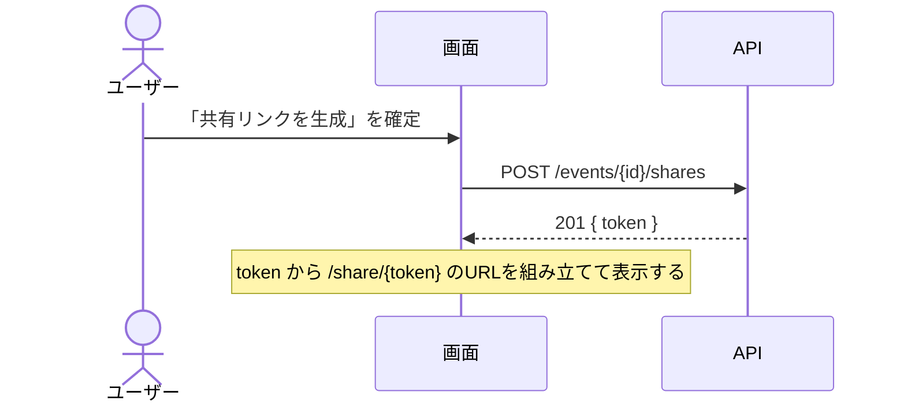

# [機能名] 仕様書

- 作成日:
- 更新日:
- ステータス: 作成中 / PDM合意済 / アーカイブ

## PRD参照

- PRD: [PRD番号とタイトル]（`docs/prd/PRD-XXX-[名前].md`）
- Issue: #[親Issue番号]

## 対象機能

対象機能の概要を1〜3文で記述する。

## 詳細仕様

### 基本フロー

正常系の操作・処理の流れを箇条書きで記述する。

### 制約条件

実装上の制約・ビジネスルールを列挙する。

- 例: ○○は必須入力
- 例: ○○は△△以下の値のみ許容

### エッジケース・境界値

考慮が必要な例外的なケースを列挙する。

- 例: 入力が空の場合
- 例: 上限値を超えた場合

## 設計

レイヤーをまたいで参照される設計を記述する。

### ドメインモデル

エンティティ・値オブジェクト・集約の構成と、守るべき不変条件を記述する。
用語・ビジネスルールの定義は `docs/domain/` に置き、ここからリンクする。

- 例: `EventShare`（エンティティ）— `Event` 集約とは別集約。トークン・有効期限を持つ
- 例: 有効期限は生成時点より未来であること

### DB設計

追加・変更するテーブルのカラム・型・制約・インデックス・リレーションを記述する。

| テーブル | カラム | 型 | 制約 | 備考 |
|---|---|---|---|---|
| | | | | |

### API設計

追加・変更するエンドポイントの一覧を記述する。エラーレスポンスの共通構造は `docs/adr/ADR-013-api-error-structure.md` に従う。

| メソッド | パス | 認証 | リクエスト | レスポンス | エラー（HTTPステータス） |
|---|---|---|---|---|---|
| | | | | | |

エンドポイントごとに `#### <メソッド> <パス>` の見出しを置き、リクエスト・レスポンス・エラーを表で記述する。
ほかの仕様書で定義済みのエンドポイントを使う場合は、型・制約はその仕様書を参照し、この機能が送る値と、その値で起こりうるエラーだけを書く。

#### POST /events/{id}/shares（例）

##### リクエスト

場所は `path` / `query` / `body` / `cookie` のいずれかを書く。リクエストがない場合は「なし」と書く。

| 場所 | フィールド | 型 | 必須 | 制約 | 説明 |
|---|---|---|---|---|---|
| cookie | session_id | string | 必須 | - | セッショントークン |
| path | id | string(uuid) | 必須 | UUID形式 | 共有する予定のID |
| body | expiresAt | string(date-time) \| null | 任意 | 現在時刻より後 | 共有リンクの有効期限 |

##### レスポンス（201 Created）

ネストした配列・オブジェクトは `events[].id` のようにドット記法で展開する。ボディがない場合は「なし」と書く。

| フィールド | 型 | null許容 | 説明 |
|---|---|---|---|
| token | string | 否 | 共有リンクのトークン |

##### エラー

返りうるエラーを、認証エラー（401）と内部エラー（500）も含めてすべて列挙する。`details` を返さない場合は `details[].code` を `-` にする。

| HTTPステータス | code | details[].code | 発生条件 |
|---|---|---|---|
| 400 | VALIDATION_ERROR | NOT_IN_FUTURE | `expiresAt` が現在時刻以前 |
| 401 | UNAUTHORIZED | - | セッションが無効 |
| 404 | NOT_FOUND | - | 予定が存在しない、または自分の予定ではない |
| 500 | INTERNAL_ERROR | - | 予期しない内部エラー |

#### API呼び出しシーケンス

基本フローの操作ごとに、画面がどのAPIをどの順序で呼び出すかと、前のAPIのレスポンスのどの値を次の呼び出しに使うかを、Mermaid の `sequenceDiagram` で記述する。

- 例: 共有リンクの生成

